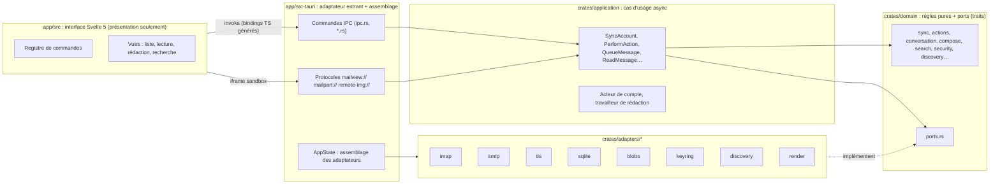
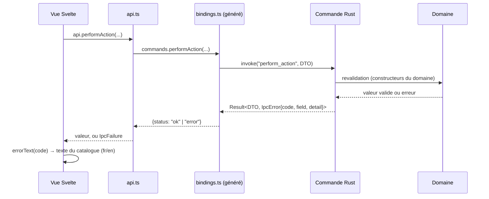
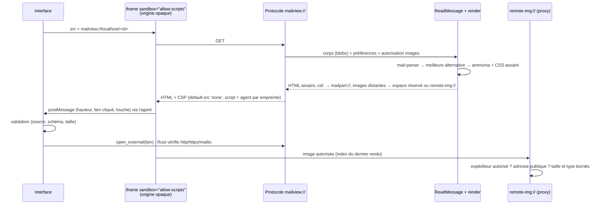
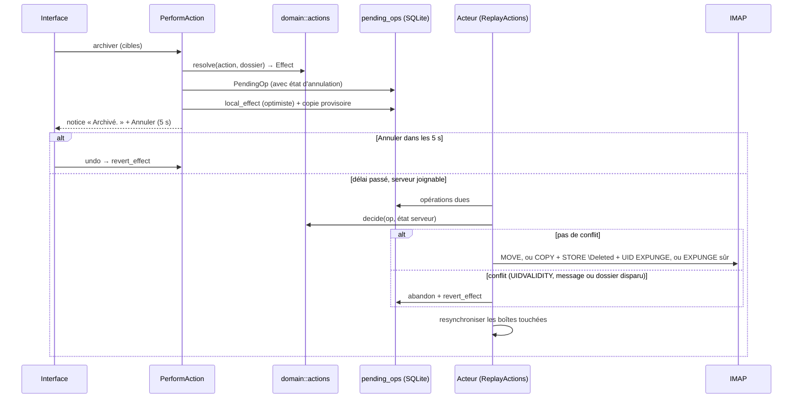
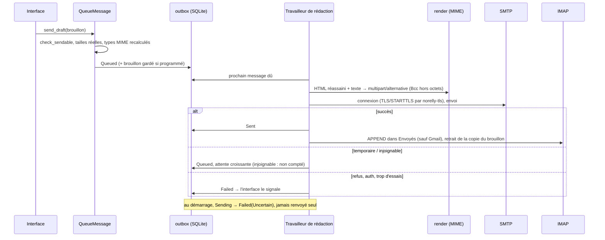

# Architecture

[← Documentation technique](README.md)

Norelly suit une **architecture hexagonale dosée** (ADR-008) : un domaine
pur entouré de ports, des adaptateurs qui les implémentent, des cas d'usage
qui les orchestrent et un point d'assemblage Tauri. Les schémas ci-dessous
sont en Mermaid (rendus par GitHub et la plupart des éditeurs).

## Vue d'ensemble



Règle de dépendance : `domain` ne dépend de rien d'autre que `thiserror`
et `serde` (vérifié par `scripts/check-domain-deps.sh`) ; `application`
dépend du domaine ; les adaptateurs dépendent du domaine ; seul
`app/src-tauri` connaît tout le monde.

## Les couches

### Domaine (`crates/domain`)

Règles métier pures, **sans aucune E/S**, et ports. C'est la zone de
relecture prioritaire du mainteneur.

| Module | Contenu |
|---|---|
| `address`, `account`, `credentials`, `endpoint` | Valeurs validées : adresse, compte, secret masqué, point de connexion |
| `security`, `capabilities`, `auth`, `connection` | Confiance TLS et exceptions, consentement au clair, STARTTLS, choix SASL, erreurs structurées |
| `discovery` | Stratégie d'autodécouverte |
| `mailbox`, `sync`, `fetch_policy` | Boîtes, UID, drapeaux ; rapprochement de synchronisation ; rapatriement ; reconnexion (`Backoff`) |
| `conversation` | Fils JWZ, version incrémentale, boîte unifiée |
| `reading` | Liens, images distantes, noms et ouverture des pièces jointes |
| `actions` | Sémantique des actions, application optimiste, file durable, conflits |
| `compose` (`draft`, `outbox`) | Réponses, sujets, fils, citation ; brouillon ; file d'envoi |
| `search` | Syntaxe des requêtes, surlignage |
| `contacts` | Fiche du carnet d'adresses validée, clé d'adresse, nom affiché, filtre et ordre de la liste (ADR-012) |
| `contact_import` | Plan d'import d'un carnet : noms en NFC (port `TextNormalizer`), nom imitant une adresse retiré, caractères invisibles refusés, doublons par `AddressKey`, rejets motivés, politique « ignorer » ou « compléter » |
| `notify`, `settings` | Notifications à émettre ; paramètres |
| `ports` | Tous les traits (≈ 27) : `RemoteMailboxConnector`, `RemoteMailboxSession`, `MailSender`, `SecretStore`, `MailStore`, `BlobStore`, `PendingOpStore`, `DraftStore`, `OutboxStore`, `SearchIndex`, carnet (`ContactBook`), requêtes d'écran (`FolderTreeQuery`, `ConversationQuery`, `MessageListQuery`, `ContactDirectory`)… |

Les ports asynchrones renvoient `impl Future + Send` (dispatch statique dans
les chemins chauds) ; `dyn` n'est utilisé qu'au point d'assemblage.

### Cas d'usage (`crates/application`)

Orchestration async des ports, sans règle métier propre :

| Module | Rôle |
|---|---|
| `accounts`, `discover_settings`, `test_connection` | `AddAccount`, `RemoveAccount`, `DiscoverSettings`, `TestConnection` |
| `account_actor` | Un acteur par compte : connexion de commandes + connexion IDLE, événements `SyncEvent` |
| `sync` | `SyncAccount`, boîte par boîte, enregistrement par lots |
| `reading` | `ReadMessage`, `allow_remote_images`, `DownloadPart` |
| `actions` | `PerformAction`, `UndoActions`, `ReplayActions` |
| `compose`, `compose_worker` | `SaveDraft`, `QueueMessage`, `PrepareReply`, `DeliverOutbox`, `RecoverOutbox`, `FileSentCopies`, `SyncDrafts` ; un travailleur par compte |
| `contacts` | `CreateContact`, `UpdateContact`, `DeleteContacts`, `ListContacts`, `GetContact` |

### Adaptateurs (`crates/adapters/*`)

| Crate | Implémente | Notes sécurité |
|---|---|---|
| `tls` | `ClientConfig` rustls : vérificateur de la plateforme + exception par empreinte | fichier sensible |
| `imap` | `RemoteMailboxConnector`, `RemoteMailboxSession` : pilote d'E/S maison au-dessus d'`imap-next` (lignes bornées, délais, rejet des octets reçus après `STARTTLS`) | fichier sensible (`connection.rs`) |
| `smtp` | `MailSender` : TLS par `norelly-tls`, puis `lettre` | STARTTLS exigé |
| `sqlite` | `MailStore`, `AccountRepository`, requêtes d'écran, `PendingOpStore`, `DraftStore`, `OutboxStore`, `SearchIndex`, `SettingsStore`, `ContactBook`, `ContactDirectory`… | SQL paramétré uniquement (`check-sql.sh`) |
| `blobs` | `BlobStore` : `.eml.zst` par compte et empreinte, écriture atomique | — |
| `keyring` | `SecretStore` : Secret Service, Credential Manager ; fichier 0600 en dérogation | — |
| `discovery` | `AutoconfigClient`, `SrvResolver`, `PortProber` | HTTPS seulement |
| `render` | Rendu MIME → vue, assainissement HTML et CSS, agent, construction MIME sortante, extraction du texte indexé | fichiers sensibles (`sanitize.rs`, `css.rs`, `agent.js`) |
| `contacts-io` | `ContactCodec` (lecture vCard, CSV Google/Outlook/Thunderbird, LDIF), `TextNormalizer` (NFC) | entrées bornées, fuzzé (`contact_import`) ; fichier lu par le shell, jamais d'URL suivie |

### Point d'assemblage et adaptateur entrant (`app/src-tauri`)

- `state.rs` : `AppState` ouvre la base, les blobs, le trousseau, démarre les
  acteurs et travailleurs ; c'est le seul endroit qui choisit les
  implémentations.
- `ipc.rs` : **contrat IPC** (DTO), sans dépendance de `specta` dans le
  domaine ; toute entrée est revalidée par les constructeurs du domaine.
- `commands.rs`, `reading.rs`, `actions.rs`, `compose.rs`, `search.rs`,
  `settings.rs`, `updates.rs` : commandes `#[tauri::command]`.
- `protocols.rs`, `remote_images.rs` : protocoles personnalisés (voir
  [données](donnees.md#protocoles-personnalisés)).
- `mail.rs` : relais des événements des acteurs vers l'interface.
- `ipc-commands.rs`, `permissions/main-window.toml`,
  `capabilities/default.json` : liste de contrôle d'accès (seule la
  fenêtre `main`, depuis l'origine de l'application, peut appeler les
  commandes).

### Interface (`app/src`)

Présentation seulement, Svelte 5 en runes. **Aucune décision de sécurité.**

- `lib/app.svelte.ts` : état global et **registre de commandes**
  (`registerAppCommands`), qui alimente raccourcis, palette, aide, barres
  d'actions, menus « Plus… », menus des comptes et menu contextuel ;
- `lib/visible-actions.ts` : actions proposées à la souris dans chaque
  zone (barre du message ouvert et « Plus… », survol d'une ligne, menu
  contextuel, barre de sélection), priorité de repli dans « Plus… »
  (`fitByPriority`) ; `lib/commands/describe.ts` (libellé, infobulle
  « Libellé — Touches », disponibilité), `lib/commands/watch.svelte.ts`
  (relecture du registre par les composants), `lib/fixed-shortcuts.ts`
  (touches de la fenêtre de rédaction) ;
- `lib/mail.svelte.ts`, `compose.svelte.ts`, `search.svelte.ts`,
  `settings.svelte.ts`, `updates.svelte.ts` : états par domaine d'écran ;
- `lib/ipc/bindings.ts` (généré, commité) et `lib/ipc/api.ts` (enveloppe :
  `Result` → exception `IpcFailure`) ;
- `lib/errors.ts` : traduction des codes d'erreur IPC ;
- `lib/agent.ts` : validation des messages `postMessage` de l'agent ;
- `components/*.svelte` ; `styles/tokens.css`.

## Contrat IPC



- Types définis en Rust (`app/src-tauri/src/ipc.rs`), exportés en
  TypeScript par `tauri-specta` dans `app/src/lib/ipc/bindings.ts` (commité).
  Le test `bindings_are_up_to_date` échoue s'ils sont périmés ;
  `./scripts/gen-bindings.sh` les régénère.
- **Aucun texte destiné à l'utilisateur ne vient de Rust** (ADR-011) : les
  erreurs sont des codes (`ErrorCodeDto`) avec un champ (`FieldDto`) et un
  `detail` technique brut facultatif, affiché tel quel.
- Événements Rust → interface : `SyncEventDto`, `ComposeEventDto`,
  `UpdateEventDto`.
- Listes paginées côté Rust (curseur) : jamais de transfert en masse
  (ADR-001).
- Les chemins de fichiers ne traversent jamais l'IPC depuis l'interface :
  les sélecteurs sont ouverts par Rust, un dépôt de fichier est désigné par
  un jeton.

## Flux principaux

### Synchronisation

```mermaid
sequenceDiagram
  participant Act as Acteur de compte
  participant S as SyncAccount
  participant Dom as domain::sync
  participant I as Adaptateur IMAP
  participant DB as SQLite (MailStore)
  participant UI as Interface
  Act->>I: connexion de commandes (TLS, auth)
  Act->>S: synchroniser le compte
  loop pour chaque boîte
    S->>DB: état local (UIDVALIDITY, HIGHESTMODSEQ, UIDNEXT)
    S->>Dom: select_request(état)
    S->>I: SELECT (CONDSTORE / QRESYNC)
    S->>Dom: plan(réponse) → SyncPlan
    S->>I: requêtes du plan (FETCH drapeaux, UID SEARCH…)
    S->>Dom: reconcile(rapport) → SyncOutcome
    S->>DB: enregistrement par lots (+ conversations, index FTS par déclencheurs)
    S->>I: corps selon fetch_policy (plus récents d'abord)
    S-->>UI: SyncEvent::FolderChanged
  end
  Note over Act,I: connexion IDLE sur INBOX : changement → sync de INBOX,<br/>renouvelée toutes les 25 min ; reconnexion avec Backoff
```

### Lecture sécurisée



### Actions hors ligne



### Envoi



## Pour aller plus loin

- Choix et alternatives écartées : [DECISIONS.md](../DECISIONS.md).
- Règles par fonctionnalité : [documentation fonctionnelle](../fonctionnel/README.md), reliée au code par [la traçabilité](tracabilite.md).
- Données et protocoles : [donnees.md](donnees.md).
