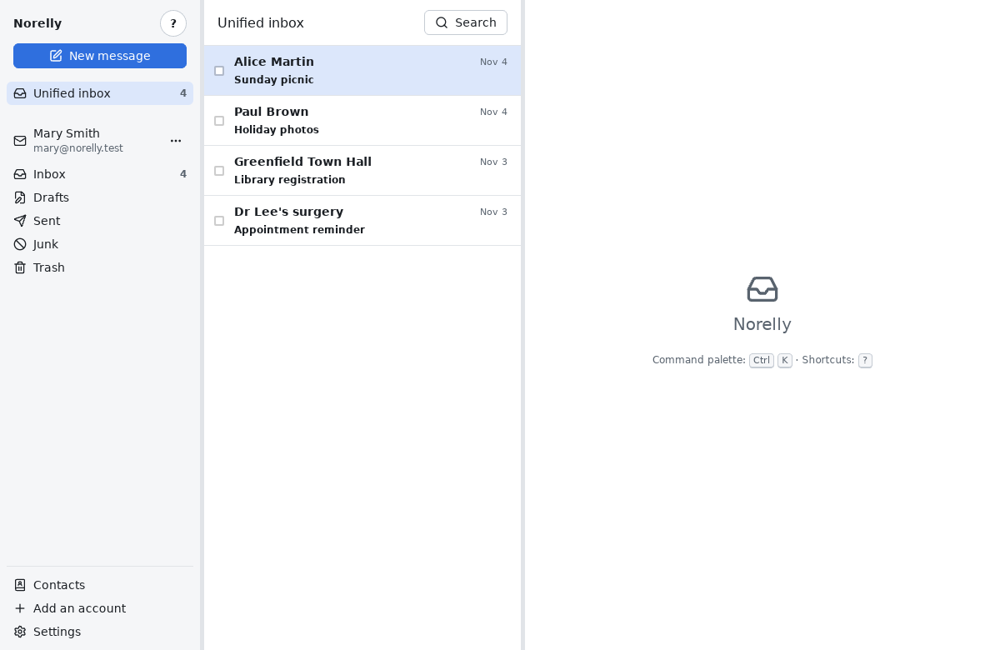

# Norelly user guide

*Version française : [../fr/README.md](../fr/README.md).*

## What is Norelly?

Norelly is a program for reading and sending your email from your
computer, on Windows or Linux.

You probably already have an email address with Gmail, Outlook.com,
Fastmail or another provider. Usually you read it on your provider's
website. Norelly lets you do the same thing in a window on your computer,
without opening a web browser:

- your messages are **copied to your computer**: you can read and find
  them even without an Internet connection;
- you can bring **several addresses** together in a single window;
- Norelly **protects you**: it blocks the images used to find out whether
  you opened a message, and it does not spy on you (no statistics are sent
  anywhere);
- everything can be done **with the mouse**, with buttons spelled out in
  words: **New message**, **Reply**, **Archive**, **Delete**… If you like
  the keyboard, shortcuts let you go faster (the **?** button shows
  them).

Norelly is free and open source.

The window is split into three parts:

1. **on the left**, your addresses (called "accounts") and their folders
   (Inbox, Sent, Drafts, Trash…). Apart from the Inbox, folders have the
   names chosen by your provider;
2. **in the middle**, the list of messages in the chosen folder. Messages
   that answer each other are grouped on a single line: a "conversation";
3. **on the right**, the message you are reading.

## Contents

1. [Installing Norelly](install.md), on Windows or Linux.
2. [Adding your address](first-account.md), including Gmail and
   Outlook.com.
3. [Using Norelly every day](everyday.md): read, reply, write, attach a
   file, tidy up, delete, search, find a draft.
4. [Keeping your contacts](contacts.md): add, edit, delete a contact,
   write to them.
5. [What to do when an error message appears](errors.md)
6. [Frequently asked questions](faq.md)
7. [Keyboard shortcuts cheat sheet](shortcuts.md)

## Three tips to get started

- **Nothing is final**: after archiving, deleting or moving a message, an
  **Undo** button appears at the bottom of the window for a few moments.
- **Lost?** Press the **Esc** key (top left of the keyboard): it closes the
  open window or goes back to the list.
- **Looking for a feature?** Press **Ctrl** and **K** together: a list of
  every possible action opens, with a box to find one by its name.
