# Keeping your contacts

[← Back to contents](README.md)

The **address book** keeps the people you often write to: their name,
their email addresses, their phone numbers. It is shared by all your
addresses and stays on your computer.

## Opening your contacts

At the bottom of the left-hand panel, click **Contacts**. The list of your
contacts replaces the list of messages; the card of the chosen contact
appears on the right.

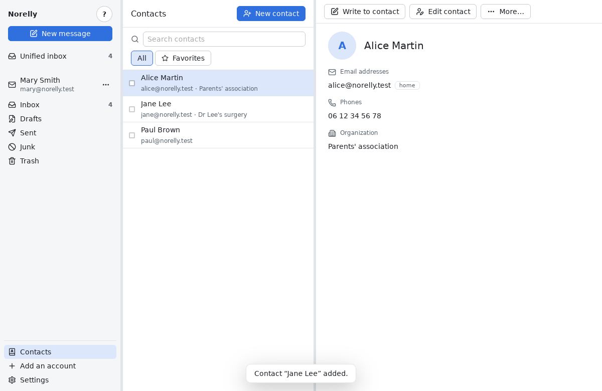

- To find someone, type a few letters of their name, address or
  organization in **Search**.
- Click **Favorites** to see only your favorites, **All** to see everyone
  again.
- To go back to your messages, click **Unified inbox** or a folder, on the
  left.

## Adding a contact

1. Click **New contact**, at the top of the list.
2. Fill in what you know: first name, last name, email address… Only the
   address is required.
3. The person has several addresses? Click **Add an address**, then tick
   **Preferred** next to the one Norelly should use when you write to
   them. The label ("work", "home") is optional.
4. Click **Save**.

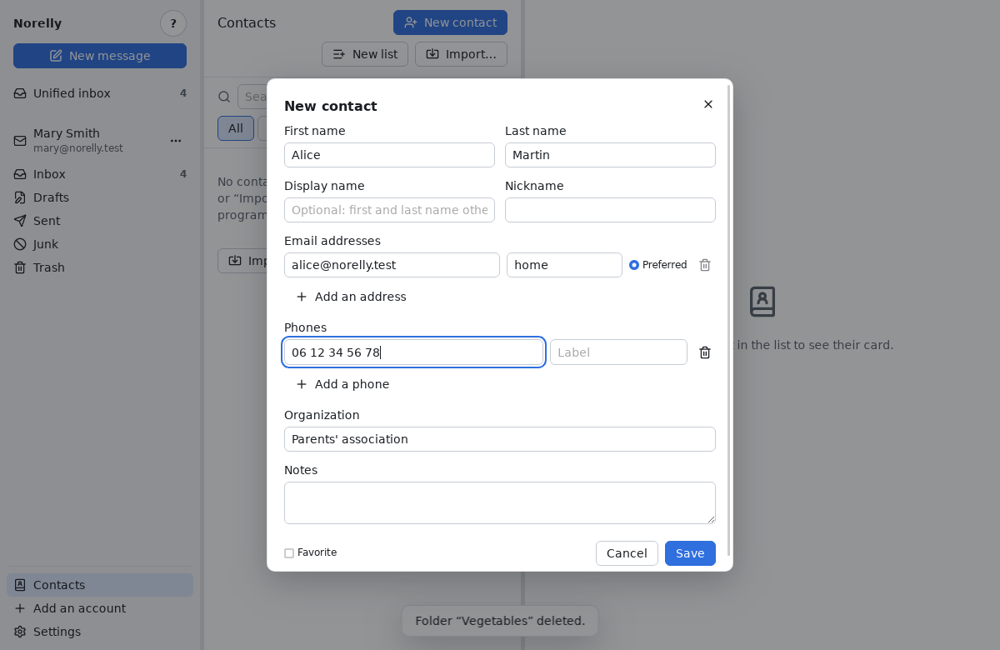

If Norelly refuses, the window stays open and explains why. The most
common case: the address already belongs to another contact. An address
can only belong to one contact; edit the one that already has it instead.

## Editing, favorites, writing

On a contact's card:

- **Edit contact** reopens their window to correct a name or add an
  address;
- **Write to contact** opens a new message, already addressed to their
  preferred address. The message is sent from the address chosen in the
  left-hand panel;
- **More…**, then **Add to favorites** (or **Remove from favorites**): a
  star appears next to their name.

These actions are also in the menu that opens with a **right-click** on a
line of the list.

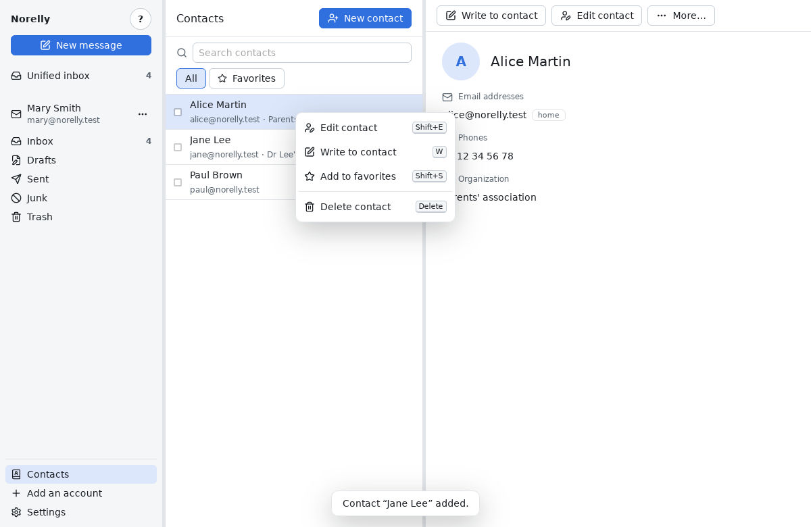

## Your contacts in your messages

When someone in your address book writes to you, Norelly shows them under
the name you gave them, in the message list as well as in the open
message. A small badge next to their name reminds you that they are in
your contacts.

To add someone who wrote to you:

1. Open their message and click their **name** (or **right-click** the
   message in the list).
2. Choose **Add to address book**: the new contact window opens, already
   filled in with their name and address.
3. Complete it if you wish, then click **Save**.

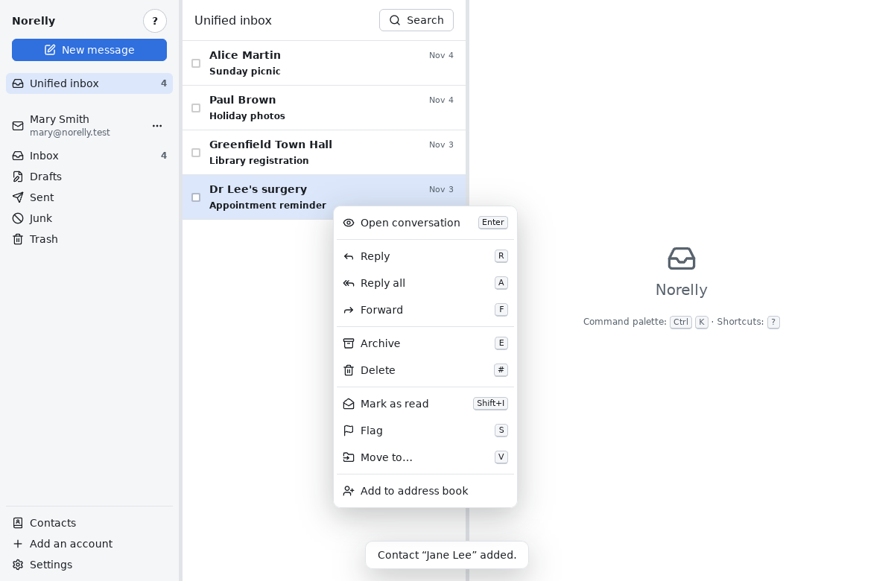

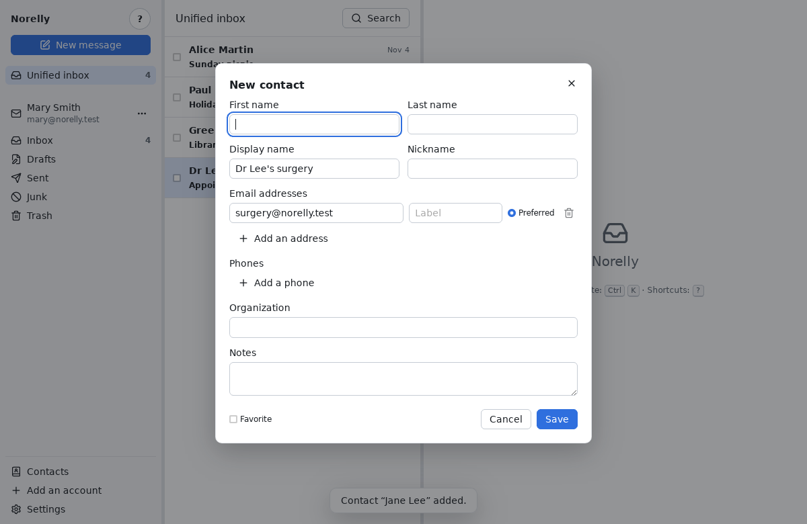

For someone already in your address book, clicking their name offers
**View contact**, which opens their card.

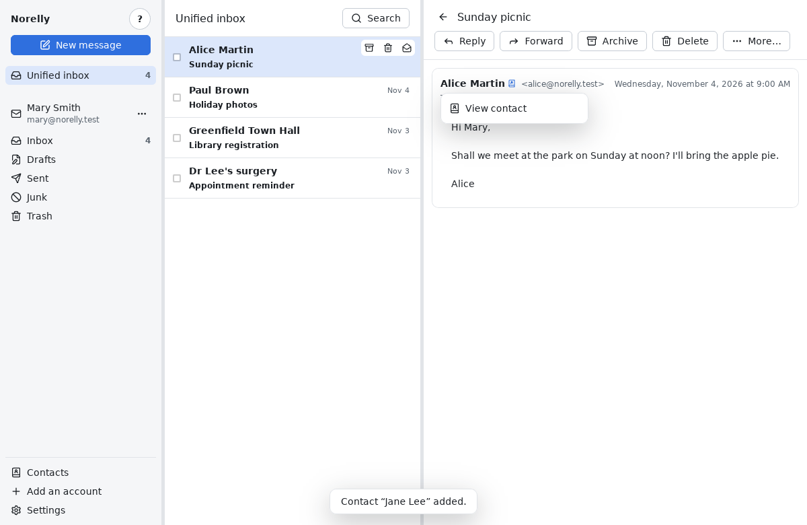

When you write a message, type the start of a contact's name in **To**:
your contacts are suggested first, under the name in your address book.

Beware: your contact's name is shown based on the address given by the
message, which a fraudster can imitate. It does not guarantee that the
message really comes from that person: if in doubt (a request for money or
a password), check by other means.

## Writing to a group: mailing lists

A **mailing list** groups several contacts (your family, a club) so you
can write to all of them at once.

1. In **Contacts**, click **New list**.
2. Give it a name, for example “Family”.
3. In **Add a contact**, type a few letters of a name, then click **Add**
   next to the right person. Repeat for each member; the cross on the
   right of a member removes them.
4. Tick **Send to members as blind copies (Bcc)** if members must not see
   each other's addresses (an association, neighbours).
5. Click **Save**.

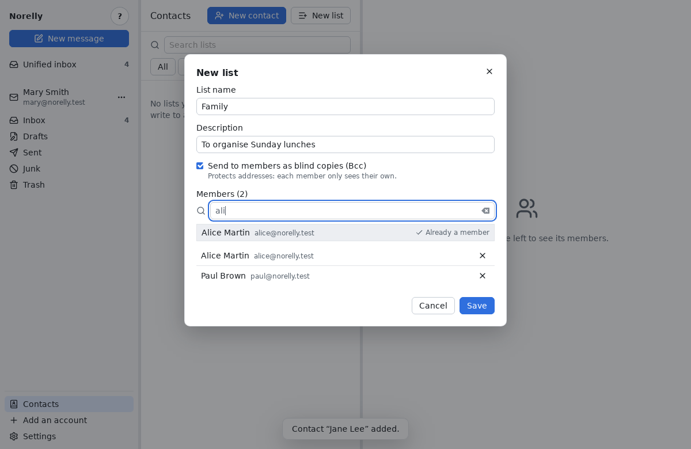

Click **Lists**, next to **All** and **Favorites**, to see your lists; the
chosen list is shown on the right with its members.

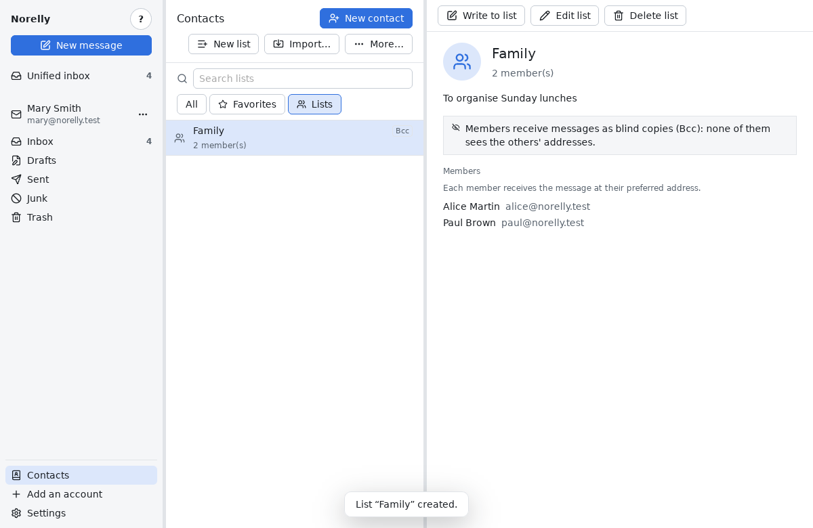

- **Write to list** opens a new message addressed to all its members.
- While writing a message, type the start of the list's name in **To**:
  it is suggested first; pick it and each member appears as a recipient.
  A “Bcc” list puts its members in **Bcc**.
- To add someone to a list from their card: **More…**, then **Add to a
  list…**.
- **Edit list** and **Delete list** are on the open list and in the
  right-click menu. Deleting a list does not delete its contacts.

Each member receives the message at their **preferred** address: change it
on their card and all their lists follow.

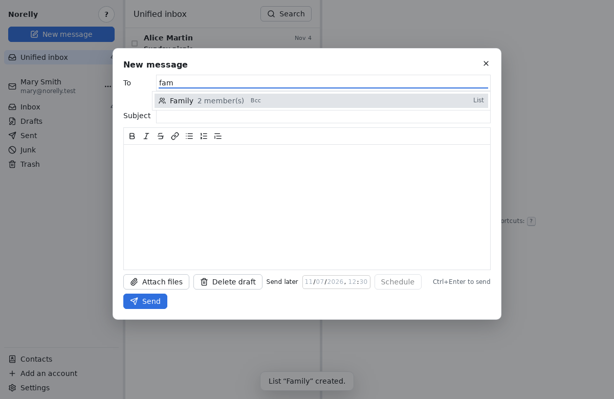

## Importing contacts from another program

Did you keep your contacts in Gmail, Outlook, Thunderbird, on an iPhone or
an Android phone? First export them from that program, as **vCard** (a
`.vcf` file) if you can, otherwise as **CSV**. Then:

1. In **Contacts**, click **Import…**, at the top of the list.
2. Choose the exported file, then **Open**.
3. Norelly shows what it is about to do, without changing anything yet:
   how many contacts will be added, how many are already in your address
   book, how many cannot be imported (click **See the cards that cannot
   be imported** to find out which ones, and why).
4. If some contacts are already in your address book, choose: **Leave
   them as they are**, or **Complete them from the file** (Norelly adds
   what they lack, without erasing anything).
5. Click **Import**.

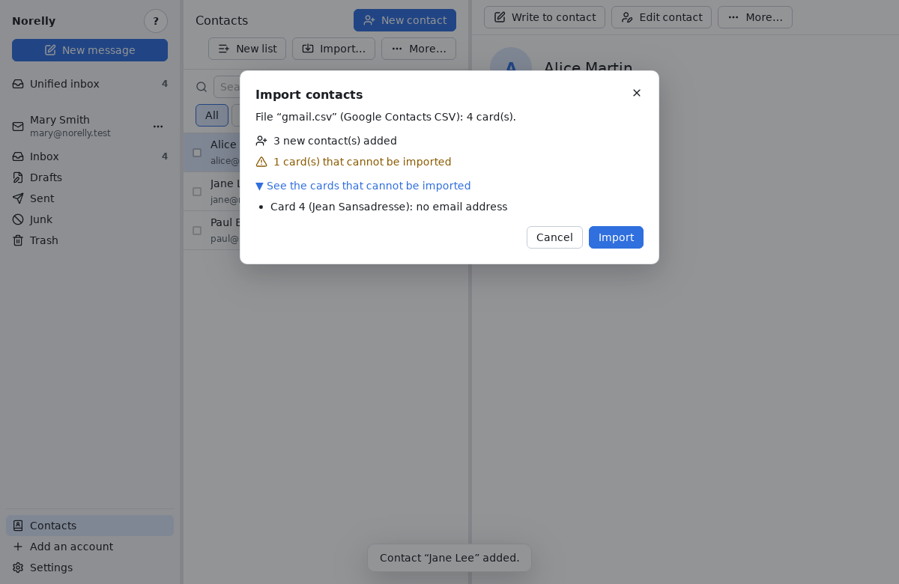

A contact is recognised as already there if it has the same email
address. A card without an email address is not imported: Norelly's
address book is for writing messages.

## Exporting your contacts

To keep a copy of your address book, or move it to another program:

1. In **Contacts**, click **Export…**, at the top of the list (in
   **More…** if the window is narrow). To export only some contacts, tick
   them first, then click **Export…** in the bar that appears.
2. Choose the format: **vCard 4.0** works almost everywhere (Gmail,
   iPhone, Android, Thunderbird); **vCard 3.0** for older software;
   **CSV** for Outlook or a spreadsheet; **LDIF** for Thunderbird.
3. Click **Export…**, choose the folder and the file name, then **Save**.

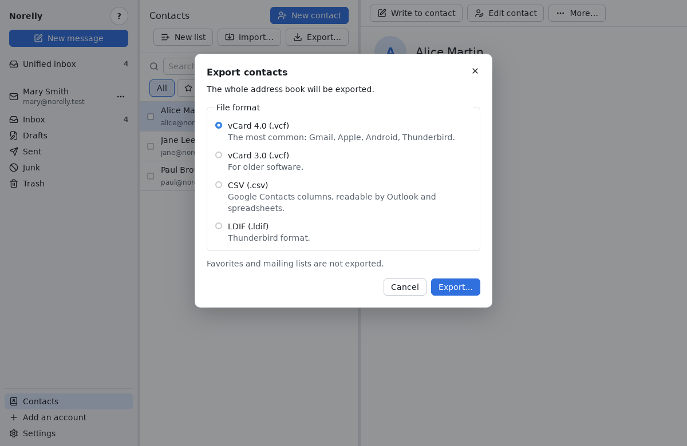

Favorites and mailing lists are not exported. In a CSV file opened in a
spreadsheet, a number starting with “+” shows with an apostrophe in front:
this is on purpose, so that the spreadsheet does not take it for a
formula.

## Merging duplicates

If the same person appears several times in your contacts (after an
import, for example):

1. In **Contacts**, click **More…** at the top of the list, then **Find
   duplicates…**.
2. Norelly shows, one group at a time, the contacts that share the same
   name or the same phone number. Check that they really are the same
   person; uncheck a card to leave it out.
3. Choose the card to keep (**Keep this card**), then click **Merge**. Or
   click **Skip** to see the next group without changing anything.

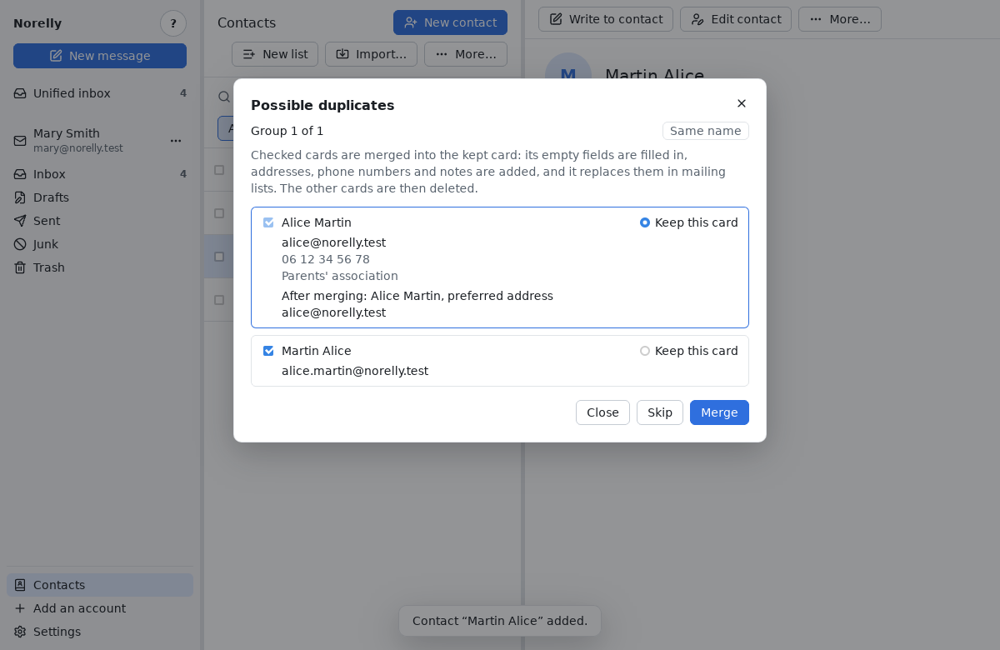

The kept card receives the addresses, phone numbers and notes of the
others, and fills in its empty fields; nothing it already held is
replaced. It takes their place in your mailing lists, then the other
cards are deleted.

## Deleting contacts

- One contact: on their card, click **Delete contact**, then confirm.
- Several contacts: tick the box at the start of each line; a bar appears
  at the top of the list, with **Delete contact** and **Write to
  contact**. **Clear contact selection** unticks everything.

Deleting a contact does not touch your messages and removes them from
their lists. Deletion is permanent.
