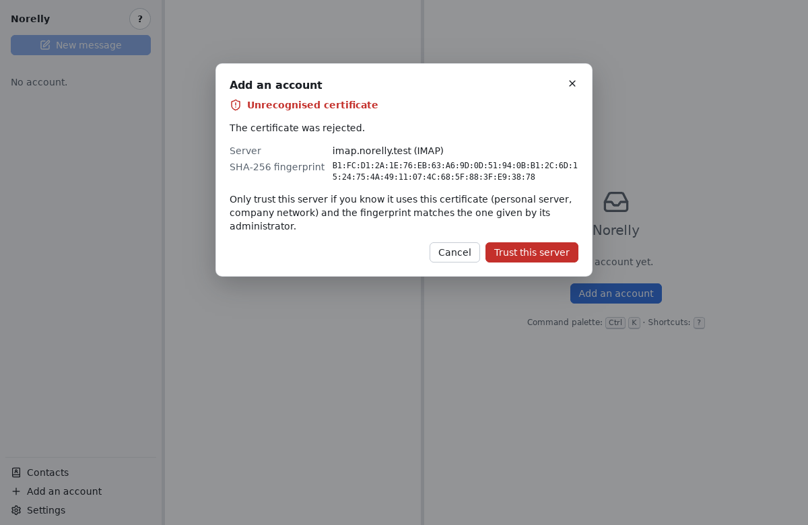

# What to do when an error message appears

[← Back to contents](README.md)

Norelly's error messages say what is happening and, most of the time, what
to do. Here are the most common ones, explained in more detail.

## Unrecognised certificate

**What you see**: an **Unrecognised certificate** window, with a server
name, a reason (for example "The certificate has expired.") and a long
string of digits and letters called the **fingerprint**.

**What it means**: Norelly could not check the server's identity. Either
the server is badly configured, or someone is pretending to be it (on
public Wi-Fi, for example) to read your messages.

**What to do**:

- With a large provider (Gmail, Outlook.com, Fastmail…), **click Cancel**.
  Try again later, at home rather than on public Wi-Fi. If the problem
  persists, check that your computer's date and time are correct: a wrong
  clock makes certificates "not valid yet" or "expired".
- With a personal server or your company's, ask its administrator for the
  fingerprint of its certificate. If it is identical to the one shown,
  click **Trust this server**.

**If the message says "this server presents a certificate different from
the one you had accepted"**: be careful. The server has changed
certificate, which happens on renewal, but also during an interception.
Only continue after checking the new fingerprint with the administrator.

## Offline

**What you see**: a small crossed-out Wi-Fi icon next to the account's
address, in the left panel. Hovering over it shows the reason (for example
"Offline: server unreachable").

**What it means**: Norelly cannot reach your provider: your computer is not
connected to the Internet, or the server is not answering at the moment.

**What to do**: nothing in particular. Norelly retries by itself, at
growing intervals, and resumes as soon as the connection is back.
Meanwhile:

- you can **read and search** every message already downloaded;
- you can **archive, delete, move**: these actions are kept and sent to the
  server when the connection returns;
- you can **write and send**: the message waits in the outbox and goes out
  by itself later.

If the icon stays while the Internet works (you can open a website in your
browser), ask for a synchronisation: click the **⋯** button next to the
account's address, then **Synchronise**. If that is not enough, your provider may have a temporary
problem: try again later.

## Google account: app password required

**What you see**: "Incoming server (IMAP): credentials rejected: a Google
account requires an app password", then the **Create a Google app
password** box.

**What it means**: your address is with Google (Gmail, or a work address
managed by Google), and Google refuses your usual password in an email
program.

**What to do**: follow the three steps in the box. The **Open the Google
page** button opens the page where you create the app password; then
paste it into the **Password** field, which was cleared for it. Details
are in [Adding your email address](first-account.md#gmail).

## Signing in with Google did not complete

**What you see**: "Signing in with Google did not complete…", then the
**Create a Google app password** box and the **Password** field.

**What it means**: signing in on Google's page was refused, abandoned or
never came back to Norelly. Until Google verifies Norelly, it limits the
number of people who can sign in to it, and may refuse a new account.

**What to do**: if you simply closed the page, click **Sign in with Google
instead**, then try again (remember **Advanced**, then **Go to Norelly
(unsafe)**). Otherwise, use an app password: follow the steps in the box
(see [Adding your address](first-account.md#gmail-the-app-password)).

## Credentials rejected (password refused)

**What you see**: "Incoming server (IMAP): credentials rejected. Check the
username and password (an app password is sometimes required)."

**What it means**: your provider refuses the address or the password.

**What to do**:

1. Check the password: is **Caps Lock** on? Is the keyboard in the right
   language?
2. **Gmail**: use **Sign in with Google** or an **app password**, not your usual password
   (see [Adding your address](first-account.md#gmail-the-app-password)).
   If you changed your Google password, older app passwords may have been
   revoked: create a new one.
   **Outlook.com, Hotmail**: use **Sign in with Microsoft**
   (see [Outlook.com and Hotmail](first-account.md#outlookcom-and-hotmail-sign-in-with-microsoft)).
3. If Norelly shows the server settings, check the **Username** field: it is
   often the full address (`mary.smith@example.com`), not just `mary.smith`.
4. Try signing in on your provider's website: your account may be
   temporarily locked after several attempts.

## Server unreachable

**What you see**: "server unreachable. Check the name and port."

**What to do**: check your Internet connection. If Norelly shows the server
settings, compare **Server** and **Port** with your provider's help page: a
single wrong letter is enough to prevent the connection.

## The server is not responding

**What you see**: "the server is not responding. Check your internet
connection, then try again."

Norelly found the server, but it did not answer in time or cut the
connection. Norelly has already tried again several times before showing
this message.

For an Outlook.com or Hotmail account, if only the sending server is not
responding, Norelly adds the account anyway: "Account added. Sending could not be checked…". You receive your
messages right away; sending will be tried with your first message, and a
message that does not go out stays in the **outbox**.

**What to do**: check your Internet connection, wait a few minutes, then
click the button again. If the problem persists, try from another
connection (for example your phone's hotspot): some networks have trouble
reaching some providers.

## Could not send

**What you see**: at the bottom of the window, "Could not send "message
subject" (reason)".

**What to do**: open the **outbox** (**⋯** button next to the account's
address, then **Outbox**). The
message is there:

- **Retry** sends it again;
- **Cancel sending** removes it from the queue: it will not be sent.

If the reason is "interrupted, may have been sent", Norelly was closed or
the connection cut at the very moment of sending. The message may have
arrived: look in the **Sent** folder on your provider's website, or ask the
recipient, before clicking **Retry**, so as not to send it twice.

## Other messages

| Message | What to do |
|---|---|
| "No keyring" | Your Linux has no active password safe. Install or start GNOME Keyring or KWallet (ask for help if needed). Otherwise, Norelly offers to store the password in an **unencrypted** file: only accept if nobody else uses your session. |
| "System keyring unavailable" | Norelly cannot read your password safe, often because it is locked. Unlock it (on Linux, a window sometimes asks for it; otherwise, log out and back in): Norelly retries on its own, and waiting messages are sent afterwards. |
| "Norelly did not get permission to stay signed in" | A permission was refused on Microsoft's sign-in page. Start again and accept all the permissions requested: without them, the account would stop working after an hour. |
| "Unencrypted connection" | The server offers no protected connection. Only click **Allow** for a server you know, on your own network; otherwise click **Edit settings** and choose **TLS**. |
| "This account has no archive folder" | Choose once and for all the folder to archive into: **⋯** button next to the account's address, then **Choose archive folder…**. |
| "Attachments exceed 25 MiB." | Remove some files, or send them in several messages. For very large files, use a file-sharing service. |
| "Too late to undo" | The action has already been done on the server. Do the opposite action (for example, move the message from the Trash back to the Inbox). |
| "Executable file type" | Norelly refuses to open a program received by email directly. Use **Save…** if you really were expecting it. |
| "Remote images blocked" | This is not an error: see [blocked images](everyday.md#blocked-images). |
