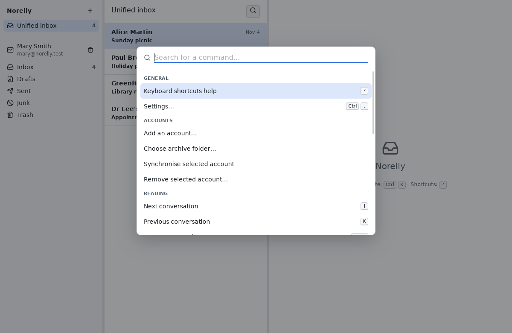
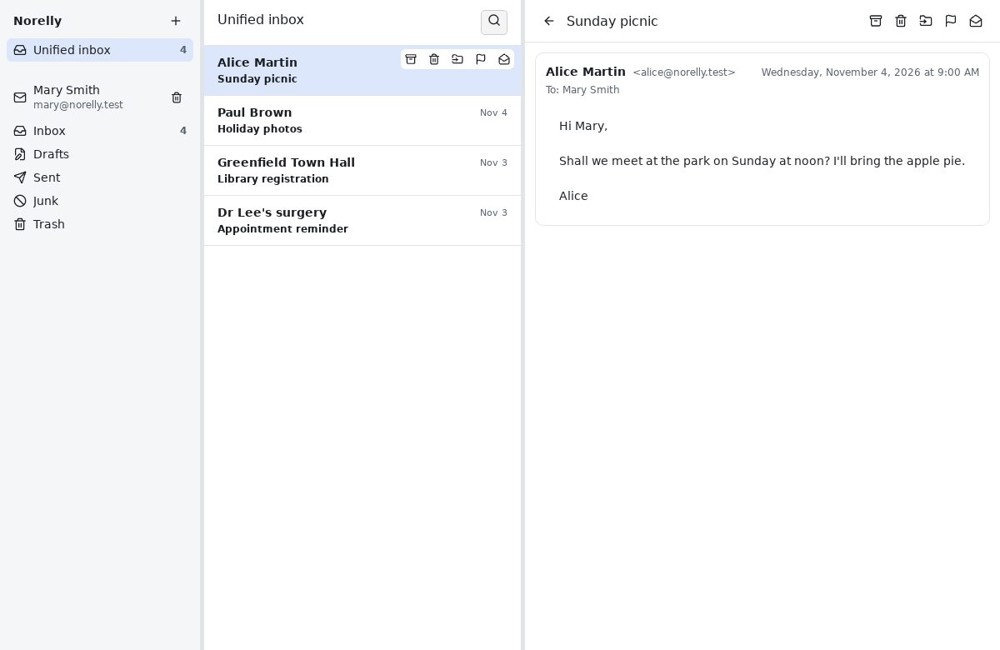
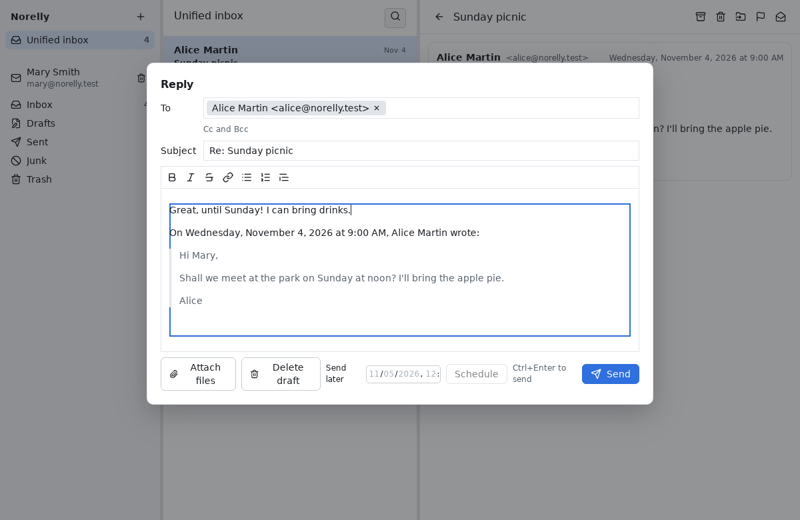
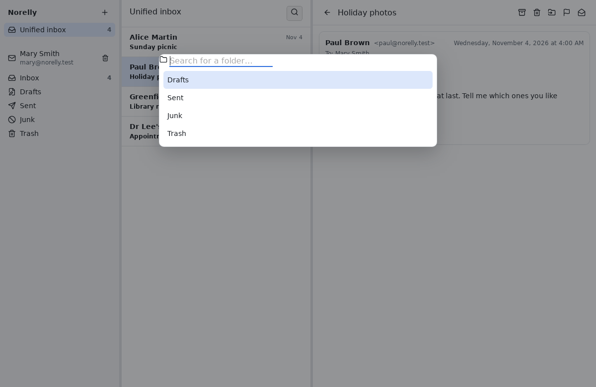
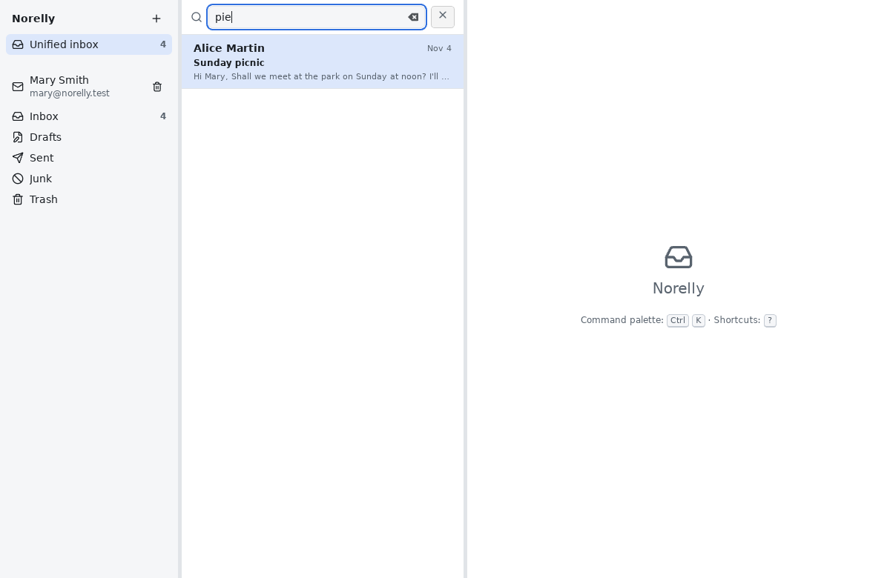
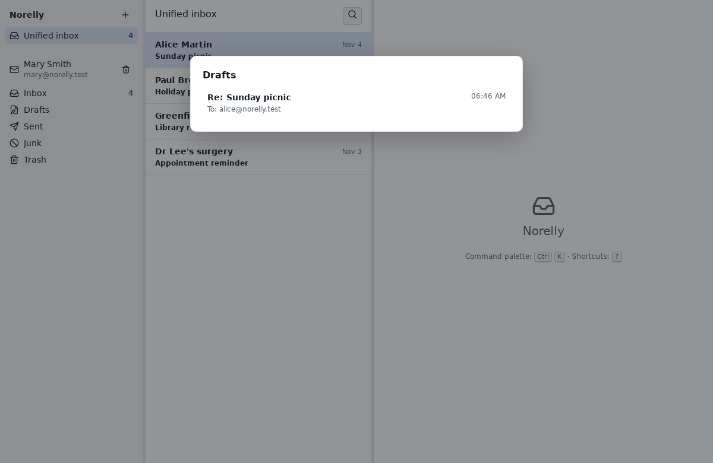

# Using Norelly every day

[← Back to contents](README.md)

This page explains everyday tasks. For each one there is a way to do it
**with the mouse** and, to go faster, a **keyboard key** (all of them are
listed in the [cheat sheet](shortcuts.md)).

> **The one thing to remember**: **Ctrl** + **K** (press the **Ctrl** key,
> hold it down, then press **K**) opens the **command palette**. Type a few
> letters of what you want to do ("reply", "draft", "move"…), then press
> **Enter**. Every Norelly action is in there.
>
> 

## Reading a message

1. In the left panel, click a folder, for example **Inbox**. To see the
   messages of all your addresses together, click **Unified inbox**.
2. In the middle list, click a message. It is shown on the right. Unread
   messages are in bold. Opening a message does not mark it as read: once
   you have read it, click the **Mark as read** button (open envelope) in
   the action bar, or press **Shift** + **I**.
3. To go back to the list, click the **Back to list** arrow or press
   **Esc**.

When several messages answer each other, they form a **conversation**: they
are stacked from oldest to newest. Click a message's header to unfold or
fold it.

From the keyboard: **J** moves to the next conversation, **K** to the
previous one, **Enter** opens it.

### Blocked images

Some messages contain images stored on the Internet. They are often used
to find out whether, and when, you opened the message. Norelly blocks them
and shows a banner: **Remote images blocked**.

If you trust the sender, click **Show images from this sender**: Norelly
will remember it for their next messages.

### Attachments

Attached files appear under the message, with their name and size:

- **Open** opens the file with your computer's usual program (for example
  your PDF reader);
- **Save…** asks you which folder to put the file in.

For your safety, **Open** only works for common files: PDFs, images, text,
recent Word, Excel, PowerPoint or LibreOffice documents, sounds and videos.
Others (`.exe` programs, scripts, older Office documents that may contain
macros…) can only be saved. Only open a program received by email if you
were expecting it.

## Replying

1. Open the message.
2. Press the **R** key (as in "reply"). To reply to everyone (the sender
   and the other recipients), press **A**. With the mouse: **Ctrl** + **K**,
   type "reply", then **Enter**.
3. The writing window opens: the recipient and the subject ("Re: …") are
   already filled in, and the original message is quoted below. Write your
   reply.
4. Click **Send**, or press **Ctrl** + **Enter**.

To **forward** a message to someone else, with its attachments, press
**F** (or palette, "forward").

## Writing a new message

1. Press the **C** key (or **Ctrl** + **K**, type "new message", then
   **Enter**). The message is sent from the address selected in the left
   panel.
2. In **To**, type the recipient's address. Norelly suggests addresses you
   already know: pick one with the arrow keys and **Enter**, or click it.
   You can add several recipients.
3. To send a **copy** (**Cc**) or a **blind copy** (**Bcc**: the other
   recipients do not see it) to someone, click **Cc and Bcc**.
4. Fill in the **Subject**, then write your text. The buttons above the
   text make it **bold** or *italic*, or add a list or a link.
5. Click **Send** (or **Ctrl** + **Enter**).

If you are not connected to the Internet, don't worry: the message waits in
the **outbox** and goes out by itself as soon as the connection is back.

### Sending later

In the writing window, click **Send later**, choose the date and time, then
**Schedule**. Until then, you can edit or cancel the message from the
**outbox** (palette, "outbox").

## Attaching a file

In the writing window:

- click **Attach files**, then choose one or more files;
- or drag a file from your file manager into the Norelly window.

The file appears under the text, with its size. To remove it, click the
cross next to its name. All the attachments of one message together cannot
exceed 25 MiB (about 25 megabytes): beyond that, most providers would
refuse the message.

## Tidying up: archive, move, flag

When a message is open, the action bar at the top right offers buttons. In
the list, the same buttons appear when the mouse is over a line, and a
**right click** on a line opens a menu.

| Action | What it does | Key |
|---|---|---|
| **Archive** | Removes the message from the inbox without deleting it: it stays in the archive. | **E** |
| **Move to…** | Puts the message in the folder of your choice. | **V** |
| **Flag** | Marks the message with a flag, so you don't forget it. | **S** |
| **Mark as read / unread** | The message becomes bold (unread) again, or not. | **Shift** + **U** / **Shift** + **I** |

To **move**, a list of your folders opens: type a few letters of the
folder's name, then **Enter**.

To act on **several messages at once**, use the keyboard: in the list, go
to each message you want (**J** and **K**) and press **X**; a tick appears
in front of it. Then choose the action: it applies to every ticked message.

**Undo**: after each action, a banner appears at the bottom with an
**Undo** button (or the **Z** key).

## Deleting

Click **Delete** (bin icon) in the action bar, or press **#** (**Shift** +
**3** on a UK keyboard).

The message goes to the **Trash**: it is not lost. To get it back, open the
**Trash** folder and move it elsewhere. Deleting a message **from the
Trash** erases it permanently.

## Searching for a message

1. Click the magnifying glass at the top of the list, or press **/**.
2. Type a word: a name, a word from the subject or the text. Results appear
   as you type, with the word highlighted.
3. Click a result (or **Enter**) to open it. **Esc** closes the search.

Search works **even without the Internet**: it looks through the copy of
your messages stored on your computer. Accents and capitals do not matter.

To narrow it down, you can add:

| Type | To find |
|---|---|
| `from:alice` | messages from Alice |
| `to:paul` | messages sent to Paul |
| `subject:invoice` | messages whose subject contains "invoice" |
| `"happy new year"` | this exact phrase |
| `has:attachment` | messages with an attachment |
| `is:unread` | unread messages (`is:read`: read, `is:flagged`: flagged) |
| `after:2026-01-31` | messages received from 31 January 2026 on (`before:`: before) |
| `-advert` | messages that do **not** contain this word |

## Finding a draft

Norelly saves what you write automatically. If you close the writing window
(**Esc** or the cross), your message becomes a **draft**: nothing is lost.

To pick it up again: **Ctrl** + **K**, type "drafts", then **Enter**. Click
the draft you want: it opens again, ready to be finished and sent.

Drafts started on another device (phone, provider's website) also appear,
under **In the server's Drafts folder**.

To throw a draft away, open it and click **Delete draft**.
