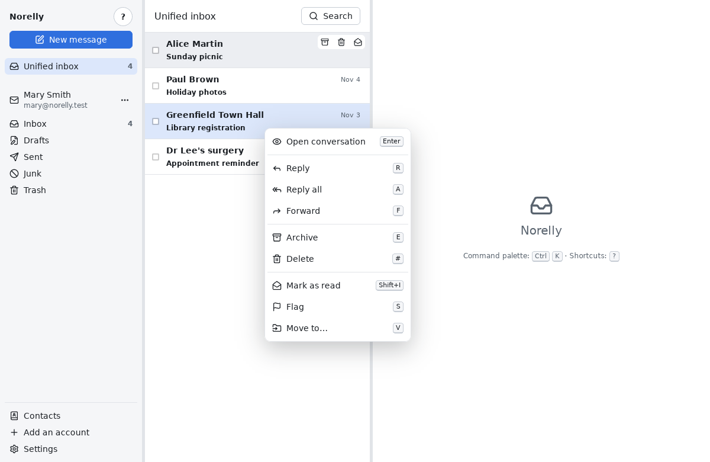
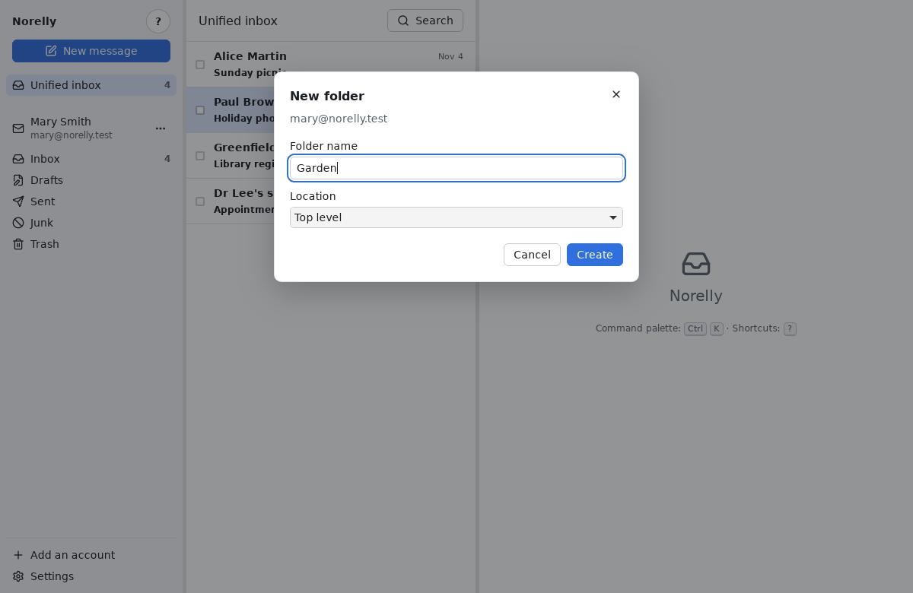
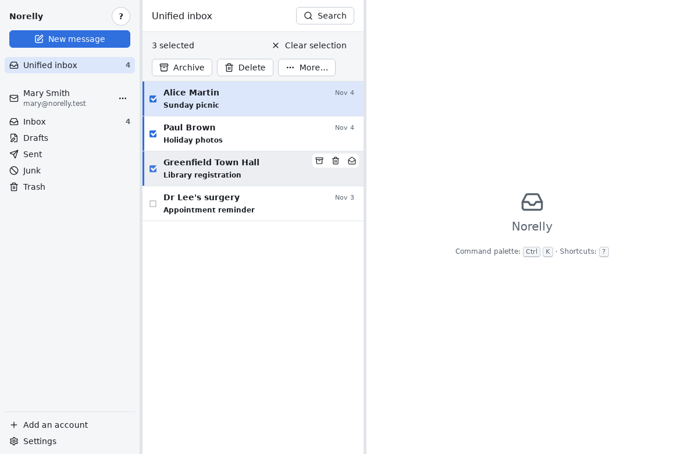

# Using Norelly every day

[← Back to contents](README.md)

This page explains everyday tasks. Everything can be done **with the
mouse**, with buttons spelled out in words. The keyboard is optional: each
button shows its key when you rest the mouse on it for a moment, and the
**?** button at the top left shows the [cheat sheet](shortcuts.md) of
shortcuts.

## Reading a message

1. In the left panel, click a folder, for example **Inbox**. To see the
   messages of all your addresses together, click **Unified inbox**.
2. In the middle list, click a message. It is shown on the right. Unread
   messages are in bold. Opening a message does not mark it as read: once
   you have read it, click **More…** in the action bar, then **Mark as
   read** (or press **Shift** + **I**).
3. To go back to the list, click the **Back to list** arrow or press
   **Esc**.

When several messages answer each other, they form a **conversation**: they
are stacked from oldest to newest. Click a message's header to unfold or
fold it.

To move to the next or previous conversation without going back to the
list: **More…**, then **Next conversation** or **Previous conversation**
(from the keyboard: **J** and **K**).

### Blocked images

Some messages contain images stored on the Internet. They are often used
to find out whether, and when, you opened the message. Norelly blocks them
and shows a banner: **Remote images blocked**.

If you trust the sender, click **Show images from this sender**: Norelly
will remember it for their next messages. Beware: a sender's address can be
imitated, so only allow senders whose images you really need.

### Attachments

Attached files appear under the message, with their name and size:

- **Open** opens the file with your computer's usual program (for example
  your PDF reader);
- **Save…** asks you which folder to put the file in.

For your safety, **Open** only works for common files: PDFs, images, text,
recent Word, Excel, PowerPoint or LibreOffice documents, sounds and videos.
Others (`.exe` programs, scripts, older Office documents that may contain
macros…) can only be saved. Only open a program received by email if you
were expecting it.

## Replying

1. Open the message, or **right-click** it in the list.
2. Click **Reply**. To reply to everyone (the sender and the other
   recipients), click **Reply all**. If the window is narrow, this button
   moves into **More…**. From the keyboard: **R** and **A**.
3. The writing window opens: the recipient and the subject ("Re: …") are
   already filled in, and the original message is quoted below. Write your
   reply.
4. Click **Send**, or press **Ctrl** + **Enter**.

To **forward** a message to someone else, with its attachments, click
**Forward** (from the keyboard: **F**).

## Writing a new message

1. Click the blue **New message** button at the top left (from the
   keyboard: **C**). The message is sent from the address selected in the
   left panel.
2. In **To**, type the recipient's address. Norelly suggests addresses you
   already know: pick one with the arrow keys and **Enter**, or click it.
   You can add several recipients.
3. To send a **copy** (**Cc**) or a **blind copy** (**Bcc**: the other
   recipients do not see it) to someone, click **Cc and Bcc**.
4. Fill in the **Subject**, then write your text. The buttons above the
   text make it **bold** or *italic*, or add a list or a link: rest the
   mouse on a button to see its name.
5. Click **Send** (or **Ctrl** + **Enter**).

If you are not connected to the Internet, don't worry: the message waits in
the **outbox** and goes out by itself as soon as the connection is back.

### Sending later

In the writing window, click **Send later**, choose the date and time, then
**Schedule**. Until then, you can edit or cancel the message from the
**outbox**: **⋯** button next to the account's address in the left panel,
then **Outbox**.

## Attaching a file

In the writing window:

- click **Attach files**, then choose one or more files;
- or drag a file from your file manager into the Norelly window.

The file appears under the text, with its size. To remove it, click the
cross next to its name. All the attachments of one message together cannot
exceed 25 MiB (about 25 megabytes): beyond that, most providers would
refuse the message.

## Tidying up: archive, move, flag

When a message is open, the action bar above it offers **Archive** and
**Delete**; the other actions are in **More…**. In the list:

- when the mouse is over a line, three small buttons appear: archive,
  delete, mark as read or unread;
- a **right click** on a line opens a menu with every action, each with its
  key on the right.

| Action | What it does | Key |
|---|---|---|
| **Archive** | Removes the message from the inbox without deleting it: it stays in the archive. | **E** |
| **Move to…** | Puts the message in the folder of your choice. | **V** |
| **Flag** | Marks the message with a flag, so you don't forget it. | **S** |
| **Mark as read / unread** | The message becomes bold (unread) again, or not. | **Shift** + **U** / **Shift** + **I** |

To **move**, a list of your folders opens: click the folder you want, or
type a few letters of its name, then **Enter**.

To **create a folder**:

1. In the left panel, click **⋯** next to your account, then **New
   folder…**.
2. Type its name. To put it inside an existing folder, choose that folder
   under **Location**; otherwise leave "Top level".
3. Click **Create**.

The folder appears in the left panel and in the **Move to…** list. It is
created at your provider: you also find it on their website and in your
other apps.

To act on **several messages at once**, tick the box at the start of each
line you want. A bar appears above the list: it shows how many messages are
selected and offers the actions, which apply to all of them. **Clear
selection** removes every tick. From the keyboard, **X** ticks or unticks
the chosen message.

**Undo**: after each action, a banner appears at the bottom with an
**Undo** button (or the **Z** key).

## Deleting

Click **Delete** in the action bar, the small bin that appears when the
mouse is over a line, or press **#** (**Shift** +
**3** on a UK keyboard).

The message goes to the **Trash**: it is not lost. To get it back, open the
**Trash** folder and move it elsewhere. Deleting a message **from the
Trash** erases it permanently.

## Searching for a message

1. Click **Search** at the top of the list (from the keyboard: **/**).
2. Type a word: a name, a word from the subject or the text. Results appear
   as you type, with the word highlighted.
3. Click a result (or **Enter**) to open it. The cross (or **Esc**) closes
   the search.

Search works **even without the Internet**: it looks through the copy of
your messages stored on your computer. Accents and capitals do not matter.

To narrow it down, you can add:

| Type | To find |
|---|---|
| `from:alice` | messages from Alice |
| `to:paul` | messages sent to Paul |
| `subject:invoice` | messages whose subject contains "invoice" |
| `"happy new year"` | this exact phrase |
| `has:attachment` | messages with an attachment |
| `is:unread` | unread messages (`is:read`: read, `is:flagged`: flagged) |
| `after:2026-01-31` | messages received from 31 January 2026 on (`before:`: before) |
| `-advert` | messages that do **not** contain this word |

## Finding a draft

Norelly saves what you write automatically. If you close the writing window
(**Esc** or the cross), your message becomes a **draft**: nothing is lost.

To pick it up again: in the left panel, click the **⋯** button next to the
account's address, then **Drafts…**. Click the draft you want: it opens
again, ready to be finished and sent.

Drafts started on another device (phone, provider's website) also appear,
under **In the server's Drafts folder**.

To throw a draft away, open it and click **Delete draft**.

## Going faster with the keyboard

Shortcuts are optional. The **?** button at the top left shows them all,
grouped by topic. The **command palette** (**Ctrl** + **K**, or the
**Command palette** button in that help) finds any action when you type a
few letters of its name ("reply", "draft", "move"…), then **Enter**.

