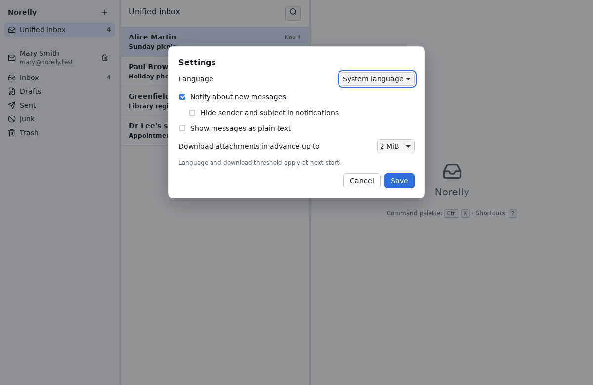

# Frequently asked questions

[← Back to contents](README.md)

## Are my messages deleted from my provider?

No. Norelly works **with** your provider: what you do in Norelly (read,
tidy, delete) is also done there, and the other way round. If you read a
message on your phone, it shows as read in Norelly. Removing an account
from Norelly deletes nothing at your provider.

## Can I use Norelly without the Internet?

Yes, for everything already on your computer: reading, searching, tidying,
writing. Actions and outgoing messages wait for the connection to return
(see [Offline](errors.md#offline)). New messages, of course, can only arrive
with the Internet.

## How do I know a new message has arrived?

New messages arrive by themselves within seconds, without doing anything.
If the Norelly window is hidden behind another one, a system
**notification** appears (a small box in a corner of the screen).

## I don't want people near me to read my notifications

In the **Settings** (**Ctrl** + **,**), tick **Hide sender and subject in
notifications**: the notification will only say that a message has arrived.
You can also untick **Notify about new messages**.

## How do I change Norelly's language?

In the **Settings**, choose the **Language** (French, English, or the
system's), then **Save**. The change applies the next time Norelly starts.

## Messages look wrong, or I prefer plain text

Some heavily decorated messages look better as plain text. Under the
message, click **Show plain text** (and **Show HTML** to go back). To always
have it, tick **Show messages as plain text** in the **Settings**.

## Why are some images not shown?

To protect your privacy: see [blocked images](everyday.md#blocked-images).

## Where are my messages stored on my computer?

In Norelly's data folder, which belongs to your session only:

- on Windows: `%APPDATA%\io.github.gbourquet.Norelly`;
- on Linux: `~/.local/share/io.github.gbourquet.Norelly` (or
  `~/.var/app/io.github.gbourquet.Norelly` with Flathub).

If you agreed to store your passwords in an unencrypted file (Linux
without a keyring), this folder also contains `mots-de-passe.json`: never
share this folder, and exclude that file from online backups.

Norelly does not encrypt this folder: protect your session with a password
and, if possible, turn on disk encryption on your computer (BitLocker on
Windows, the encryption offered during installation on Linux).

## Does Norelly send information about me?

No. Norelly contains no statistics or advertising tools. It only connects
to your email providers, to settings lookups when an account is added, to
the images you have allowed and, if you accepted it on Windows, to
GitHub (which hosts Norelly) to check for updates: GitHub then sees your IP
address, but no identifier is sent.

## Outlook.com refuses my app password

Microsoft increasingly restricts password access by email programs and
asks for sign-in through its own page ("modern authentication"), which
Norelly cannot do yet. If Norelly says "credentials rejected" with a
correct app password, your Outlook.com account cannot be used in Norelly
yet. This kind of sign-in is planned for a future version.

## My provider is not found automatically

Norelly knows most providers, but not all. It then shows you the server
settings to fill in: see
[If Norelly shows you the server settings](first-account.md#if-norelly-shows-you-the-server-settings).

## How can I do everything from the keyboard?

See the [shortcuts cheat sheet](shortcuts.md). In Norelly, the **?** key
also shows the list of shortcuts.

## Where can I report a problem?

At <https://github.com/gbourquet/norelly/issues> (in English or French).
Describe what you were doing, what happened and the message shown. **Never
send your password**, nor the content of private messages.

If the problem is about **security** (a message that runs something,
blocked images that show anyway, a visible password…), do not publish it:
follow <https://github.com/gbourquet/norelly/security/policy>, which
explains how to report it privately.
