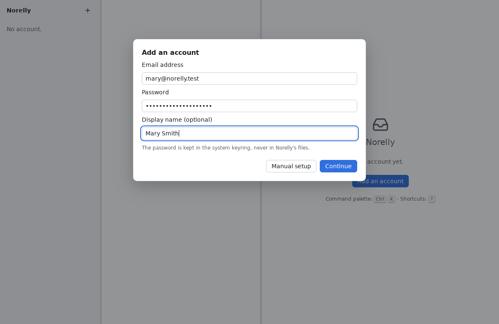
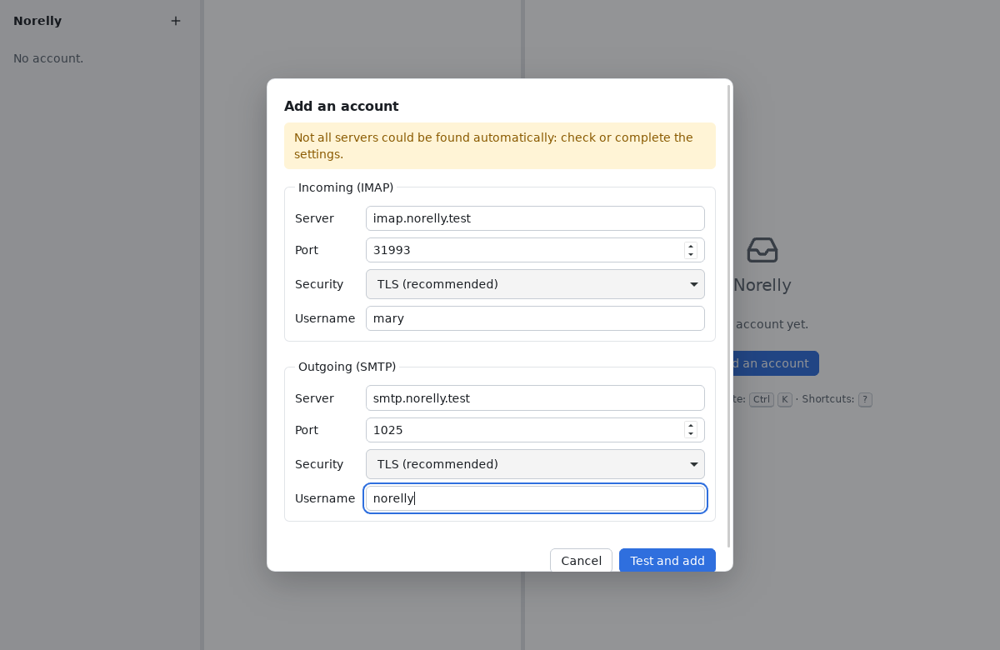
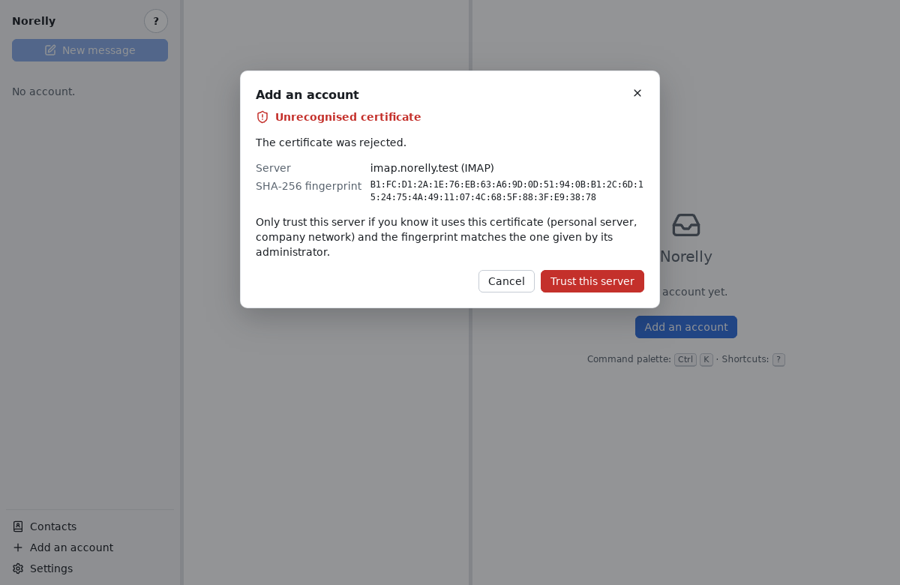
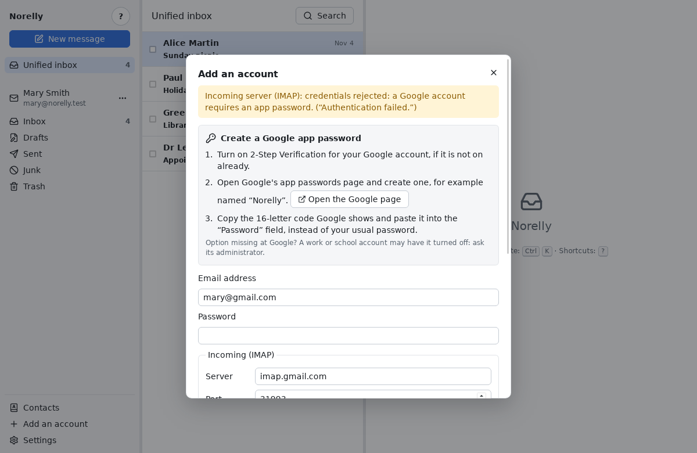
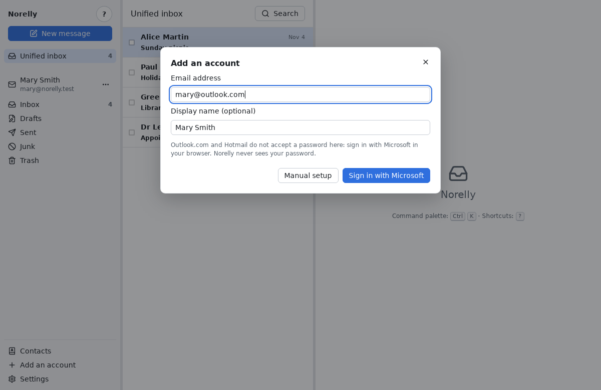

# Adding your email address

[← Back to contents](README.md)

In Norelly, each email address is called an **account**. You can add
several (for example a personal address and one for a club).

## What you need

- your **email address**, for example `mary.smith@example.com`;
- its **password**. For Gmail, this is not your usual password but an
  **app password**: first read [the Gmail section](#gmail-the-app-password).
  For Outlook.com and Hotmail, no password is asked: see
  [Outlook.com and Hotmail](#outlookcom-and-hotmail-sign-in-with-microsoft).

## Step by step

1. Click **Add an account**: on the welcome screen if it is your first
   account, otherwise on the **+** button at the top of the left panel.
2. Type your **email address** and your **password**. The **display name**
   is optional: it is the name your contacts will see next to your address
   (for example "Mary Smith").

   

3. Click **Continue**. Norelly looks up your provider's settings by itself:
   wait a few seconds.
4. Most of the time, that's all: Norelly tests the connection, then your
   address appears in the left panel and your messages arrive. The first
   time, downloading your messages can take a few minutes if you have many.
   You can already read the first ones.

Your password is stored in your system's **keyring** (the password safe of
Windows or Linux). The only exception: on Linux, if no keyring responds,
Norelly may offer to store it in an **unencrypted** file; it only does so
if you accept (see [error messages](errors.md#other-messages)).

### If Norelly shows you the server settings

When Norelly cannot find the settings by itself, it shows two boxes:
**Incoming (IMAP)** and **Outgoing (SMTP)**. Your provider gives this
information on its help pages (search for "IMAP" and "SMTP" with your
provider's name).

- **Server**: a name such as `imap.example.com` (incoming) or
  `smtp.example.com` (outgoing);
- **Port**: a number, most often `993` for incoming and `465` or `587` for
  outgoing;
- **Security**: keep **TLS (recommended)**, or **STARTTLS** if your
  provider says so (often with port `587` or `143`). Only choose **None
  (unencrypted)** if you know exactly why;
- **Username**: most often your full address.

Then click **Test and add**.

### If Norelly talks about a certificate

A **certificate** is a server's identity card. If Norelly cannot check it,
it stops and shows this screen.

With large providers (Gmail, Outlook.com, Fastmail…) this screen **should
never appear**: if it does, click **Cancel** and try again later, from
another network (your home connection rather than public Wi-Fi). See also
[error messages](errors.md#unrecognised-certificate).

Only click **Trust this server** for a server you know (a personal server,
your company's), and if its administrator has confirmed the
**fingerprint** shown.

## Gmail: the app password

Gmail refuses your usual password in a program like Norelly. Google asks
you to create an **app password**: a special password of 16 letters,
reserved for Norelly. You create it once, on Google's website, then paste
it into Norelly instead of your password.

The benefit: if one day you change your usual password, or want to cut off
Norelly's access, you just delete this app password.

If you typed your usual password, Norelly notices: the sign-in is
rejected, and Norelly shows the steps below instead, with an **Open the
Google page** button that opens the right page in your browser. The
**Password** field is cleared: paste the app password into it, then click
**Continue** (or **Test and add**) again.

1. First turn on **2-Step Verification** for your Google account, if not
   already done: in your browser, open
   <https://myaccount.google.com/security>, then **2-Step Verification**,
   and follow the instructions (Google will text you a code, for example).
2. Then open <https://myaccount.google.com/apppasswords>. Sign in if Google
   asks you to.
3. In **App name**, type `Norelly`, then click **Create**.
4. Google shows a 16-letter password in a yellow box. Select it, copy it
   (**Ctrl** + **C**), then paste it (**Ctrl** + **V**) into Norelly's
   **Password** field. Spaces do not matter.
5. Click **Done** at Google: this password will never be shown again. That
   is fine: if you lose it, create another one.

Cannot find the option at Google? It does not exist for an account
protected only by a security key, nor for an account under "Advanced
Protection". For a work or school address managed by Google, its
administrator may have turned it off: ask them.

## Outlook.com and Hotmail: sign in with Microsoft

Outlook.com, Hotmail, Live and MSN do not accept a password in a program
like Norelly. Instead, you sign in on Microsoft's page, in your browser:

1. In the **Add an account** window, type your address (for example
   `mary.smith@outlook.com`). The **Password** field disappears and the
   **Sign in with Microsoft** button appears.
2. Click **Sign in with Microsoft**. Your browser opens Microsoft's page:
   sign in as usual, with the account of the address you typed, then allow
   Norelly to access your messages. If you choose another account, Norelly
   refuses it and asks you to start again with the right one.
3. The browser shows "you can close this page": come back to Norelly. The
   account appears in the left column.

Norelly never sees your Microsoft password. It receives an authorization,
kept in the system keyring, which it renews on its own.

### Signing in again

If you change your Microsoft password, or remove Norelly's access on
Microsoft's website, the authorization stops working. A **Sign in again**
button then appears next to the account, in the left column (the entry is
also in the account's **⋯** menu). Click it and sign in again in the
browser: receiving resumes.

### If receiving is refused

Microsoft sometimes accepts the sign-in but refuses access to the mailbox.
Norelly then tries again a few times on its own. If the refusal persists,
Norelly asks you to check that **IMAP access** is turned on in
Outlook.com: on the Outlook.com website, open **Settings**, then **Mail**,
then **Forwarding and IMAP**, and turn on IMAP access. Then try again in a
few minutes: on Microsoft's side, this refusal is sometimes temporary.

### If the connection fails after you sign in with Microsoft

If the connection fails right after you sign in in your browser (server
not responding, unstable network), click **Sign in with Microsoft** again:
for ten minutes, Norelly reuses the sign-in you just completed, without
opening the browser again. The window then shows "Connecting to your
Microsoft mailbox…".

### If sending is refused

On some Outlook.com accounts, Microsoft turns off sending from email
programs, while receiving works. Norelly tells you so when adding the
account: turn sending on in your Outlook.com account settings, then try
again.

## Removing an account

In the left panel, click the **⋯** button next to the account's address,
then **Remove this account…**. Norelly asks you to confirm.

Removing an account erases from your computer its copy of the messages and
its password. **Your messages stay with your provider**: you will find them
on its website, or by adding the account again.

Next: [using Norelly every day](everyday.md).
