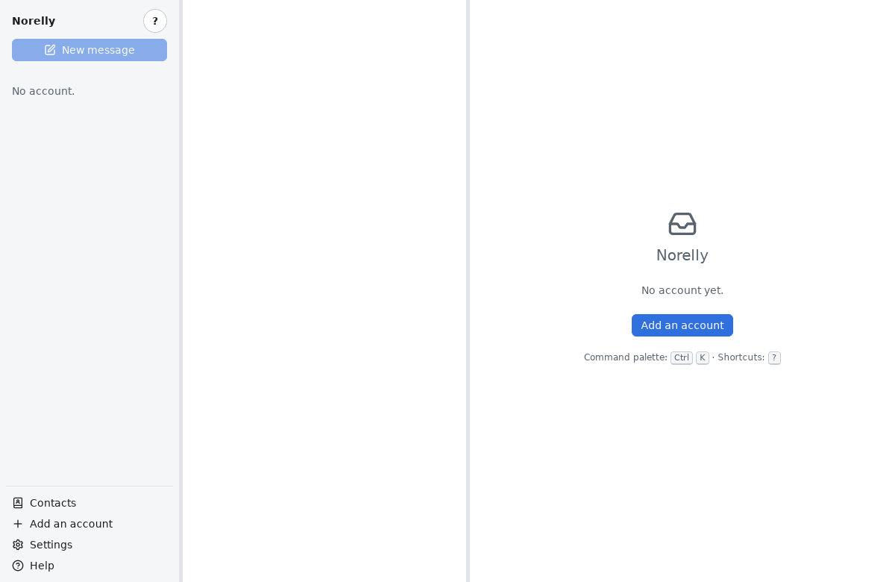

# Installing Norelly

[← Back to contents](README.md)

Norelly runs on **Windows 10 and 11** and on **Linux**. Pick the section
that matches your computer.

> **Where to get Norelly?** Only from the addresses given below. Never
> download Norelly from another website: a modified program could steal
> your passwords.

## On Windows

### The simple way: the installer

1. Open your web browser (Edge, Firefox, Chrome…) and go to
   <https://github.com/gbourquet/norelly/releases>.
2. Under the title of the latest version (at the very top), click
   **Assets** if the list is folded, then click the file whose name ends
   with **`_x64-setup.exe`** (for example `Norelly_1.0.0_x64-setup.exe`).
3. Wait for the download to finish, then open the file: click it in the
   browser's download list, or find it in your **Downloads** folder.
4. Windows may show a blue window saying **"Windows protected your PC"**.
   This is expected: Norelly does not yet have a digital signature
   recognised by Microsoft (it has been requested): the publisher shows as
   **"Unknown publisher"**. This window therefore cannot tell you whether
   the file is genuine: the guarantee is that you downloaded it yourself
   from the address above (check that it starts with
   `https://github.com/gbourquet/norelly` in the address bar), or that you
   checked it ([see below](#checking-a-downloaded-file-optional)). If so,
   click **More info**, then **Run anyway**. If in doubt, prefer the winget
   method below, which checks the file for you.
5. The installer opens. Click **Next**, then **Install**. No administrator
   password is needed: Norelly is installed for you only.
6. Click **Finish**. Norelly is now in the **Start** menu: type "Norelly"
   to find it.

### For experienced users: winget

If you use the Windows terminal, one command is enough:

```
winget install GuillaumeBourquet.Norelly
```

### Updates on Windows

On first launch, Norelly asks whether it may check for new versions by
itself ([see below](#first-launch)). If you answer **Yes**, a banner tells
you when a new version is ready: click **Install and restart**. Every update
is verified (signed) before it is installed.

## On Linux

### Recommended: Flathub

Flathub is the app store used by most Linux distributions (Ubuntu, Fedora,
Linux Mint, Debian…).

1. Open your system's **software centre** ("Software", "GNOME Software",
   "Discover" or "Software Manager", depending on the distribution).
2. Search for **Norelly**, then click **Install**.
3. Once installed, Norelly appears among your applications.

From the command line, if Flathub is already set up:

```
flatpak install flathub io.github.gbourquet.Norelly
```

Updates then arrive through the software centre, like your other
applications.

> **Do you have a Gmail address?** The Flathub version does not offer the
> **Sign in with Google** button. Your Gmail address still works there,
> with an **app password**: Norelly shows you how to create one when you
> add the address (see
> [Gmail: the app password](first-account.md#gmail-the-app-password)).
> The button is available in the .deb and .rpm packages below, and on
> Windows.

### Another way: .deb or .rpm package

1. Go to <https://github.com/gbourquet/norelly/releases>.
2. Download:
   - the file ending in **`.deb`** for Ubuntu, Debian, Linux Mint;
   - the file ending in **`.rpm`** for Fedora, openSUSE.
3. Double-click the downloaded file: the software centre opens and offers
   **Install**. Your session password is requested.

With a .deb or .rpm package, Norelly does not update itself: visit the
releases page from time to time.

## Checking a downloaded file (optional)

This part is for people comfortable with a terminal: you do not need it to
use Norelly. It lets you make sure that a downloaded file is the one the
project built, and that it has not been modified since.

On the releases page, every version contains, besides the installers:

- **`SHA256SUMS`**: the fingerprint (checksum) of every file of the
  version;
- **`Norelly_<version>_provenance.sigstore.json`**: a signed provenance
  attestation. It proves that every file of the version, and `SHA256SUMS`
  itself, was built by the release workflow of the `gbourquet/norelly`
  repository, from that exact version.

In the commands below, replace `1.0.0` with the number of the version you
downloaded (it appears several times) and `Norelly_1.0.0_x64-setup.exe`
with the name of your file (`.deb`, `.rpm`, or `SHA256SUMS`).

### With cosign, no account needed

Install [cosign](https://docs.sigstore.dev/cosign/system_config/installation/),
put the file and the attestation in the same folder, then run, in that
folder:

```
cosign verify-blob-attestation --new-bundle-format --type slsaprovenance1 --bundle Norelly_1.0.0_provenance.sigstore.json --certificate-oidc-issuer https://token.actions.githubusercontent.com --certificate-identity https://github.com/gbourquet/norelly/.github/workflows/release.yml@refs/tags/v1.0.0 Norelly_1.0.0_x64-setup.exe
```

The answer **`Verified OK`** confirms that the file is genuine. Any other
message (signature, fingerprint or identity refused): do not install it.

### With GitHub CLI, with a GitHub account

If you use [GitHub CLI](https://cli.github.com) (`gh`), signed in to your
account, the attestation is fetched from GitHub, without downloading it:

```
gh attestation verify Norelly_1.0.0_x64-setup.exe --repo gbourquet/norelly --signer-workflow gbourquet/norelly/.github/workflows/release.yml --source-ref refs/tags/v1.0.0 --deny-self-hosted-runners
```

The answer must say **`Verification succeeded!`**; if it is refused, `gh`
shows an error: do not install the file.

### With the fingerprints

Once `SHA256SUMS` is checked with one of the commands above, comparing the
fingerprints of the other downloaded files is enough:

- on Linux, in the folder of the files:
  `sha256sum --check --ignore-missing SHA256SUMS` (every file must show
  **OK**);
- on Windows, in PowerShell: `Get-FileHash Norelly_1.0.0_x64-setup.exe`,
  then compare the fingerprint shown with the file's line in `SHA256SUMS`
  (upper or lower case does not matter).

Comparing fingerprints **without** having checked `SHA256SUMS` only
detects a damaged download, not a fake file: a website offering a fake
file can offer fake fingerprints too.

## First launch

Open Norelly from the **Start** menu (Windows) or your list of
applications (Linux).

On Windows, on the very first launch, Norelly asks a single question:
**"Norelly can check for updates automatically. Would you like that?"**.
The **Yes** button is selected in advance: press **Enter** or click it. No
personal information is sent for this, and you can change your mind in the
**Settings**. On Linux this question is not asked: updates come through the
software centre.

Norelly is then empty: it is waiting for your first email address. Click
**Add an account** and follow the next page.



Next: [add your address](first-account.md).
