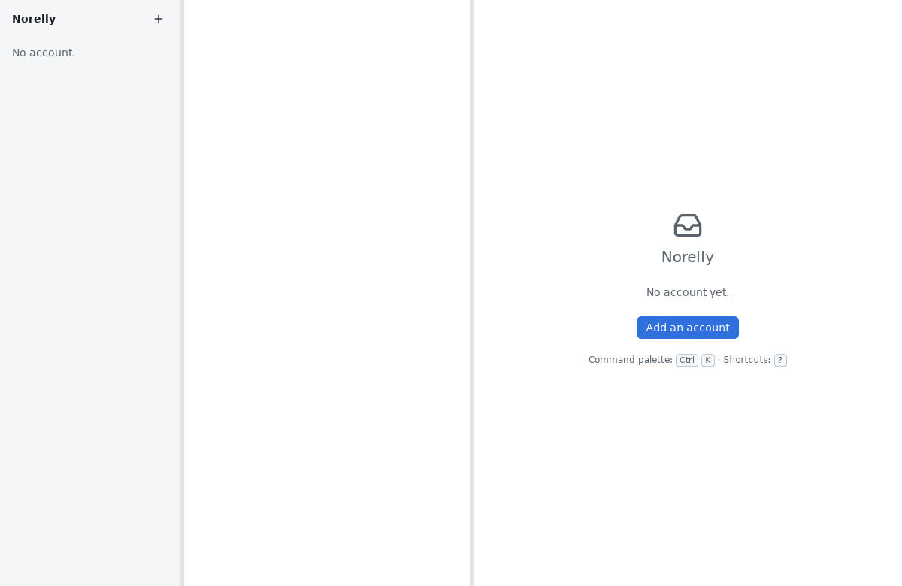

# Installing Norelly

[← Back to contents](README.md)

Norelly runs on **Windows 10 and 11** and on **Linux**. Pick the section
that matches your computer.

> **Where to get Norelly?** Only from the addresses given below. Never
> download Norelly from another website: a modified program could steal
> your passwords.

## On Windows

### The simple way: the installer

1. Open your web browser (Edge, Firefox, Chrome…) and go to
   <https://github.com/gbourquet/norelly/releases>.
2. Under the title of the latest version (at the very top), click
   **Assets** if the list is folded, then click the file whose name ends
   with **`_x64-setup.exe`** (for example `Norelly_1.0.0_x64-setup.exe`).
3. Wait for the download to finish, then open the file: click it in the
   browser's download list, or find it in your **Downloads** folder.
4. Windows may show a blue window saying **"Windows protected your PC"**.
   This is expected: Norelly does not yet have a digital signature
   recognised by Microsoft (it has been requested). Click **More info**,
   check that the file name is Norelly's, then click **Run anyway**.
5. The installer opens. Click **Next**, then **Install**. No administrator
   password is needed: Norelly is installed for you only.
6. Click **Finish**. Norelly is now in the **Start** menu: type "Norelly"
   to find it.

### For experienced users: winget

If you use the Windows terminal, one command is enough:

```
winget install GuillaumeBourquet.Norelly
```

### Updates on Windows

On first launch, Norelly asks whether it may check for new versions by
itself ([see below](#first-launch)). If you answer **Yes**, a banner tells
you when a new version is ready: click **Install and restart**. Every update
is verified (signed) before it is installed.

## On Linux

### Recommended: Flathub

Flathub is the app store used by most Linux distributions (Ubuntu, Fedora,
Linux Mint, Debian…).

1. Open your system's **software centre** ("Software", "GNOME Software",
   "Discover" or "Software Manager", depending on the distribution).
2. Search for **Norelly**, then click **Install**.
3. Once installed, Norelly appears among your applications.

From the command line, if Flathub is already set up:

```
flatpak install flathub io.github.gbourquet.Norelly
```

Updates then arrive through the software centre, like your other
applications.

### Another way: .deb or .rpm package

1. Go to <https://github.com/gbourquet/norelly/releases>.
2. Download:
   - the file ending in **`.deb`** for Ubuntu, Debian, Linux Mint;
   - the file ending in **`.rpm`** for Fedora, openSUSE.
3. Double-click the downloaded file: the software centre opens and offers
   **Install**. Your session password is requested.

With a .deb or .rpm package, Norelly does not update itself: visit the
releases page from time to time.

## First launch

Open Norelly from the **Start** menu (Windows) or your list of
applications (Linux).

On Windows, on the very first launch, Norelly asks a single question:
**"Norelly can check for updates automatically. Would you like that?"**.
The **Yes** button is selected in advance: press **Enter** or click it. No
personal information is sent for this, and you can change your mind in the
**Settings**. On Linux this question is not asked: updates come through the
software centre.

Norelly is then empty: it is waiting for your first email address. Click
**Add an account** and follow the next page.



Next: [add your address](first-account.md).
