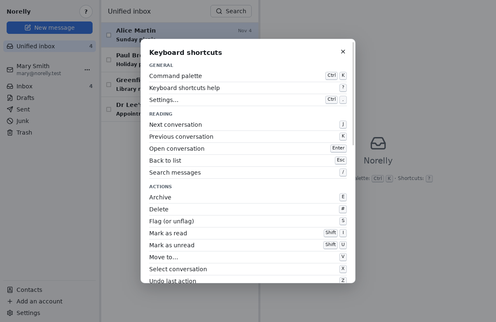

# Keyboard shortcuts cheat sheet

[← Back to contents](README.md)

A **shortcut** is a key (or a combination of keys) that performs an action
without using the mouse. They are optional: everything can also be done
with the mouse or through the **command palette**.

**How to read this table**: `Ctrl+K` means "press **Ctrl**, hold it down,
then press **K**". **Shift** is the capitals key (upward arrow, ⇧). Single
letters (`J`, `R`…) are typed in lower case, without **Shift**.

Single-key shortcuts do not work while you are typing in a field (otherwise
typing an "r" in a message would start a reply). Press **Esc** first to
leave the field.

In Norelly, the `?` key or the **?** button at the top left shows this table
at any time. Each button also shows its key when you rest the mouse on it
for a moment.

## General

| Action | Shortcut |
|---|---|
| Command palette | `Ctrl+K` |
| Keyboard shortcuts help | `?` |
| Settings… | `Ctrl+,` |

## Reading

| Action | Shortcut |
|---|---|
| Next conversation | `J` |
| Previous conversation | `K` |
| Open conversation | `Enter` |
| Back to list | `Esc` |
| Search messages | `/` |
| Unified inbox | palette |
| Prefer plain text (or HTML) | palette |

In the search, `J` and `K` move from one result to the next and `Esc`
closes the search.

## Actions

| Action | Shortcut |
|---|---|
| Archive | `E` |
| Delete | `#` |
| Flag (or unflag) | `S` |
| Mark as read | `Shift+I` |
| Mark as unread | `Shift+U` |
| Move to… | `V` |
| Select conversation | `X` |
| Clear selection | palette |
| Undo last action | `Z` |

Actions apply to the open conversation, the one chosen in the list, or all
the conversations ticked with `X`.

## Writing

| Action | Shortcut |
|---|---|
| New message | `C` |
| Reply | `R` |
| Reply all | `A` |
| Forward | `F` |
| Drafts… | palette |
| Outbox | palette |

In the writing window: `Ctrl+Enter` sends the message, `Esc` closes the
window and keeps the draft. In the **To** field: the arrow keys choose a
suggested address, `Enter` or `,` confirms it.

## Contacts

| Action | Shortcut |
|---|---|
| Open contacts | `Ctrl+Shift+B` |
| New contact | `N` |
| Import contacts… | palette |
| Export contacts… | palette |
| Export selected contacts… | palette |
| Find duplicates… | palette |
| Edit contact | `Shift+E` |
| Write to contact | `W` |
| Favorite (add or remove) | `Shift+S` |
| Delete contact | `Delete` |
| Clear contact selection | palette |
| Add to address book | palette |
| View contact | palette |
| Add to a list… | palette |
| New list | palette |
| Edit list | palette |
| Write to list | palette |
| Delete list | palette |

In the **Contacts** view, these actions apply to the contact shown on the
right, or to all checked contacts. `N` works everywhere: it opens the
contacts and a new contact card. **Add to address book** and **View
contact** apply to the person whose menu is open (click a name in a
message, right-click a conversation), otherwise to the sender of the last
message of the open conversation.

Mailing list actions apply to the list shown on the right in the **Lists**
section (or to the list whose menu is open with a right-click).

## Accounts

| Action | Shortcut |
|---|---|
| Add an account… | palette |
| New folder… | palette |
| Rename folder… | palette |
| Move folder… | palette |
| Delete folder… | palette |
| Choose archive folder… | palette |
| Synchronise selected account | palette |
| Sign in again to the selected account | palette |
| Change the selected account's password… | palette |
| Remove selected account… | palette |

"palette": no shortcut, open the palette (`Ctrl+K`) and type a few letters
of the action's name.

## Panels

The dividers between the three panels can also be moved from the keyboard:
reach them with **Tab**, then use the **←** and **→** arrow keys (**Home**
and **End** for the extremes).
