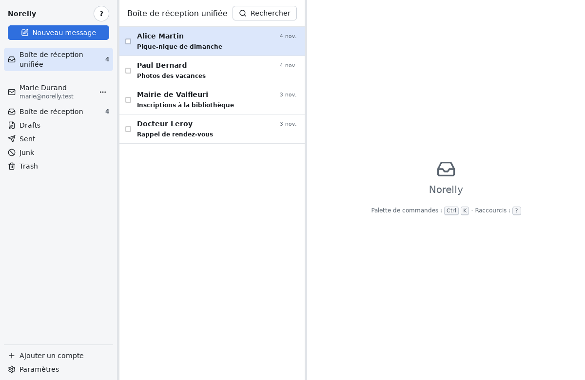

# Norelly : guide d'utilisation

*English version: [../en/README.md](../en/README.md).*

## Qu'est-ce que Norelly ?

Norelly est un programme pour lire et envoyer vos courriels (vos « mails »)
depuis votre ordinateur, sous Windows ou Linux.

Vous avez sans doute déjà une adresse électronique, chez Gmail, Outlook.com,
Orange, Free, Fastmail ou ailleurs. D'habitude, vous la consultez sur le
site de votre fournisseur. Norelly vous permet de faire la même chose dans
une fenêtre de votre ordinateur, sans ouvrir de navigateur :

- vos messages sont **copiés sur votre ordinateur** : vous pouvez les lire
  et les retrouver même sans Internet ;
- vous pouvez réunir **plusieurs adresses** dans une seule fenêtre ;
- Norelly **vous protège** : il bloque les images qui servent à savoir si
  vous avez ouvert un message, et il ne vous espionne pas (aucune
  statistique n'est envoyée) ;
- tout se fait **à la souris**, avec des boutons écrits en toutes lettres :
  **Nouveau message**, **Répondre**, **Archiver**, **Supprimer**… Si vous
  aimez le clavier, des raccourcis permettent d'aller plus vite (le bouton
  **?** les affiche).

Norelly est gratuit et libre.

La fenêtre est partagée en trois parties :

1. **à gauche**, vos adresses (on dit « comptes ») et leurs dossiers
   (Boîte de réception, Envoyés, Brouillons, Corbeille…). Hormis la Boîte
   de réception, les dossiers portent les noms choisis par votre
   fournisseur, parfois en anglais (« Sent », « Drafts », « Trash ») ;
2. **au milieu**, la liste des messages du dossier choisi. Les messages
   qui se répondent sont regroupés en une seule ligne : une
   « conversation » ;
3. **à droite**, le message que vous lisez.

## Sommaire

1. [Installer Norelly](install.md), sous Windows ou Linux.
2. [Ajouter votre adresse](first-account.md), avec le cas de Gmail et
   d'Outlook.com.
3. [Utiliser Norelly au quotidien](everyday.md) : lire, répondre, écrire,
   joindre un fichier, ranger, supprimer, rechercher, retrouver un
   brouillon.
4. [Que faire quand un message d'erreur s'affiche ?](errors.md)
5. [Questions fréquentes](faq.md)
6. [Aide-mémoire des raccourcis clavier](shortcuts.md)

## Trois conseils pour commencer

- **Rien n'est grave** : après avoir archivé, supprimé ou déplacé un
  message, un bouton **Annuler** apparaît en bas de la fenêtre pendant
  quelques instants.
- **Vous êtes perdu ?** Appuyez sur la touche **Échap** (en haut à gauche
  du clavier) : elle ferme la fenêtre ouverte ou revient à la liste.
- **Vous cherchez une fonction ?** Appuyez en même temps sur **Ctrl** et
  **K** : une liste de toutes les actions possibles s'ouvre, avec une
  zone pour en chercher une par son nom.
