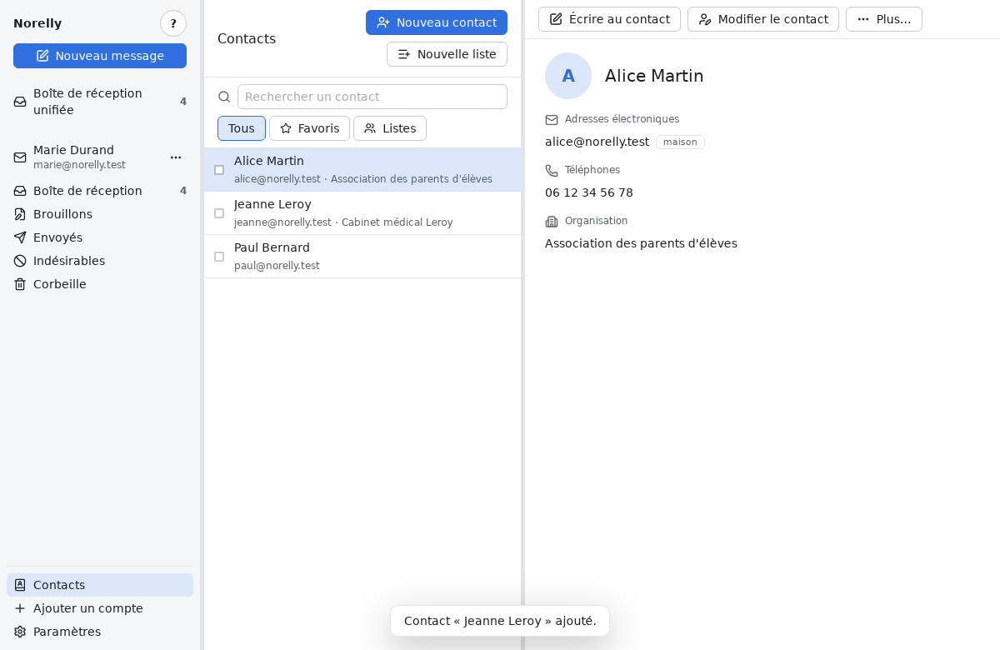
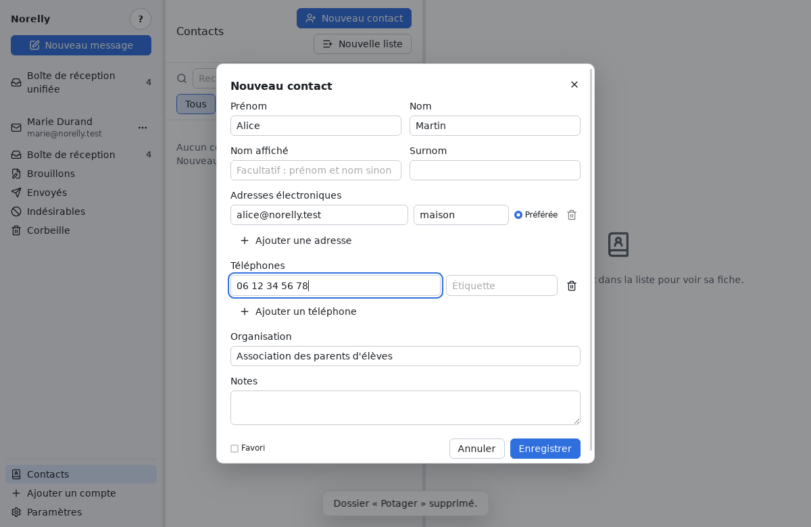
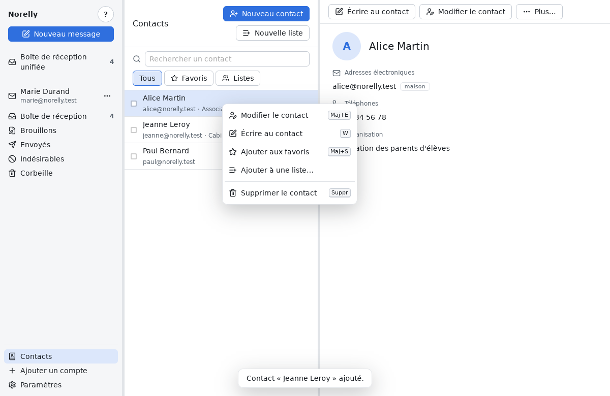
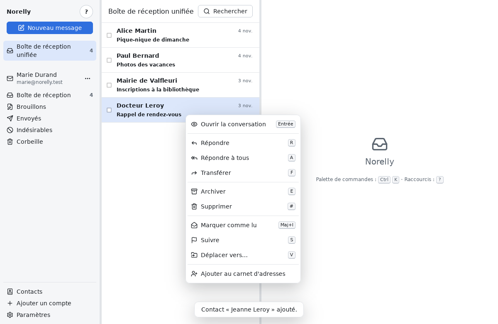
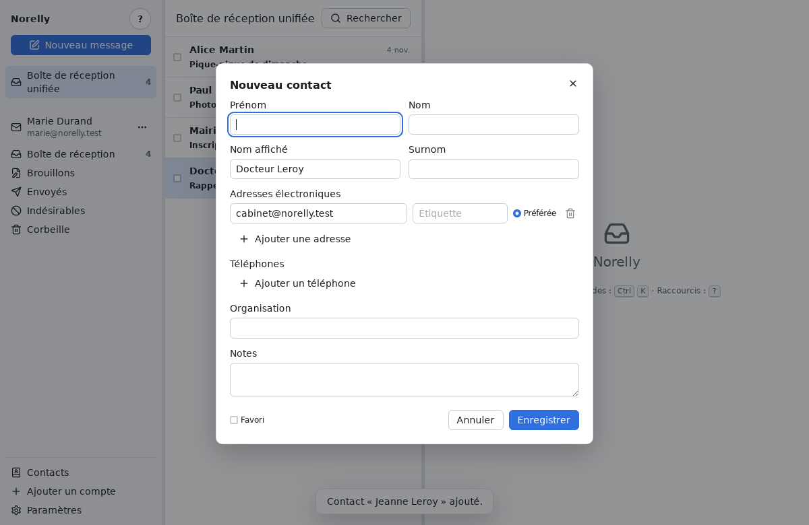
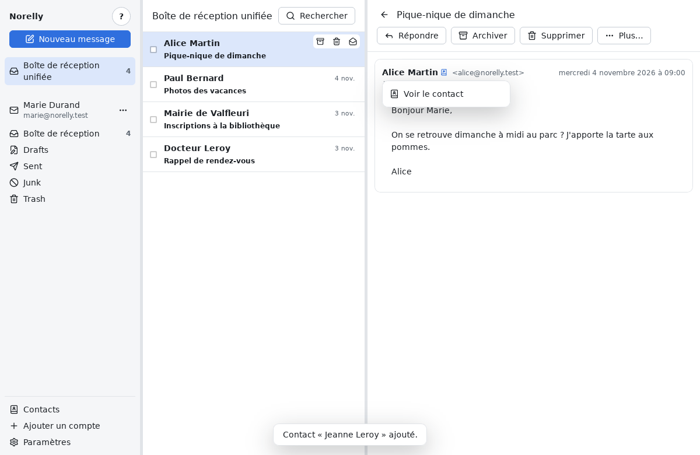
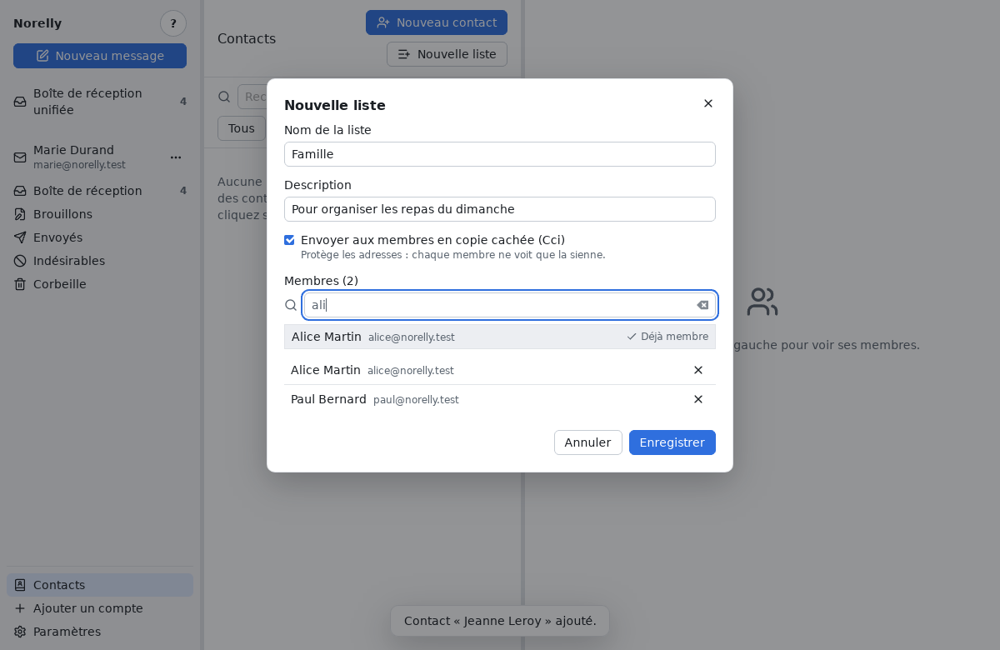
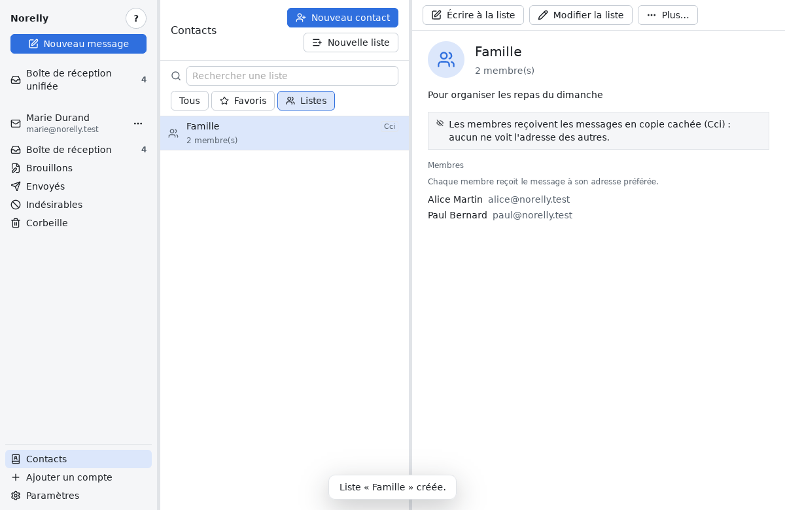
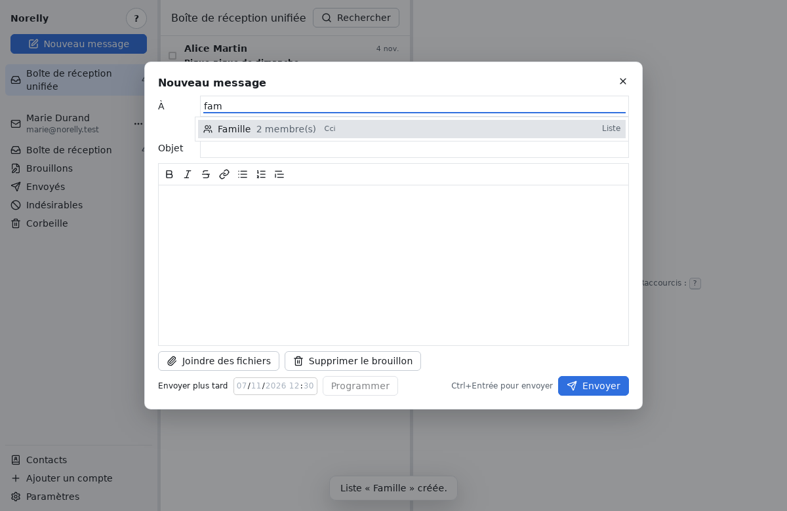

# Garder vos contacts

[← Retour au sommaire](README.md)

Le **carnet d'adresses** garde les personnes à qui vous écrivez souvent :
leur nom, leurs adresses électroniques, leurs téléphones. Il est commun à
toutes vos adresses et reste sur votre ordinateur.

## Ouvrir vos contacts

En bas du panneau de gauche, cliquez sur **Contacts**. La liste de vos
contacts remplace celle des messages ; la fiche du contact choisi s'affiche
à droite.

- Pour trouver quelqu'un, tapez quelques lettres de son nom, de son
  adresse ou de son organisation dans **Rechercher**.
- Cliquez sur **Favoris** pour ne voir que vos favoris, sur **Tous** pour
  tout revoir.
- Pour revenir à vos messages, cliquez sur **Boîte de réception unifiée**
  ou sur un dossier, à gauche.

## Ajouter un contact

1. Cliquez sur **Nouveau contact**, en haut de la liste.
2. Remplissez ce que vous connaissez : prénom, nom, adresse électronique…
   Seule l'adresse est obligatoire.
3. La personne a plusieurs adresses ? Cliquez sur **Ajouter une adresse**,
   puis cochez **Préférée** devant celle que Norelly doit utiliser quand
   vous lui écrivez. L'étiquette (« travail », « maison ») est facultative.
4. Cliquez sur **Enregistrer**.

Si Norelly refuse, la fenêtre reste ouverte et explique pourquoi. Le cas
le plus courant : l'adresse appartient déjà à un autre contact. Une
adresse ne peut appartenir qu'à un seul contact ; modifiez plutôt celui
qui l'a déjà.

## Modifier, mettre en favori, écrire

Sur la fiche d'un contact :

- **Modifier le contact** rouvre sa fenêtre pour corriger un nom ou
  ajouter une adresse ;
- **Écrire au contact** ouvre un nouveau message, déjà adressé à son
  adresse préférée. Le message part de l'adresse choisie dans le panneau
  de gauche ;
- **Plus…**, puis **Ajouter aux favoris** (ou **Retirer des favoris**) :
  une étoile apparaît à côté de son nom.

Ces actions sont aussi dans le menu qui s'ouvre d'un **clic droit** sur
une ligne de la liste.

## Vos contacts dans vos messages

Quand une personne de votre carnet vous écrit, Norelly l'affiche sous le
nom que vous lui avez donné, dans la liste des messages comme dans le
message ouvert. Une petite pastille à côté de son nom rappelle qu'elle est
dans vos contacts.

Pour ajouter quelqu'un qui vous a écrit :

1. Ouvrez son message et cliquez sur son **nom** (ou faites un **clic
   droit** sur le message dans la liste).
2. Choisissez **Ajouter au carnet d'adresses** : la fenêtre d'un nouveau
   contact s'ouvre, déjà remplie avec son nom et son adresse.
3. Complétez si vous le souhaitez, puis cliquez sur **Enregistrer**.

Pour une personne déjà dans votre carnet, un clic sur son nom propose
**Voir le contact**, qui ouvre sa fiche.

Quand vous écrivez un message, tapez le début du nom d'un contact dans
**À** : vos contacts sont proposés en premier, sous le nom de votre carnet.

Attention : le nom de votre contact s'affiche d'après l'adresse indiquée
par le message, qu'un fraudeur peut imiter. Il ne garantit pas que le
message vient vraiment de cette personne : en cas de doute (demande
d'argent, de mot de passe), vérifiez par un autre moyen.

## Écrire à un groupe : les listes de diffusion

Une **liste de diffusion** regroupe plusieurs contacts (votre famille, un
club) pour leur écrire en une seule fois.

1. Dans **Contacts**, cliquez sur **Nouvelle liste**.
2. Donnez-lui un nom, par exemple « Famille ».
3. Dans **Ajouter un contact**, tapez quelques lettres d'un nom, puis
   cliquez sur **Ajouter** à côté de la bonne personne. Recommencez pour
   chaque membre ; la croix à droite d'un membre le retire.
4. Cochez **Envoyer aux membres en copie cachée (Cci)** si les membres ne
   doivent pas voir l'adresse des autres (une association, des voisins).
5. Cliquez sur **Enregistrer**.

Cliquez sur **Listes**, à côté de **Tous** et **Favoris**, pour voir vos
listes ; la liste choisie s'affiche à droite avec ses membres.

- **Écrire à la liste** ouvre un nouveau message adressé à tous ses
  membres.
- En écrivant un message, tapez le début du nom de la liste dans **À** :
  elle est proposée en tête, choisissez-la et chaque membre apparaît
  comme destinataire. Une liste « Cci » range ses membres dans **Cci**.
- Pour ajouter quelqu'un à une liste depuis sa fiche : **Plus…**, puis
  **Ajouter à une liste…**.
- **Modifier la liste** et **Supprimer la liste** sont sur la liste
  ouverte et dans le menu du clic droit. Supprimer une liste ne supprime
  pas ses contacts.

Chaque membre reçoit le message à son adresse **préférée** : changez-la
sur sa fiche et toutes ses listes en tiennent compte.

## Supprimer des contacts

- Un contact : sur sa fiche, cliquez sur **Supprimer le contact**, puis
  confirmez.
- Plusieurs contacts : cochez la case au début de chaque ligne ; une
  barre apparaît en haut de la liste, avec **Supprimer le contact** et
  **Écrire au contact**. **Désélectionner les contacts** décoche tout.

Supprimer un contact ne touche pas à vos messages et le retire de ses
listes. La suppression est définitive.
