# Garder vos contacts

[← Retour au sommaire](README.md)

Le **carnet d'adresses** garde les personnes à qui vous écrivez souvent :
leur nom, leurs adresses électroniques, leurs téléphones. Il est commun à
toutes vos adresses et reste sur votre ordinateur, sauf si vous le
synchronisez avec un serveur de contacts (voir plus bas).

## Ouvrir vos contacts

En bas du panneau de gauche, cliquez sur **Contacts**. La liste de vos
contacts remplace celle des messages ; la fiche du contact choisi s'affiche
à droite.

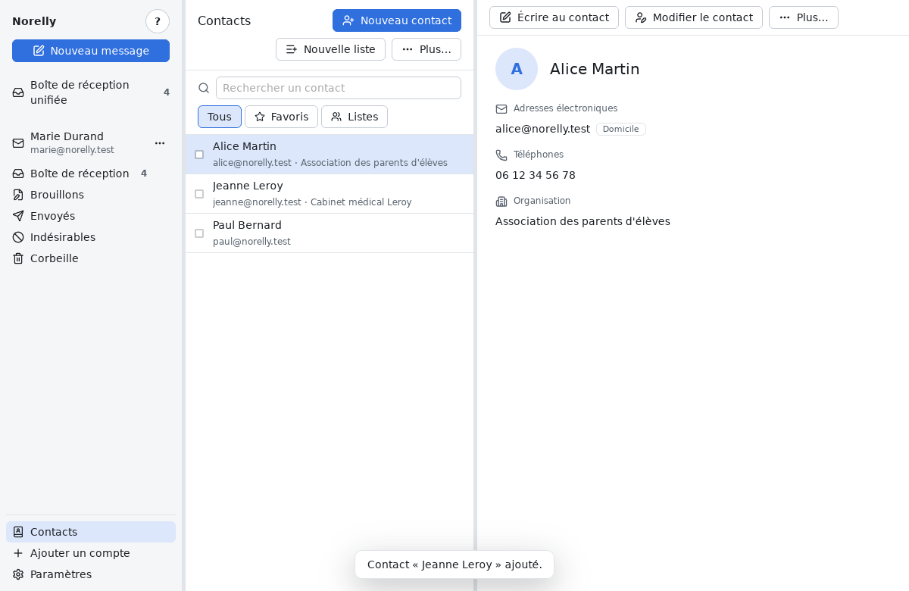

- Pour trouver quelqu'un, tapez quelques lettres de son nom, de son
  adresse ou de son organisation dans **Rechercher**. Vous pouvez taper
  le prénom puis le début du nom : « alice mar » trouve Alice Martin.
- Cliquez sur **Favoris** pour ne voir que vos favoris, sur **Tous** pour
  tout revoir.
- Pour revenir à vos messages, cliquez sur **Boîte de réception unifiée**
  ou sur un dossier, à gauche.

## Ajouter un contact

1. Cliquez sur **Nouveau contact**, en haut de la liste.
2. Remplissez ce que vous connaissez : prénom, nom, adresse électronique…
   Seule l'adresse est obligatoire.
3. La personne a plusieurs adresses ? Cliquez sur **Ajouter une adresse**,
   puis cochez **Préférée** devant celle que Norelly doit utiliser quand
   vous lui écrivez. L'étiquette (« travail », « maison ») est facultative.
4. Cliquez sur **Enregistrer**.

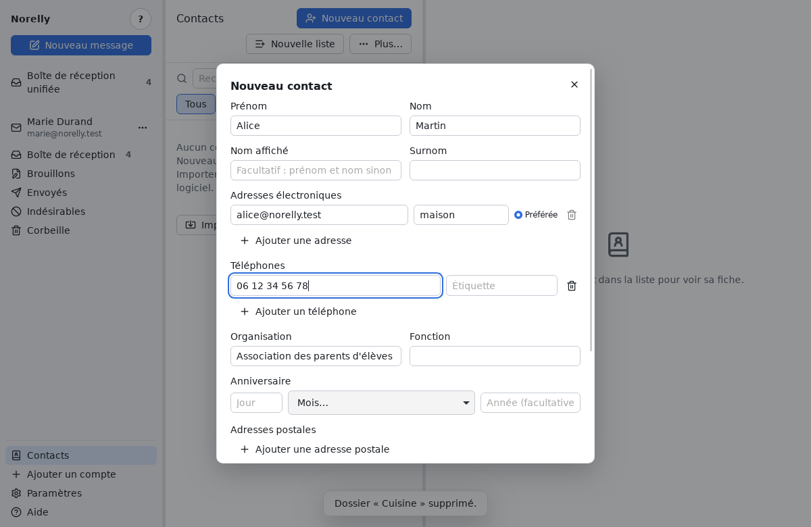

Plus bas dans la même fenêtre, vous pouvez aussi noter :

- sa **Fonction**, à côté de l'**Organisation** ;
- son **Anniversaire** : le jour, le mois, et l'année si vous la
  connaissez (elle est facultative) ;
- une ou plusieurs **adresses postales** : cliquez sur **Ajouter une
  adresse postale**, puis remplissez la rue, le code postal, la ville et
  le pays ;
- ses **sites web** : cliquez sur **Ajouter un site web**. Écrire
  « www.exemple.fr » suffit. Sur la fiche, un clic sur le site l'ouvre dans
  votre navigateur.

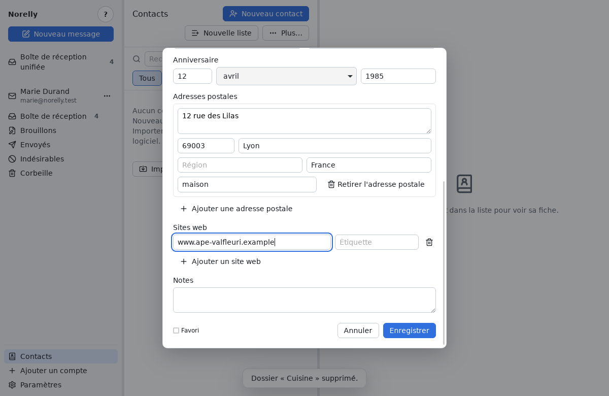

Si Norelly refuse, la fenêtre reste ouverte et explique pourquoi. Le cas
le plus courant : l'adresse appartient déjà à un autre contact. Une
adresse ne peut appartenir qu'à un seul contact ; modifiez plutôt celui
qui l'a déjà.

Un nom ne peut pas ressembler à une adresse électronique : « @ », « < »
et « > » y sont refusés (« @ » aussi écrit en toutes lettres, comme « (at) »), pour qu'un message ne puisse pas se faire passer
pour quelqu'un d'autre. L'explication s'affiche sous le champ concerné ;
saisissez un nom, par exemple « Alice Martin ».

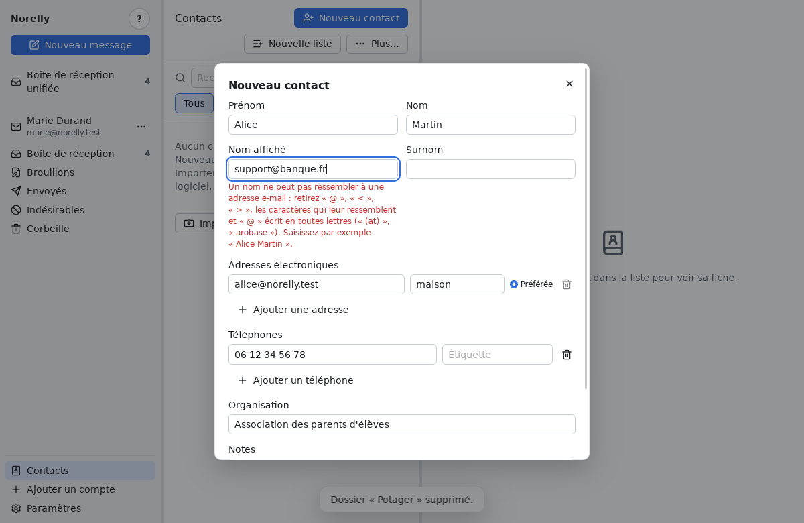

## Modifier, mettre en favori, écrire

Sur la fiche d'un contact :

- **Modifier le contact** rouvre sa fenêtre pour corriger un nom ou
  ajouter une adresse ;
- **Écrire au contact** ouvre un nouveau message, déjà adressé à son
  adresse préférée. Le message part de l'adresse choisie dans le panneau
  de gauche ;
- **Plus…**, puis **Ajouter aux favoris** (ou **Retirer des favoris**) :
  une étoile apparaît à côté de son nom.

Ces actions sont aussi dans le menu qui s'ouvre d'un **clic droit** sur
une ligne de la liste.

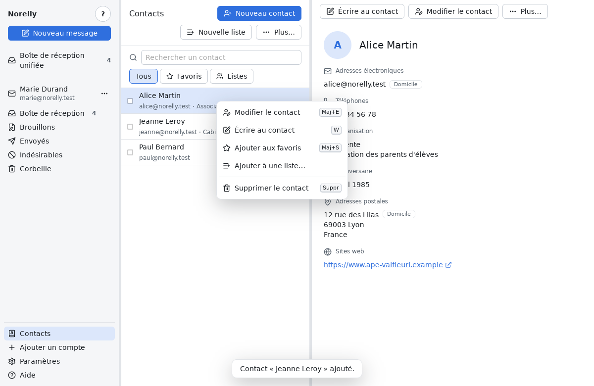

## Vos contacts dans vos messages

Quand une personne de votre carnet vous écrit, Norelly l'affiche sous le
nom que vous lui avez donné, dans la liste des messages comme dans le
message ouvert. Une petite pastille à côté de son nom rappelle qu'elle est
dans vos contacts, quand le serveur de votre messagerie a confirmé que le
message vient bien de son adresse. Sans cette confirmation (certaines
messageries, dont celles de Microsoft, ne la donnent pas), son nom
s'affiche, mais sans pastille.

Si le serveur de votre messagerie constate au contraire que le message ne
vient pas de l'adresse affichée, la mention **Expéditeur non vérifié**
apparaît à côté du nom : méfiez-vous des liens et des pièces jointes de ce
message.

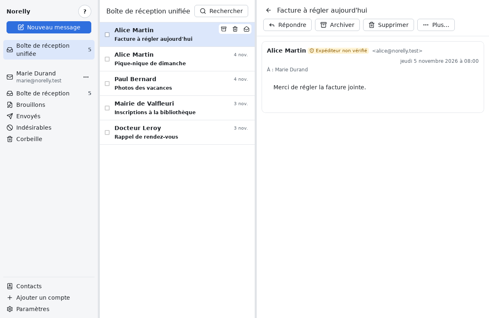

Pour ajouter quelqu'un qui vous a écrit :

1. Ouvrez son message et cliquez sur son **nom** (ou faites un **clic
   droit** sur le message dans la liste).
2. Choisissez **Ajouter au carnet d'adresses** : la fenêtre d'un nouveau
   contact s'ouvre, déjà remplie avec son nom et son adresse.
3. Complétez si vous le souhaitez, puis cliquez sur **Enregistrer**.

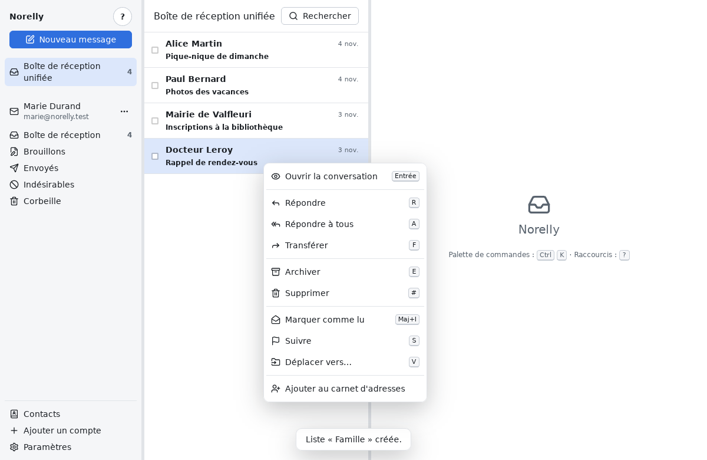

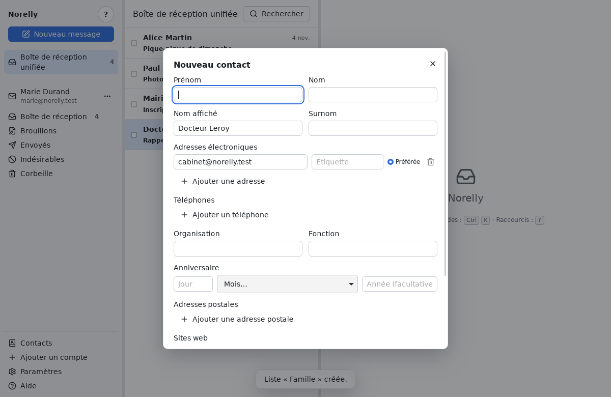

Pour une personne déjà dans votre carnet, un clic sur son nom propose
**Voir le contact**, qui ouvre sa fiche.

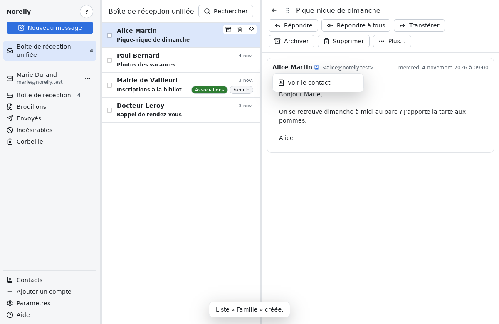

Quand vous écrivez un message, tapez le début du nom d'un contact dans
**À** : vos contacts sont proposés en premier, sous le nom de votre carnet.

Attention : le nom de votre contact s'affiche d'après l'adresse indiquée
par le message, qu'un fraudeur peut imiter. Le nom seul ne garantit pas
que le message vient vraiment de cette personne, et la pastille non plus
n'est pas une preuve absolue : en cas de doute (demande d'argent, de mot
de passe), vérifiez par un autre moyen.

Quand l'expéditeur n'est pas dans vos contacts et que son nom ressemble à
un site (« Banque.fr »), la liste des messages montre d'abord son adresse
réelle, puis ce nom entre parenthèses : c'est l'adresse qui compte. Une
adresse longue est abrégée, en gardant la fin, qui désigne l'expéditeur
réel ; posez la souris sur la ligne pour lire l'adresse complète. Un nom qui imite une adresse
(« support(at)banque.fr ») n'est pas affiché du tout : seule l'adresse
réelle apparaît.

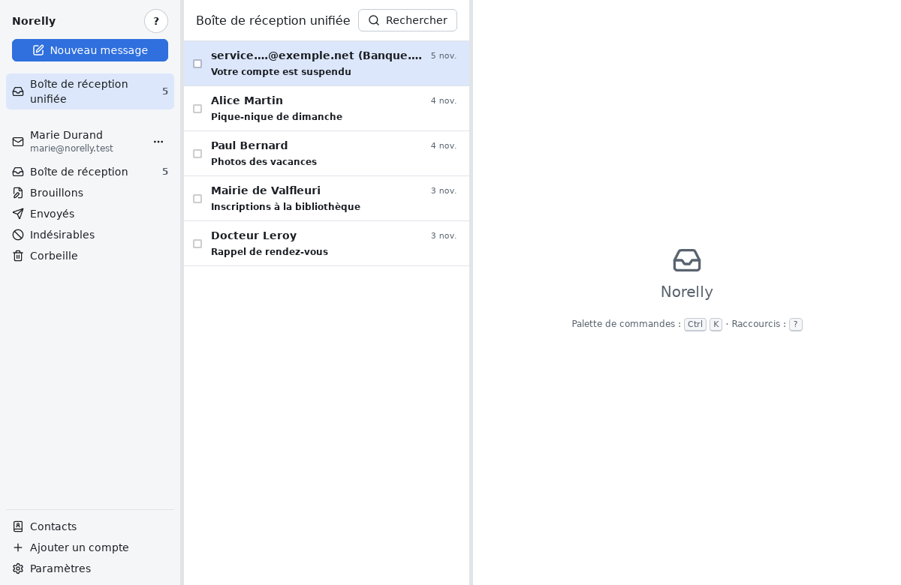

## Écrire à un groupe : les listes de diffusion

Une **liste de diffusion** regroupe plusieurs contacts (votre famille, un
club) pour leur écrire en une seule fois.

1. Dans **Contacts**, cliquez sur **Nouvelle liste**.
2. Donnez-lui un nom, par exemple « Famille ».
3. Dans **Ajouter un contact**, tapez quelques lettres d'un nom, puis
   cliquez sur **Ajouter** à côté de la bonne personne. Recommencez pour
   chaque membre ; la croix à droite d'un membre le retire.
4. Cochez **Envoyer aux membres en copie cachée (Cci)** si les membres ne
   doivent pas voir l'adresse des autres (une association, des voisins).
5. Cliquez sur **Enregistrer**.

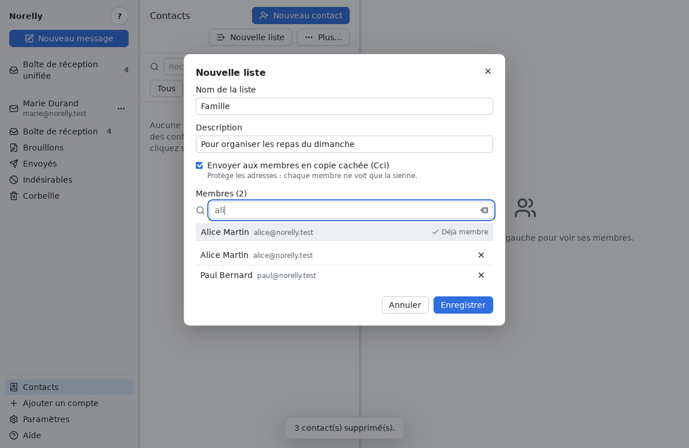

Cliquez sur **Listes**, à côté de **Tous** et **Favoris**, pour voir vos
listes ; la liste choisie s'affiche à droite avec ses membres.

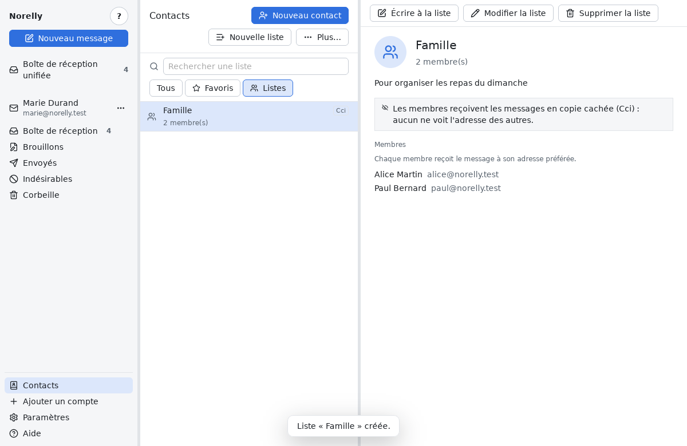

- **Écrire à la liste** ouvre un nouveau message adressé à tous ses
  membres.
- En écrivant un message, tapez le début du nom de la liste dans **À** :
  elle est proposée en tête, choisissez-la et chaque membre apparaît
  comme destinataire. Une liste « Cci » range ses membres dans **Cci**.
- Un message ne peut pas avoir plus d'un certain nombre de destinataires.
  Si une liste ferait dépasser cette limite, elle n'est pas ajoutée et un
  avertissement sous les destinataires indique combien il y en aurait et
  quelle est la limite : retirez quelques destinataires, ou partagez
  l'envoi en plusieurs messages.
- Pour ajouter quelqu'un à une liste depuis sa fiche : **Plus…**, puis
  **Ajouter à une liste…**.
- **Modifier la liste** et **Supprimer la liste** sont sur la liste
  ouverte et dans le menu du clic droit. Supprimer une liste ne supprime
  pas ses contacts.

Chaque membre reçoit le message à son adresse **préférée** : changez-la
sur sa fiche et toutes ses listes en tiennent compte.

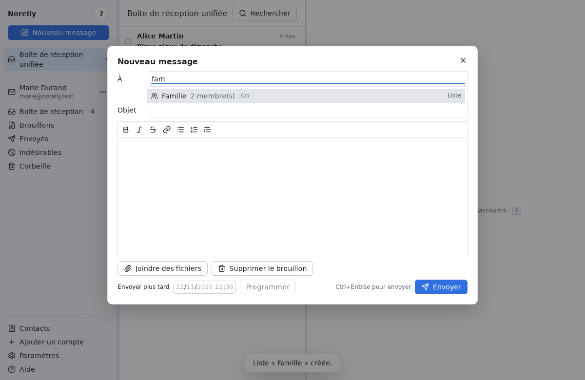

## Importer les contacts d'un autre logiciel

Vous aviez vos contacts dans Gmail, Outlook, Thunderbird, sur un iPhone ou
un téléphone Android ? Exportez-les d'abord depuis ce logiciel, en
**vCard** (fichier `.vcf`) de préférence, sinon en **CSV**. Puis :

1. Dans **Contacts**, cliquez sur **Importer…**, en haut de la liste.
2. Choisissez le fichier exporté, puis **Ouvrir**.
3. Norelly montre ce qu'il va faire, sans encore rien changer : combien
   de contacts seront ajoutés, combien sont déjà dans votre carnet,
   combien ne peuvent pas être importés (cliquez sur **Voir les fiches
   impossibles à importer** pour savoir lesquelles, et pourquoi).
4. Si des contacts sont déjà dans votre carnet, choisissez : **Les laisser
   tels quels**, ou **Les compléter avec le fichier** (Norelly ajoute ce
   qui leur manque, sans rien effacer).
5. Cliquez sur **Importer**.

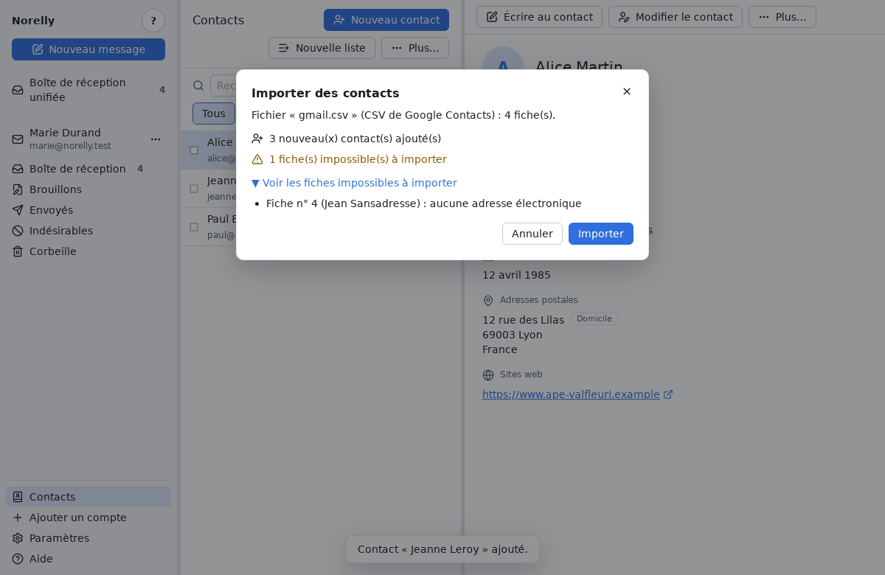

Un contact est reconnu comme déjà présent s'il a la même adresse
électronique. Une fiche sans adresse électronique n'est pas importée : le
carnet de Norelly sert à écrire des messages.

Le carnet peut contenir un très grand nombre de contacts, mais pas un
nombre illimité. Si les nouveaux contacts d'un fichier ne tiennent pas
dans le carnet, Norelly le dit dès l'aperçu et n'importe rien.
Supprimez les contacts dont vous n'avez plus besoin, ou importez un
fichier plus petit, puis réessayez. Un carnet plein refuse aussi un
nouveau contact, avec le même message.

Les listes de diffusion du fichier (les groupes d'un fichier vCard ou
LDIF) sont importées avec leurs membres. Une liste qui porte le même nom
qu'une de vos listes n'est pas importée, et votre liste ne change pas :
un fichier n'ajoute jamais personne à vos listes. Un membre qui n'est ni
dans le fichier ni dans votre carnet est laissé de côté : l'aperçu
indique combien.

Les étiquettes courantes des adresses et des téléphones (travail,
domicile, mobile, fax…) s'affichent en français, quelle que soit la
langue du logiciel d'origine. Les étiquettes personnelles, comme celles
créées dans Contacts d'Apple (« bureau », « chalet »), sont reprises telles
quelles.

Les **photos** contenues dans un fichier vCard sont reprises et
s'affichent sur la fiche du contact, à côté de son nom ; sans photo, la
fiche montre l'initiale du nom. Norelly garde une copie en petit format de
chaque photo, sans les informations cachées qu'elle pouvait contenir
(lieu, date, appareil). Une photo indiquée par un simple lien vers
Internet n'est jamais chargée, et une photo trop grande ou d'un format
inhabituel est laissée de côté : le contact est importé sans elle. Un
contact déjà dans votre carnet ne reçoit la photo du fichier que s'il n'en
a pas et que vous choisissez **Les compléter avec le fichier**.

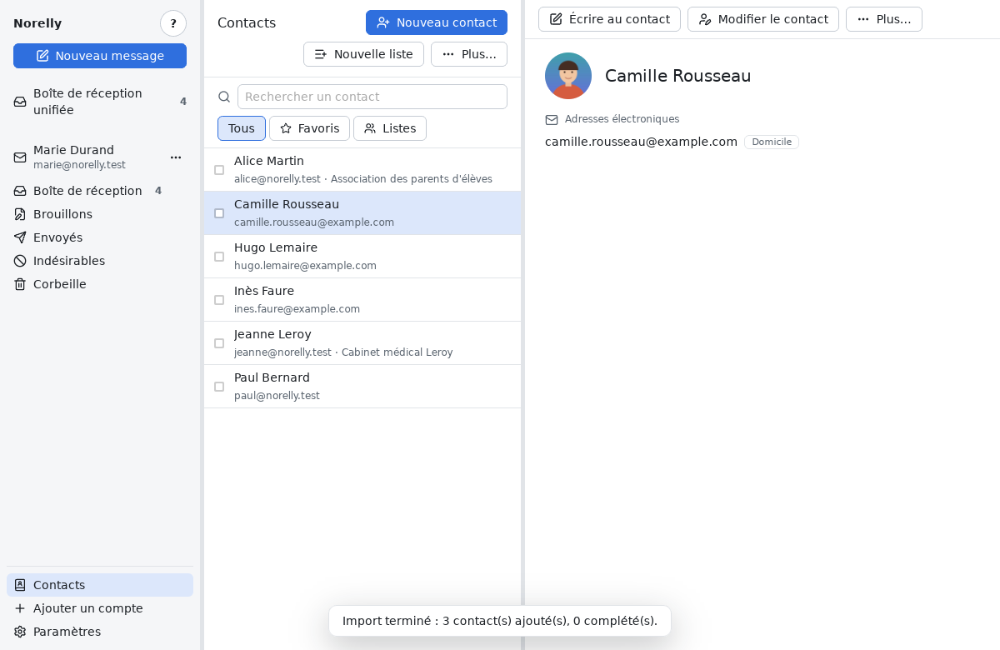

## Exporter vos contacts

Pour garder une copie de votre carnet, ou le reprendre dans un autre
logiciel :

1. Dans **Contacts**, cliquez sur **Exporter…**, en haut de la liste
   (dans **Plus…** si la fenêtre est étroite) ; tant que le carnet est
   vide, il est grisé : il n'y a rien à exporter. Pour n'exporter que
   quelques contacts, cochez-les d'abord, puis cliquez sur **Exporter…**
   dans la barre qui apparaît.
2. Choisissez le format : **vCard 4.0** convient presque partout (Gmail,
   iPhone, Android, Thunderbird) ; **vCard 3.0** pour un logiciel ancien ;
   **CSV** pour Outlook, un tableur ou Google Contacts (les contacts y
   arrivent dans « Mes contacts ») ; **LDIF** pour Thunderbird.
3. Cliquez sur **Exporter…**, choisissez le dossier et le nom du fichier,
   puis **Enregistrer**.

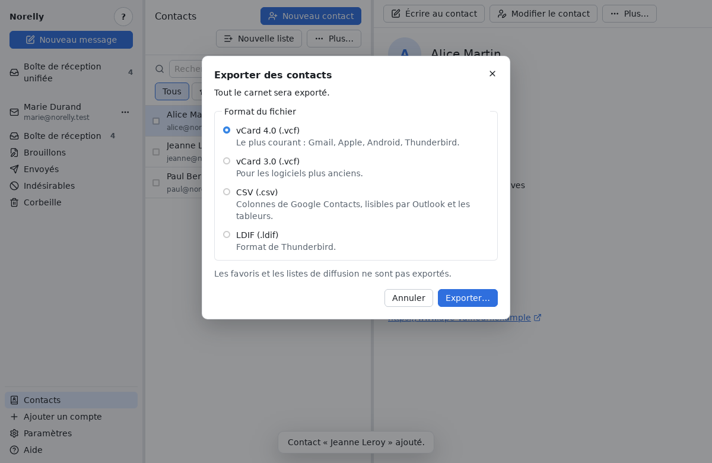

Les favoris sont gardés en vCard et en CSV (Google Contacts les range
dans ses favoris, et Norelly les retrouve à l'import), pas en LDIF. Les
listes de diffusion sont exportées avec tout le carnet, en vCard et en
LDIF ; elles ne le sont pas en CSV, ni quand vous n'exportez que quelques
contacts cochés. Les photos ne sont gardées que dans les fichiers vCard.
Dans un
fichier CSV ouvert avec un tableur, un numéro commençant par « + »
apparaît précédé d'une apostrophe : c'est voulu, pour que le tableur ne le
prenne pas pour un calcul.

## Fusionner les doublons

Si une même personne figure plusieurs fois dans vos contacts (après un
import, par exemple) :

1. Dans **Contacts**, cliquez sur **Plus…**, en haut de la liste, puis
   sur **Rechercher les doublons…**.
2. Norelly présente, un groupe à la fois, les contacts qui portent le même
   nom (avec ou sans accents : « Hélène » et « Helene » se ressemblent),
   le même numéro de téléphone ou la même adresse Gmail (Gmail
   ignore les points : « jean.dupont@gmail.com » et
   « jeandupont@gmail.com » sont la même boîte). Vérifiez qu'il s'agit
   bien de la même personne ; décochez une fiche pour la laisser de côté.
3. Choisissez la fiche à garder (**Garder cette fiche**), puis cliquez sur
   **Fusionner**. Quand les fiches ne portent pas exactement le même nom,
   accents compris, Norelly ne choisit pas à votre place : sélectionnez vous-même la fiche à garder.
   Sous la fiche gardée, Norelly indique le nom et l'adresse préférée que
   le contact aura après la fusion. Ou cliquez sur **Passer** pour voir le
   groupe suivant sans rien changer : ce groupe ne vous sera plus
   proposé, sauf si vous modifiez l'une de ses fiches.

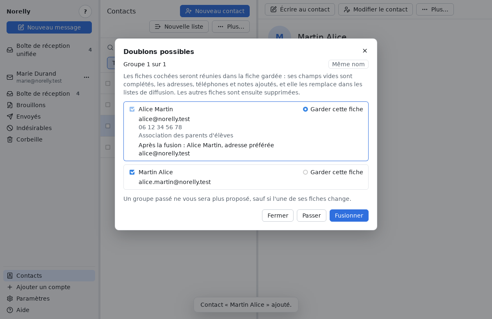

La fiche gardée reçoit les adresses, les téléphones et les notes des
autres, et complète ses champs vides ; rien de ce qu'elle contenait n'est
remplacé. Elle prend leur place dans vos listes de diffusion, puis les
autres fiches sont supprimées.

## Retrouver vos contacts sur vos autres appareils

Si votre fournisseur propose un serveur de contacts (CardDAV : Nextcloud,
Fastmail, Synology, Baïkal…), Norelly peut tenir votre carnet à jour avec
lui, dans les deux sens : un contact ajouté, modifié ou supprimé sur votre
téléphone l'est aussi dans Norelly, et inversement.

1. Créez un **mot de passe d'application** dans les réglages de sécurité
   de votre fournisseur.
2. Dans **Contacts**, cliquez sur **Plus…**, en haut de la liste, puis sur
   **Synchroniser avec un serveur…**.
3. Saisissez l'adresse du serveur (son nom suffit, par exemple
   `nextcloud.exemple.fr`), votre identifiant et le mot de passe
   d'application, puis cliquez sur **Rechercher les carnets**.
4. Choisissez le carnet à synchroniser, puis cliquez sur **Synchroniser ce
   carnet**.

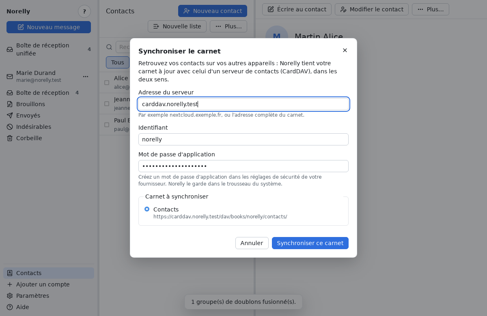

Le mot de passe est gardé dans le trousseau de votre système. Le carnet est
synchronisé à chaque ouverture de Norelly ; **Synchroniser maintenant**,
dans la même fenêtre, le fait tout de suite.

Bon à savoir :

- Une fiche modifiée des deux côtés garde la modification la plus récente.
- Norelly ne change sur le serveur que ce qu'il connaît (noms,
  organisation, adresses, téléphones, notes) : la photo ou l'anniversaire
  saisis sur votre téléphone sont gardés.
- Les favoris et les listes de diffusion restent dans Norelly seulement.
- Une fiche sans adresse électronique n'est pas reprise dans Norelly ; elle
  reste sur le serveur.
- Si votre carnet est plein, les nouvelles fiches du serveur attendent : la
  fenêtre de synchronisation dit combien. Supprimez les contacts dont vous
  n'avez plus besoin, elles arriveront à la synchronisation suivante.
- **Déconnecter** arrête la synchronisation ; vos contacts restent dans
  Norelly, et rien n'est supprimé sur le serveur.
- Par prudence, si beaucoup de contacts disparaissent d'un coup du serveur,
  Norelly ne les supprime pas : supprimez-les vous-même dans Norelly.
- Google Contacts et iCloud ne sont pas encore pris en charge.

## Supprimer des contacts

- Un contact : sur sa fiche, cliquez sur **Supprimer le contact**, puis
  confirmez.
- Plusieurs contacts : cochez la case au début de chaque ligne ; une
  barre apparaît en haut de la liste, avec **Supprimer le contact** et
  **Écrire au contact**. **Désélectionner les contacts** décoche tout.
  Vous pouvez cocher jusqu'à 1 000 contacts à la fois : au-delà, la case
  reste vide et la barre vous le signale.

Supprimer un contact ne touche pas à vos messages et le retire de ses
listes. La suppression est définitive.
