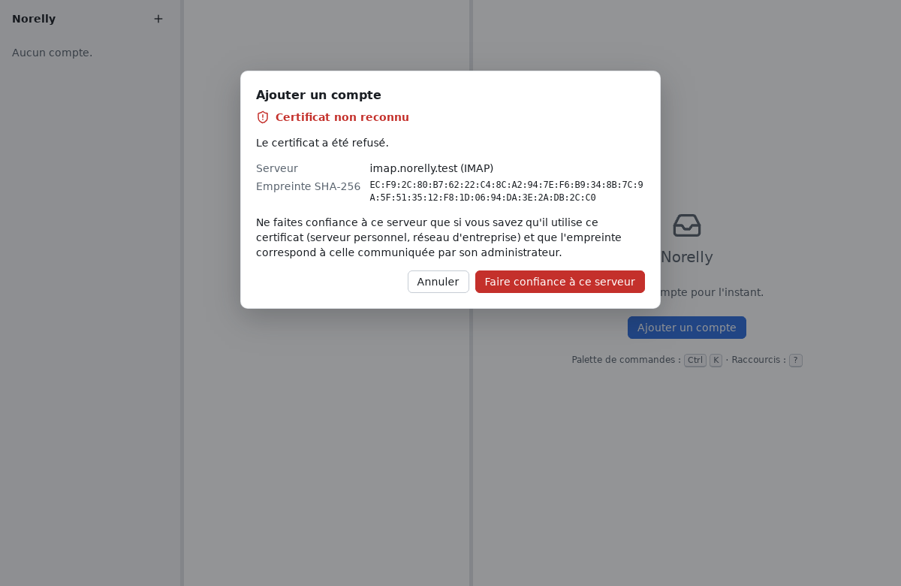

# Que faire quand un message d'erreur s'affiche ?

[← Retour au sommaire](README.md)

Les messages d'erreur de Norelly disent ce qui se passe et, le plus
souvent, quoi faire. Voici les plus fréquents, expliqués plus en détail.

## Certificat non reconnu

**Ce que vous voyez** : une fenêtre **Certificat non reconnu**, avec le nom
d'un serveur, une raison (par exemple « Le certificat a expiré. ») et une
longue suite de chiffres et de lettres appelée **empreinte**.

**Ce que cela veut dire** : Norelly n'a pas pu vérifier l'identité du
serveur. Soit le serveur est mal réglé, soit quelqu'un essaie de se faire
passer pour lui (sur un Wi-Fi public, par exemple) afin de lire vos
messages.

**Quoi faire** :

- Avec un grand fournisseur (Gmail, Outlook.com, Orange, Free, Fastmail…),
  **cliquez sur Annuler**. Réessayez plus tard, chez vous plutôt que sur
  un Wi-Fi public. Si le problème continue, vérifiez que la date et l'heure
  de votre ordinateur sont justes : une horloge déréglée rend les
  certificats « pas encore valides » ou « expirés ».
- Avec un serveur personnel ou celui de votre entreprise, demandez à son
  administrateur l'empreinte de son certificat. Si elle est identique à
  celle affichée, cliquez sur **Faire confiance à ce serveur**.

**Si le message dit « ce serveur présente un certificat différent de celui
que vous aviez accepté »** : soyez prudent. Le serveur a changé de
certificat, ce qui arrive lors d'un renouvellement, mais aussi lors d'une
interception. Ne continuez qu'après avoir vérifié la nouvelle empreinte
auprès de l'administrateur.

## Hors ligne

**Ce que vous voyez** : une petite icône de Wi-Fi barré à côté de
l'adresse du compte, dans le panneau de gauche. En passant la souris
dessus, la raison s'affiche (par exemple « Hors ligne : serveur
injoignable »).

**Ce que cela veut dire** : Norelly n'arrive pas à joindre votre
fournisseur : votre ordinateur n'est pas connecté à Internet, ou le
serveur ne répond pas pour le moment.

**Quoi faire** : rien de particulier. Norelly réessaie tout seul, de plus
en plus espacé, et reprend dès que la connexion revient. En attendant :

- vous pouvez **lire et rechercher** tous les messages déjà téléchargés ;
- vous pouvez **archiver, supprimer, déplacer** : ces actions sont gardées
  et envoyées au serveur au retour de la connexion ;
- vous pouvez **écrire et envoyer** : le message attend dans la boîte
  d'envoi et part tout seul plus tard.

Si l'icône reste affichée alors qu'Internet fonctionne (vous pouvez ouvrir
un site dans votre navigateur), demandez une synchronisation : cliquez sur
le bouton **⋯** à côté de l'adresse du compte, puis sur **Synchroniser**. Si cela ne suffit
pas, votre fournisseur a peut-être un problème passager : réessayez plus
tard.

## Compte Google : mot de passe d'application nécessaire

**Ce que vous voyez** : « Serveur de réception (IMAP) : identifiants
refusés : un compte Google demande un mot de passe d'application », puis
l'encadré **Créer un mot de passe d'application Google**.

**Ce que cela veut dire** : votre adresse est chez Google (Gmail, ou une
adresse d'entreprise gérée par Google), et Google refuse votre mot de
passe habituel dans un programme de messagerie.

**Quoi faire** : suivez les trois étapes de l'encadré. Le bouton **Ouvrir
la page Google** ouvre la page où créer le mot de passe d'application ;
collez-le ensuite dans le champ **Mot de passe**, qui a été vidé pour lui.
Le détail est dans
[Ajouter votre adresse](first-account.md#gmail).

## Connexion avec Google non aboutie

**Ce que vous voyez** : « La connexion avec Google n'a pas abouti… », puis
l'encadré **Créer un mot de passe d'application Google** et le champ
**Mot de passe**.

**Ce que cela veut dire** : la connexion dans la page de Google a été
refusée, abandonnée ou n'est pas revenue jusqu'à Norelly. Tant que Google
n'a pas validé Norelly, il limite le nombre de personnes qui peuvent s'y
connecter, et peut refuser un nouveau compte.

**Quoi faire** : si vous aviez simplement fermé la page, cliquez sur **Se
connecter avec Google plutôt**, puis recommencez (pensez à **Paramètres
avancés**, puis **Accéder à Norelly (non sécurisé)**). Sinon, utilisez un
mot de passe d'application : suivez les étapes de l'encadré (voir
[Ajouter votre adresse](first-account.md#gmail--le-mot-de-passe-dapplication)).

## Identifiants refusés (mot de passe refusé)

**Ce que vous voyez** : « Serveur de réception (IMAP) : identifiants
refusés. Vérifiez le nom d'utilisateur et le mot de passe (un mot de passe
d'application est parfois nécessaire). »

**Ce que cela veut dire** : votre fournisseur refuse l'adresse ou le mot
de passe.

**Quoi faire** :

1. Vérifiez le mot de passe : la touche **Verr. Maj** (majuscules) est-elle
   activée ? Le clavier est-il dans la bonne langue ?
2. **Gmail** : utilisez **Se connecter avec Google** ou un **mot de passe
   d'application**, pas votre mot de passe habituel (voir
   [Ajouter votre adresse](first-account.md#gmail--le-mot-de-passe-dapplication)).
   Si vous avez changé votre mot de passe Google, les anciens mots de passe
   d'application ont pu être annulés : créez-en un nouveau.
   **Outlook.com, Hotmail** : utilisez **Se connecter avec Microsoft**
   (voir [Outlook.com et Hotmail](first-account.md#outlookcom-et-hotmail--se-connecter-avec-microsoft)).
3. Si Norelly montre les réglages des serveurs, vérifiez le champ
   **Utilisateur** : c'est souvent l'adresse complète
   (`marie.durand@exemple.fr`), pas seulement `marie.durand`.
4. Essayez de vous connecter sur le site de votre fournisseur : votre
   compte est peut-être bloqué temporairement après plusieurs essais.

## Serveur injoignable

**Ce que vous voyez** : « serveur injoignable. Vérifiez le nom et le
port. »

**Quoi faire** : vérifiez votre connexion à Internet. Si Norelly vous
montre les réglages des serveurs, comparez le **Serveur** et le **Port**
avec la page d'aide de votre fournisseur : une seule lettre de travers
suffit à empêcher la connexion.

## Le serveur ne répond pas

**Ce que vous voyez** : « le serveur ne répond pas. Vérifiez votre
connexion à Internet, puis réessayez. »

Norelly a bien trouvé le serveur, mais celui-ci n'a pas répondu à temps
ou a coupé la connexion. Norelly a déjà réessayé plusieurs fois avant
d'afficher ce message.

Pour un compte Outlook.com ou Hotmail, si seul le serveur d'envoi ne
répond pas, Norelly ajoute quand même le compte : « Compte ajouté. L'envoi n'a pas pu être vérifié… ». Vous recevez
vos messages tout de suite ; l'envoi sera essayé à votre premier message,
et un message qui ne part pas reste dans la **boîte d'envoi**.

**Quoi faire** : vérifiez votre connexion à Internet, attendez quelques
minutes, puis cliquez de nouveau sur le bouton. Si le problème dure, essayez
depuis une autre connexion (par exemple le partage de connexion de votre
téléphone) : certains réseaux ont du mal à joindre certains fournisseurs.

## Envoi impossible

**Ce que vous voyez** : en bas de la fenêtre, « Envoi impossible : « sujet
du message » (raison) ».

**Quoi faire** : ouvrez la **boîte d'envoi** (bouton **⋯** à côté de
l'adresse du compte, puis **Boîte d'envoi**). Vous y retrouvez le message :

- **Réessayer** le renvoie ;
- **Annuler l'envoi** le retire de la file : il ne partira pas.

Si la raison est « envoi interrompu, peut-être parti », Norelly a été
fermé ou la connexion coupée au moment précis de l'envoi. Le message est
peut-être arrivé : regardez dans le dossier **Envoyés** du site de votre
fournisseur, ou demandez au destinataire, avant de cliquer sur
**Réessayer** pour ne pas l'envoyer deux fois.

## Autres messages

| Message | Quoi faire |
|---|---|
| « Aucun trousseau » | Votre Linux n'a pas de coffre-fort à mots de passe actif. Installez ou démarrez GNOME Keyring ou KWallet (demandez de l'aide si besoin). Sinon, Norelly propose d'enregistrer le mot de passe dans un fichier **non chiffré** : acceptez seulement si personne d'autre n'utilise votre session. |
| « Trousseau du système indisponible » | Norelly n'arrive pas à lire votre coffre-fort à mots de passe, souvent parce qu'il est verrouillé. Déverrouillez-le (sous Linux, une fenêtre le demande parfois ; sinon, fermez puis rouvrez votre session) : Norelly réessaie tout seul, et les messages en attente partent ensuite. |
| « Norelly n'a pas reçu l'autorisation de rester connecté » | Dans la page de connexion de Microsoft, une autorisation a été refusée. Recommencez et acceptez toutes les autorisations demandées : sans elles, le compte cesserait de fonctionner au bout d'une heure. |
| « Connexion non chiffrée » | Le serveur ne propose pas de connexion protégée. Ne cliquez sur **Autoriser** que pour un serveur que vous connaissez, sur votre propre réseau ; sinon, cliquez sur **Modifier les paramètres** et choisissez **TLS**. |
| « Aucun dossier d'archives sur ce compte » | Choisissez une fois pour toutes le dossier où archiver : bouton **⋯** à côté de l'adresse du compte, puis **Choisir le dossier d'archives…**. |
| « Les pièces jointes dépassent 25 Mio. » | Retirez des fichiers, ou envoyez-les en plusieurs messages. Pour de très gros fichiers, utilisez un service de partage de fichiers. |
| « Trop tard pour annuler » | L'action a déjà été faite sur le serveur. Faites l'action inverse (par exemple, déplacez le message de la Corbeille vers la Boîte de réception). |
| « Type de fichier exécutable » | Norelly refuse d'ouvrir directement un programme reçu par courriel. Utilisez **Enregistrer…** si vous l'attendiez vraiment. |
| « Images distantes bloquées » | Ce n'est pas une erreur : voir [les images bloquées](everyday.md#les-images-bloquées). |
