# Utiliser Norelly au quotidien

[← Retour au sommaire](README.md)

Cette page explique les gestes de tous les jours. Tout se fait **à la
souris**, avec des boutons écrits en toutes lettres. Le clavier est
facultatif : chaque bouton montre sa touche quand vous laissez la souris
dessus un instant, et le bouton **?** en haut à gauche affiche
[l'aide-mémoire](shortcuts.md) des raccourcis.

## Lire un message

1. Dans le panneau de gauche, cliquez sur un dossier, par exemple
   **Boîte de réception**. Pour voir ensemble les messages de toutes vos
   adresses, cliquez sur **Boîte de réception unifiée**.
2. Dans la liste du milieu, cliquez sur un message. Il s'affiche à droite.
   Les messages non lus sont écrits en gras. Ouvrir un message ne le marque
   pas comme lu : quand vous l'avez lu, cliquez sur **Plus…** dans la barre
   d'actions, puis sur **Marquer comme lu** (ou appuyez sur **Maj** + **I**).
3. Pour revenir à la liste, cliquez sur la flèche **Retour à la liste**
   ou appuyez sur **Échap**.

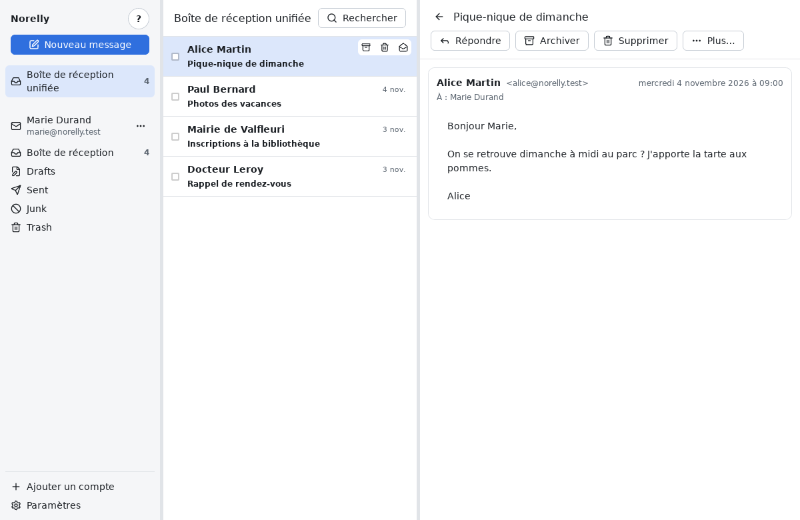

Quand plusieurs messages se répondent, ils forment une **conversation** :
ils sont empilés du plus ancien au plus récent. Cliquez sur l'en-tête d'un
message pour le déplier ou le replier.

Pour passer à la conversation suivante ou précédente sans revenir à la
liste : **Plus…**, puis **Conversation suivante** ou **Conversation
précédente** (au clavier : **J** et **K**).

### Les images bloquées

Certains messages contiennent des images placées sur Internet. Elles
servent souvent à savoir si, et quand, vous avez ouvert le message. Norelly
les bloque et affiche un bandeau : **Images distantes bloquées**.

Si vous faites confiance à l'expéditeur, cliquez sur **Afficher les images
de cet expéditeur** : Norelly s'en souviendra pour ses prochains messages.
Attention, l'adresse d'un expéditeur peut être imitée : n'autorisez que les
expéditeurs dont les images vous sont vraiment utiles.

### Les pièces jointes

Les fichiers joints apparaissent sous le message, avec leur nom et leur
taille :

- **Ouvrir** ouvre le fichier avec le programme habituel de votre
  ordinateur (par exemple votre lecteur de PDF) ;
- **Enregistrer…** vous demande dans quel dossier ranger le fichier.

Par sécurité, **Ouvrir** ne fonctionne que pour les fichiers courants :
PDF, images, textes, documents Word, Excel, PowerPoint ou LibreOffice
récents, sons et vidéos. Les autres (programmes `.exe`, scripts, anciens
documents Office pouvant contenir des macros…) peuvent seulement être
enregistrés. N'ouvrez un programme reçu par courriel que si vous
l'attendiez.

## Répondre

1. Ouvrez le message, ou faites un **clic droit** dessus dans la liste.
2. Cliquez sur **Répondre**. Pour répondre à tout le monde (l'expéditeur et
   les autres destinataires), cliquez sur **Répondre à tous**. Si la
   fenêtre est étroite, ce bouton se range dans **Plus…**. Au clavier :
   **R** et **A**.
3. La fenêtre de rédaction s'ouvre : le destinataire et l'objet
   (« Re: … ») sont déjà remplis, et le message d'origine est cité en
   dessous. Écrivez votre réponse.
4. Cliquez sur **Envoyer**, ou appuyez sur **Ctrl** + **Entrée**.

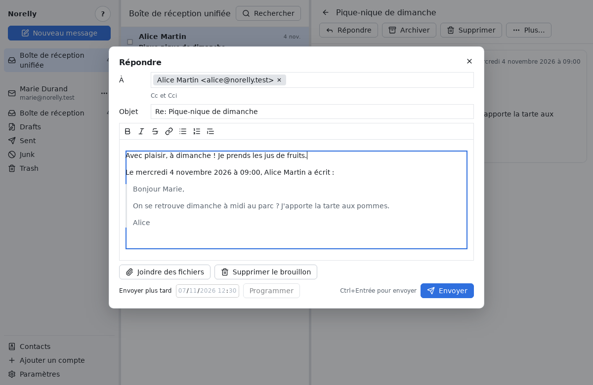

Pour **transférer** un message à quelqu'un d'autre, avec ses pièces
jointes, cliquez sur **Transférer** (au clavier : **F**).

## Écrire un nouveau message

1. Cliquez sur le bouton bleu **Nouveau message**, en haut à gauche (au
   clavier : **C**). Le message part de l'adresse sélectionnée dans le
   panneau de gauche.
2. Dans **À**, tapez l'adresse du destinataire. Norelly propose les
   adresses que vous connaissez déjà : choisissez avec les flèches du
   clavier puis **Entrée**, ou cliquez dessus. Vous pouvez mettre
   plusieurs destinataires.
3. Pour mettre quelqu'un **en copie** (**Cc**) ou **en copie cachée**
   (**Cci** : les autres destinataires ne le voient pas), cliquez sur
   **Cc et Cci**.
4. Remplissez l'**Objet** (le sujet du message), puis écrivez votre texte.
   Les boutons au-dessus du texte mettent en **gras**, en *italique*,
   ajoutent une liste ou un lien : laissez la souris sur un bouton pour
   voir son nom.
5. Cliquez sur **Envoyer** (ou **Ctrl** + **Entrée**).

Si vous n'êtes pas connecté à Internet, ce n'est pas grave : le message
attend dans la **boîte d'envoi** et part tout seul dès le retour de la
connexion.

### Envoyer plus tard

Dans la fenêtre de rédaction, cliquez sur **Envoyer plus tard**, choisissez
la date et l'heure, puis **Programmer**. Jusque-là, vous pouvez modifier ou
annuler l'envoi depuis la **boîte d'envoi** : bouton **⋯** à côté de
l'adresse du compte, dans le panneau de gauche, puis **Boîte d'envoi**.

## Joindre un fichier

Dans la fenêtre de rédaction :

- cliquez sur **Joindre des fichiers**, puis choisissez un ou plusieurs
  fichiers ;
- ou faites glisser un fichier depuis votre explorateur de fichiers jusque
  dans la fenêtre de Norelly.

Le fichier apparaît sous le texte, avec sa taille. Pour le retirer, cliquez
sur la croix à côté de son nom. L'ensemble des pièces jointes d'un message
ne peut pas dépasser 25 Mio (environ 25 mégaoctets) : au-delà, la plupart
des fournisseurs refuseraient le message.

## Ranger : archiver, déplacer, suivre

Quand un message est ouvert, la barre d'actions au-dessus du message
propose **Archiver** et **Supprimer** ; les autres actions sont dans
**Plus…**. Dans la liste :

- quand la souris passe sur une ligne, trois petits boutons apparaissent :
  archiver, supprimer, marquer comme lu ou non lu ;
- un **clic droit** sur une ligne ouvre un menu avec toutes les actions,
  et la touche de chacune à droite.

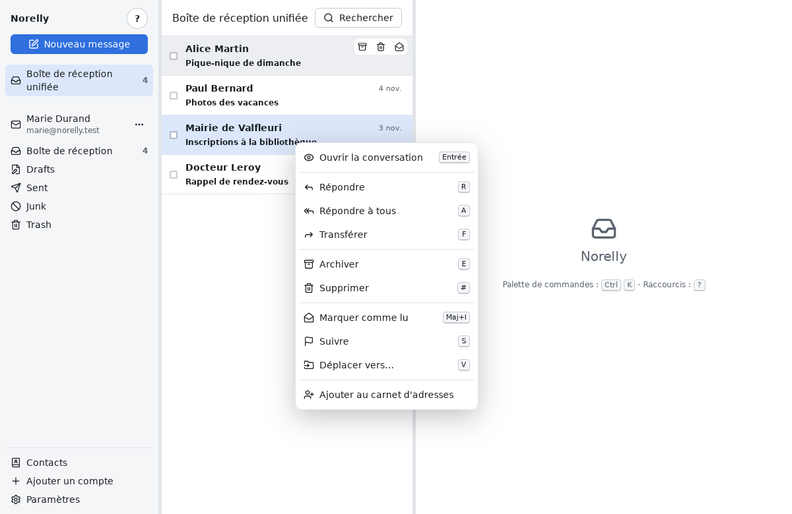

| Action | À quoi ça sert | Touche |
|---|---|---|
| **Archiver** | Retire le message de la boîte de réception sans le supprimer : il reste dans les archives. | **E** |
| **Déplacer vers…** | Range le message dans le dossier de votre choix. | **V** |
| **Suivre** | Marque le message d'un drapeau, pour ne pas l'oublier. | **S** |
| **Marquer comme lu / non lu** | Le message redevient gras (non lu), ou non. | **Maj** + **U** / **Maj** + **I** |

Pour **déplacer**, une liste de vos dossiers s'ouvre : cliquez sur le
dossier voulu, ou tapez quelques lettres de son nom puis **Entrée**.

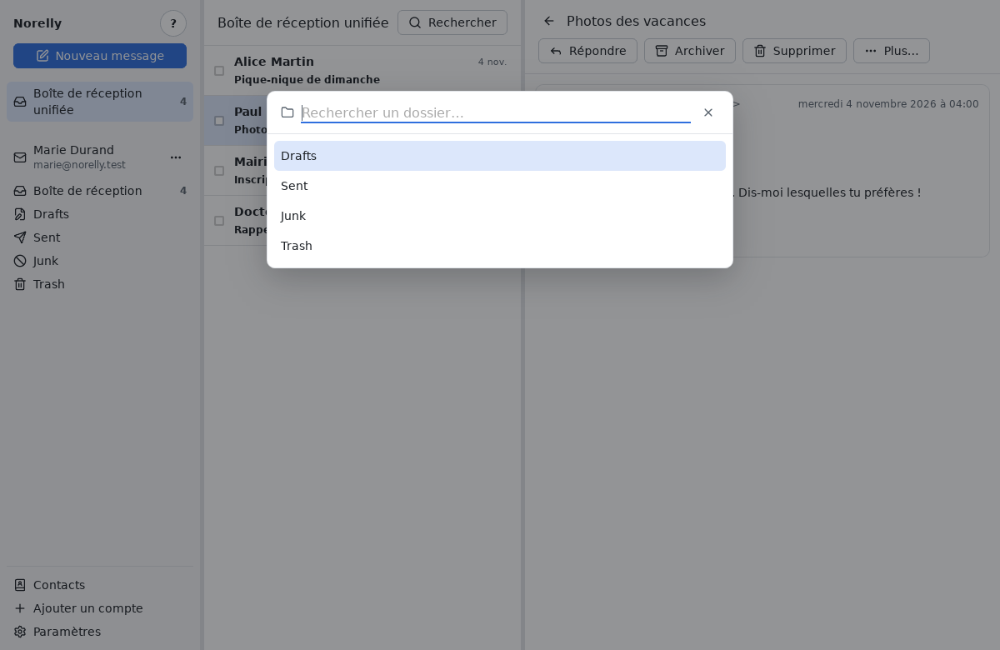

Vous pouvez aussi **glisser** un message dans un dossier : cliquez sur le
message dans la liste, gardez le bouton de la souris enfoncé, amenez-le sur
un dossier du panneau de gauche, puis relâchez. Le dossier qui va recevoir
le message est encadré. Si vous avez coché plusieurs messages, glissez l'un
d'eux : ils partent tous ensemble. Pour renoncer, relâchez ailleurs ou
appuyez sur **Échap**. Comme pour **Déplacer vers…**, vous pouvez annuler
juste après.

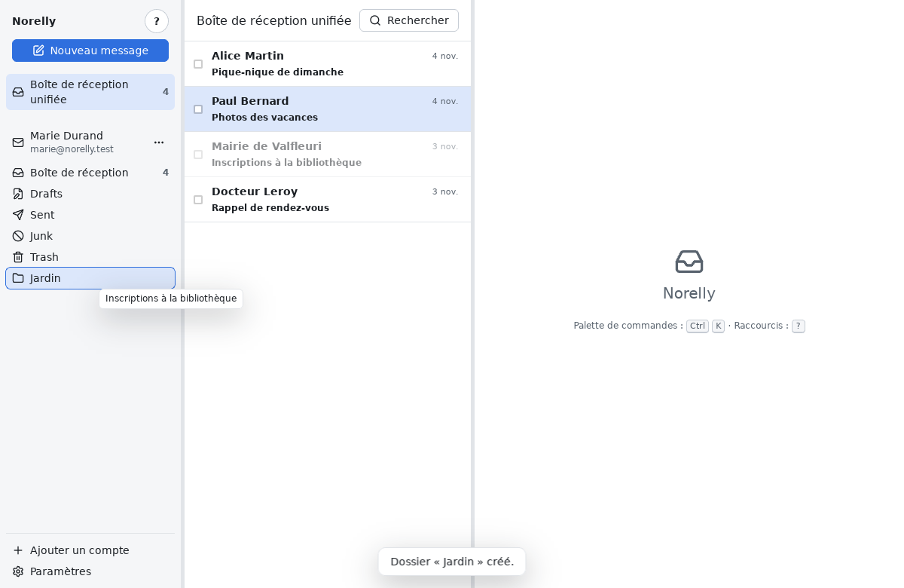

Pour **créer un dossier** :

1. Dans le panneau de gauche, cliquez sur **⋯** à côté de votre compte,
   puis sur **Nouveau dossier…**.
2. Tapez son nom. Pour le ranger dans un dossier existant, choisissez-le
   dans **Emplacement** ; sinon, laissez « Au premier niveau ».
3. Cliquez sur **Créer**.

Le dossier apparaît dans le panneau de gauche et dans la liste **Déplacer
vers…**. Il est créé chez votre fournisseur : vous le retrouvez aussi sur
son site et dans vos autres applications.

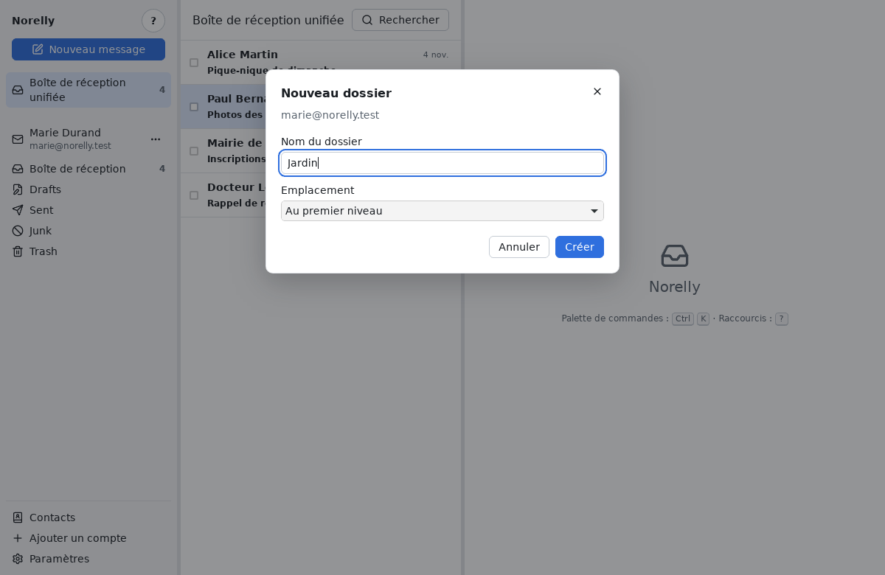

Pour **renommer**, **déplacer** ou **supprimer** un de vos dossiers,
passez la souris sur son nom dans le panneau de gauche, cliquez sur le
**⋯** qui apparaît à droite, puis sur **Renommer le dossier…**,
**Déplacer le dossier…** ou **Supprimer le dossier…**.

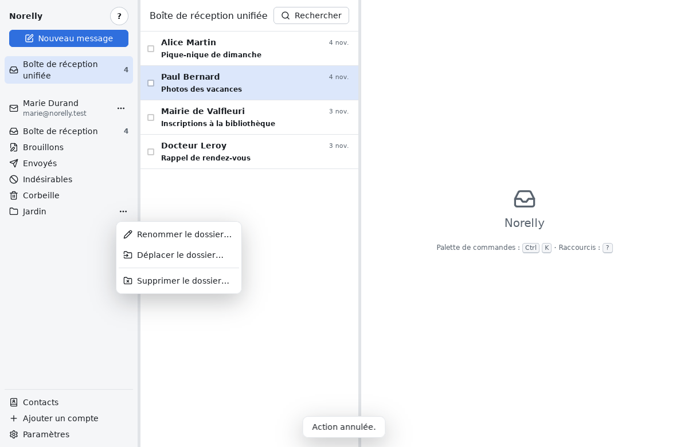

- **Renommer** : tapez le nouveau nom, puis cliquez sur **Renommer**. Le
  dossier garde sa place, ses messages et ses sous-dossiers.

  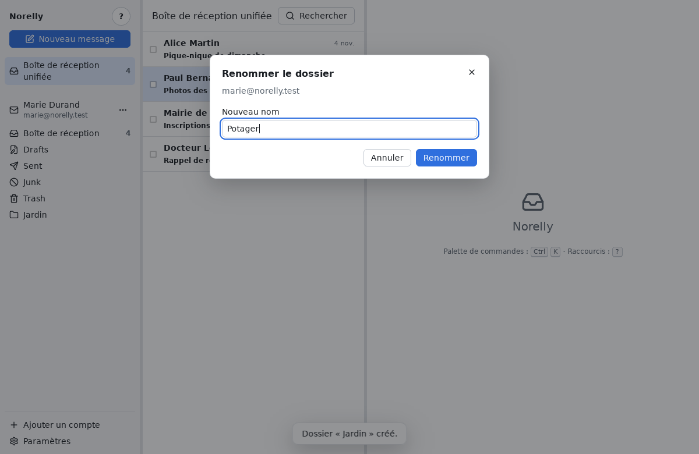

- **Déplacer** : choisissez le **nouvel emplacement**, « Au premier
  niveau » ou un autre dossier, puis cliquez sur **Déplacer**. Le dossier
  garde son nom ; ses messages et ses sous-dossiers le suivent. C'est
  ainsi qu'on range un dossier dans un autre pour réorganiser ses
  dossiers.

  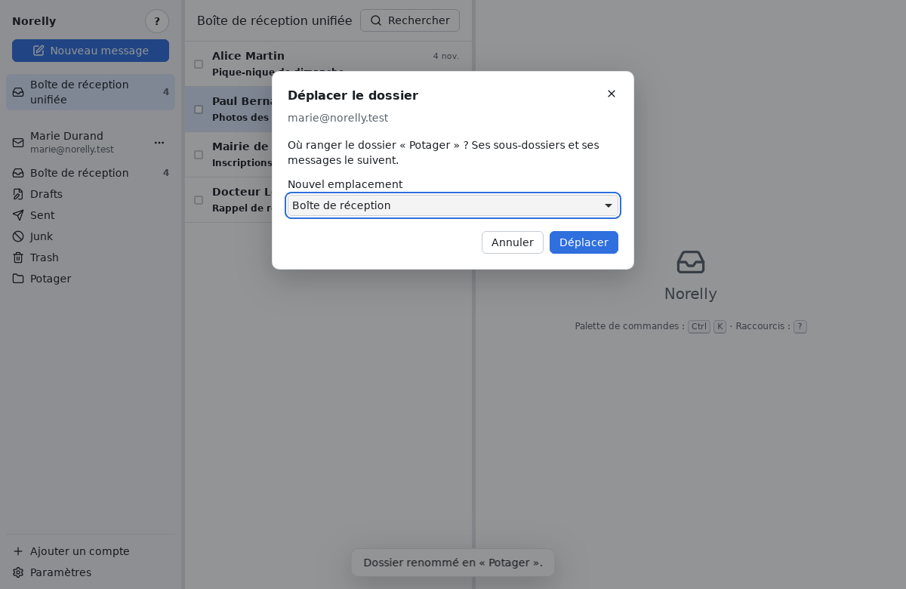

  Plus rapide : **glissez** le dossier avec la souris et lâchez-le sur un
  autre dossier pour l'y ranger, ou sur la ligne de votre compte (votre
  nom et votre adresse) pour le remettre au premier niveau. La cible est
  encadrée pendant que vous la survolez ; appuyez sur **Échap** pour
  annuler.

  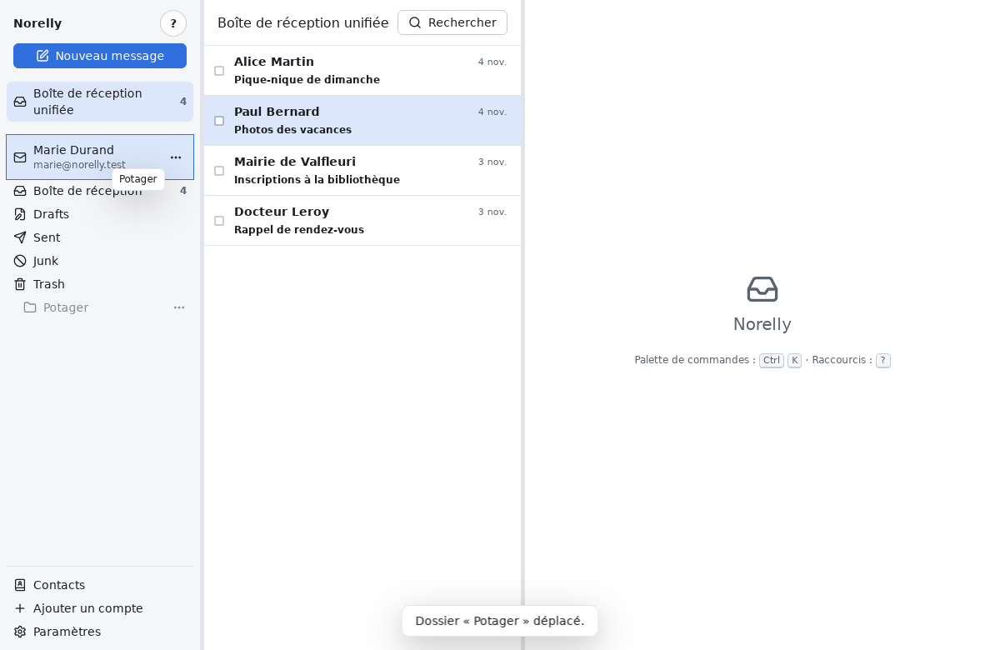

- **Supprimer** : une fenêtre vous demande de confirmer. Attention, les
  messages du dossier sont **supprimés définitivement**, sans passer par la
  corbeille : déplacez d'abord ceux que vous voulez garder. Un dossier qui
  contient des sous-dossiers ne peut pas être supprimé : supprimez d'abord
  ses sous-dossiers.

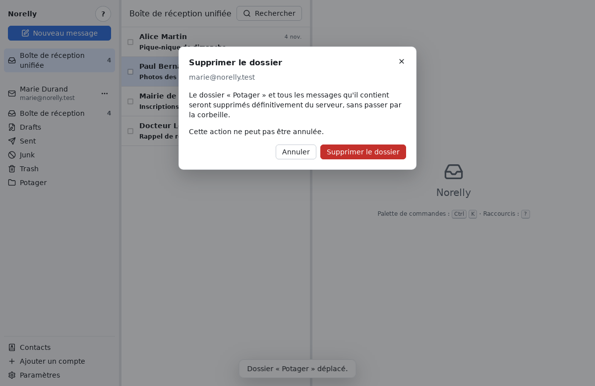

La boîte de réception et les dossiers spéciaux (Envoyés, Brouillons,
Corbeille…) ne peuvent être ni renommés, ni déplacés, ni supprimés.

Pour agir sur **plusieurs messages d'un coup**, cochez la case au début de
chaque ligne voulue. Une barre apparaît au-dessus de la liste : elle
indique combien de messages sont sélectionnés et propose les actions, qui
s'appliquent à tous. **Tout désélectionner** retire toutes les coches. Au
clavier, **X** coche ou décoche le message choisi.

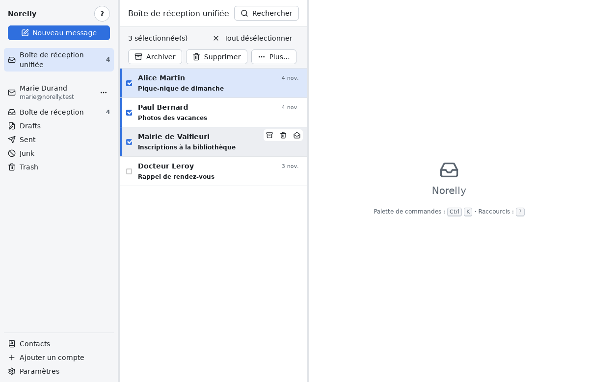

**Annuler** : après chaque action, un bandeau apparaît en bas avec un
bouton **Annuler** (ou la touche **Z**).

## Supprimer

Cliquez sur **Supprimer** dans la barre d'actions, sur la petite corbeille
qui apparaît au survol d'une ligne, ou appuyez sur **#** (**Maj** + **3** sur un clavier français, selon le
modèle).

Le message va dans la **Corbeille** : il n'est pas perdu. Pour le
récupérer, ouvrez le dossier **Corbeille** et déplacez-le ailleurs.
Supprimer un message **depuis la Corbeille** l'efface définitivement.

## Rechercher un message

1. Cliquez sur **Rechercher**, en haut de la liste (au clavier : **/**).
2. Tapez un mot : un nom, un mot du sujet ou du texte. Les résultats
   s'affichent au fur et à mesure, le mot trouvé surligné.
3. Cliquez sur un résultat (ou **Entrée**) pour l'ouvrir. La croix (ou
   **Échap**) ferme la recherche.

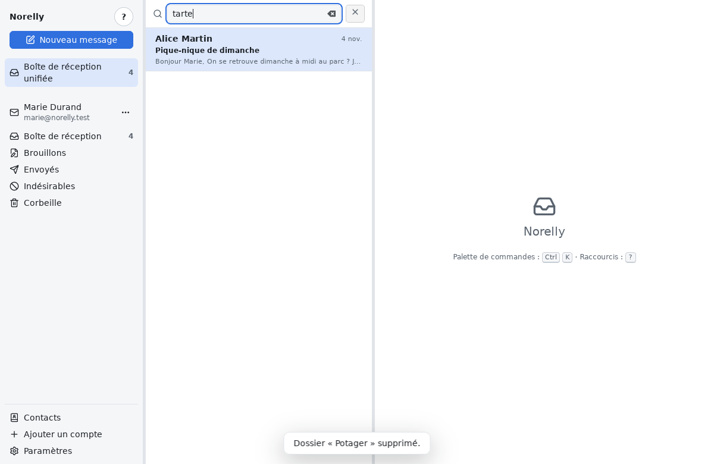

La recherche fonctionne **même sans Internet** : elle se fait dans la copie
de vos messages rangée sur votre ordinateur. Les accents et les majuscules
n'ont pas d'importance.

Pour affiner, vous pouvez ajouter :

| Écrivez | Pour trouver |
|---|---|
| `from:alice` | les messages d'Alice |
| `to:paul` | les messages envoyés à Paul |
| `subject:facture` | les messages dont le sujet contient « facture » |
| `"bonne année"` | cette expression exacte |
| `has:attachment` | les messages avec une pièce jointe |
| `is:unread` | les messages non lus (`is:read` : lus, `is:flagged` : suivis) |
| `after:2026-01-31` | les messages reçus à partir du 31 janvier 2026 (`before:` : avant) |
| `-publicité` | les messages qui **ne** contiennent **pas** ce mot |

## Retrouver un brouillon

Norelly enregistre tout seul ce que vous écrivez. Si vous fermez la
fenêtre de rédaction (**Échap** ou la croix), votre message devient un
**brouillon** : rien n'est perdu.

Pour le reprendre : dans le panneau de gauche, cliquez sur le bouton **⋯**
à côté de l'adresse du compte, puis sur **Brouillons…**. Cliquez sur le
brouillon voulu : il se rouvre, prêt à être terminé et envoyé.

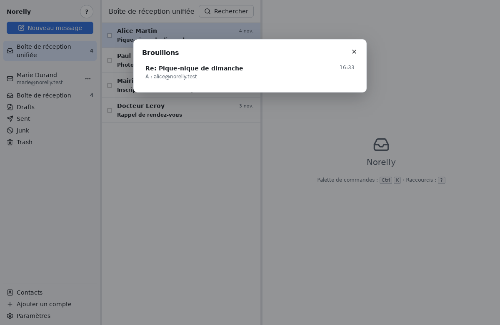

Les brouillons commencés sur un autre appareil (téléphone, site du
fournisseur) apparaissent aussi, sous **Dans le dossier Brouillons du
serveur**.

Pour jeter un brouillon, ouvrez-le puis cliquez sur **Supprimer le
brouillon**.

## Aller plus vite avec le clavier

Les raccourcis sont facultatifs. Le bouton **?**, en haut à gauche, les
affiche tous, rangés par thème. La **palette de commandes** (**Ctrl** +
**K**, ou le bouton **Palette de commandes** de cette aide) retrouve
n'importe quelle action en tapant quelques lettres de son nom
(« répondre », « brouillon », « déplacer »…), puis **Entrée**.

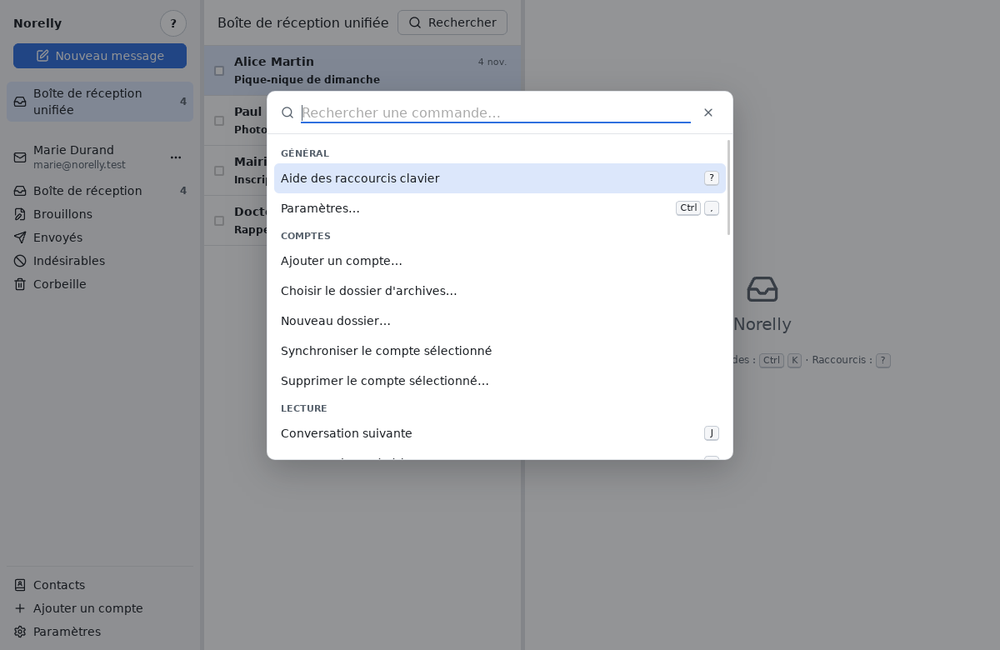
