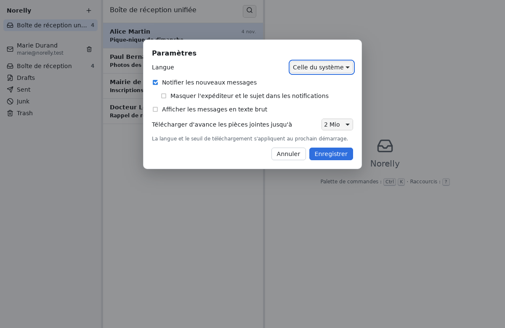

# Questions fréquentes

[← Retour au sommaire](README.md)

## Mes messages sont-ils supprimés de chez mon fournisseur ?

Non. Norelly travaille **avec** votre fournisseur : ce que vous faites dans
Norelly (lire, ranger, supprimer) est fait aussi chez lui, et inversement.
Si vous lisez un message sur votre téléphone, il apparaît comme lu dans
Norelly. Retirer un compte de Norelly ne supprime rien chez votre
fournisseur.

## Puis-je utiliser Norelly sans Internet ?

Oui, pour tout ce qui est déjà sur votre ordinateur : lire, rechercher,
ranger, écrire. Les actions et les envois attendent le retour de la
connexion (voir [Hors ligne](errors.md#hors-ligne)). Les nouveaux messages,
eux, ne peuvent évidemment arriver qu'avec Internet.

## Comment savoir si un nouveau message est arrivé ?

Les nouveaux messages arrivent tout seuls en quelques secondes, sans rien
faire. Si la fenêtre de Norelly est cachée derrière une autre, une
**notification** du système s'affiche (un petit cadre dans un coin de
l'écran).

## Je ne veux pas que mes voisins de bureau lisent mes notifications

Dans les **Paramètres** (**Ctrl** + **,**), cochez **Masquer l'expéditeur
et le sujet dans les notifications** : la notification dira seulement
qu'un message est arrivé. Vous pouvez aussi décocher **Notifier les
nouveaux messages**.

## Comment changer la langue de Norelly ?

Dans les **Paramètres**, choisissez la **Langue** (français, anglais, ou
celle du système), puis **Enregistrer**. Le changement s'applique au
prochain démarrage de Norelly.

## Les messages s'affichent mal, ou je préfère le texte simple

Certains messages très décorés s'affichent mieux en texte simple. Sous le
message, cliquez sur **Afficher en texte brut** (et **Afficher le HTML**
pour revenir). Pour l'avoir toujours, cochez **Afficher les messages en
texte brut** dans les **Paramètres**.

## Pourquoi certaines images ne s'affichent pas ?

Pour protéger votre vie privée : voir
[les images bloquées](everyday.md#les-images-bloquées).

## Où sont rangés mes messages sur mon ordinateur ?

Dans le dossier de données de Norelly, qui appartient à votre seule
session :

- sous Windows : `%APPDATA%\io.github.gbourquet.Norelly` ;
- sous Linux : `~/.local/share/io.github.gbourquet.Norelly` (ou
  `~/.var/app/io.github.gbourquet.Norelly` avec Flathub).

Ce dossier n'est pas chiffré par Norelly : protégez votre session par un
mot de passe et, si possible, activez le chiffrement du disque de votre
ordinateur (BitLocker sous Windows, chiffrement proposé à l'installation
sous Linux).

## Norelly envoie-t-il des informations sur moi ?

Non. Norelly ne contient aucun outil de statistiques ni de publicité. Il
se connecte uniquement à vos fournisseurs de messagerie, à la recherche de
réglages lors de l'ajout d'un compte, aux images que vous avez acceptées et,
si vous l'avez accepté sous Windows, au site de Norelly pour vérifier les
mises à jour (sans aucun identifiant).

## Outlook.com refuse mon mot de passe d'application

Microsoft restreint de plus en plus l'accès des programmes de messagerie
par mot de passe et demande une connexion par sa propre page
(« authentification moderne »), que Norelly ne sait pas encore faire. Si
Norelly affiche « identifiants refusés » avec un mot de passe d'application
correct, votre compte Outlook.com ne peut pas encore être utilisé dans
Norelly. Cette connexion est prévue dans une prochaine version.

## Mon fournisseur n'est pas trouvé automatiquement

Norelly connaît la plupart des fournisseurs, mais pas tous. Il vous montre
alors les réglages des serveurs à remplir : voir
[Si Norelly vous montre les réglages des serveurs](first-account.md#si-norelly-vous-montre-les-réglages-des-serveurs).

## Comment faire pour tout faire au clavier ?

Voir [l'aide-mémoire des raccourcis](shortcuts.md). Dans Norelly, la touche
**?** affiche aussi la liste des raccourcis.

## Où signaler un problème ?

Sur <https://github.com/gbourquet/norelly/issues> (en français ou en
anglais). Décrivez ce que vous faisiez, ce qui s'est passé et le message
affiché. **N'envoyez jamais votre mot de passe**, ni le contenu de messages
privés.
