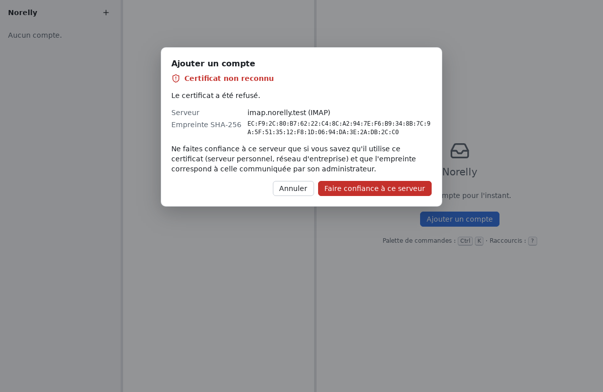
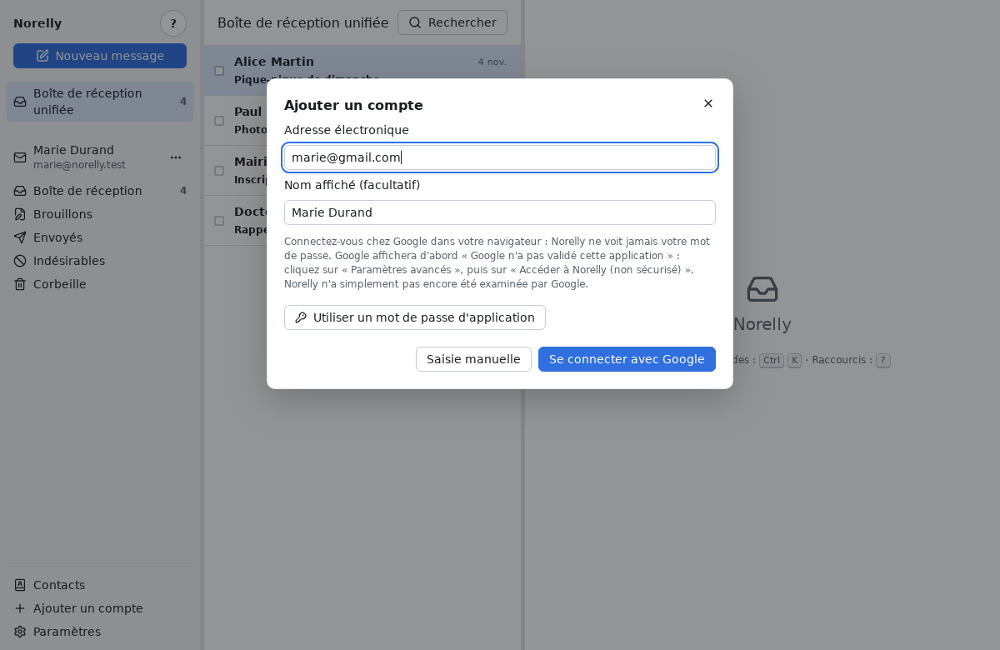
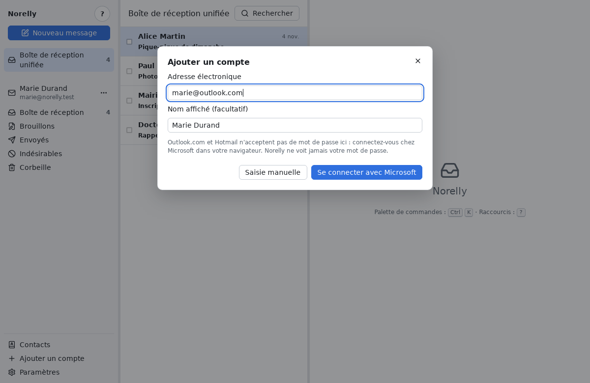

# Ajouter votre adresse électronique

[← Retour au sommaire](README.md)

Dans Norelly, chaque adresse électronique s'appelle un **compte**. Vous
pouvez en ajouter plusieurs (par exemple une adresse personnelle et une
adresse pour une association).

## Ce qu'il vous faut

- votre **adresse électronique**, par exemple `marie.durand@exemple.fr` ;
- son **mot de passe**. Pour Gmail, aucun mot de passe n'est demandé : voir
  [Gmail : se connecter avec Google](#gmail--se-connecter-avec-google)
  (un **mot de passe d'application** reste possible :
  [la partie Gmail](#gmail--le-mot-de-passe-dapplication)). Pour
  Outlook.com et Hotmail non plus : voir
  [Outlook.com et Hotmail](#outlookcom-et-hotmail--se-connecter-avec-microsoft).

## Étape par étape

1. Cliquez sur **Ajouter un compte** : sur l'accueil si c'est votre
   premier compte, sinon sur le bouton **+** en haut du panneau de gauche.
2. Tapez votre **adresse électronique** et votre **mot de passe**. Le
   **nom affiché** est facultatif : c'est le nom que vos correspondants
   verront à côté de votre adresse (par exemple « Marie Durand »).

   

3. Cliquez sur **Continuer**. Norelly cherche tout seul les réglages de
   votre fournisseur : patientez quelques secondes.
4. Le plus souvent, c'est tout : Norelly teste la connexion, puis votre
   adresse apparaît dans le panneau de gauche et vos messages arrivent.
   La première fois, le téléchargement de vos messages peut prendre
   quelques minutes si vous en avez beaucoup. Vous pouvez déjà lire les
   premiers arrivés : dossiers et messages apparaissent au fur et à
   mesure. Tant que ce n'est pas fini, la ligne **Synchronisation…**
   s'affiche sous votre adresse, avec le nombre de dossiers déjà traités
   (par exemple « 12 / 61 »).

Votre mot de passe est rangé dans le **trousseau** de votre système (le
coffre-fort à mots de passe de Windows ou de Linux). Seule exception : sous
Linux, si aucun trousseau ne répond, Norelly peut vous proposer de
l'enregistrer dans un fichier **non chiffré** ; il ne le fait que si vous
l'acceptez (voir [les messages d'erreur](errors.md#autres-messages)).

### Si Norelly vous montre les réglages des serveurs

Quand Norelly ne trouve pas tout seul les réglages, il vous affiche deux
cadres : **Réception (IMAP)** et **Envoi (SMTP)**. Votre fournisseur
donne ces informations sur sa page d'aide (cherchez « IMAP » et « SMTP »
avec le nom de votre fournisseur).

- **Serveur** : un nom comme `imap.exemple.fr` (réception) ou
  `smtp.exemple.fr` (envoi) ;
- **Port** : un nombre, le plus souvent `993` pour la réception et `465`
  ou `587` pour l'envoi ;
- **Sécurité** : gardez **TLS (recommandé)**, ou **STARTTLS** si votre
  fournisseur l'indique (souvent avec le port `587` ou `143`). Ne
  choisissez **Aucune (non chiffré)** que si vous savez exactement
  pourquoi ;
- **Utilisateur** : le plus souvent votre adresse complète.

Cliquez ensuite sur **Tester et ajouter**.

### Si Norelly vous parle de certificat

Un **certificat** est la carte d'identité d'un serveur. Si Norelly ne
peut pas la vérifier, il s'arrête et vous montre cet écran.

Avec les grands fournisseurs (Gmail, Outlook.com, Orange, Free…), cet
écran **ne doit jamais apparaître** : s'il apparaît, cliquez sur
**Annuler** et réessayez plus tard, depuis un autre réseau (votre box
plutôt qu'un Wi-Fi public). Voir aussi
[les messages d'erreur](errors.md#certificat-non-reconnu).

Ne cliquez sur **Faire confiance à ce serveur** que pour un serveur que
vous connaissez (un serveur personnel, celui de votre entreprise), et si
son administrateur vous a confirmé l'**empreinte** affichée.

## Gmail : se connecter avec Google

Avec une adresse Gmail, vous vous connectez sur la page de Google, dans
votre navigateur, sans donner votre mot de passe à Norelly :

1. Dans la fenêtre **Ajouter un compte**, tapez votre adresse (par exemple
   `marie.durand@gmail.com`). Le champ **Mot de passe** disparaît et le
   bouton **Se connecter avec Google** apparaît.
2. Cliquez sur **Se connecter avec Google**. Votre navigateur s'ouvre sur
   la page de Google : choisissez le compte de l'adresse tapée.
3. Google affiche alors un avertissement : **« Google n'a pas validé cette
   application »**. Norelly n'a simplement pas encore été examinée par
   Google. Pour continuer, cliquez sur **Paramètres avancés**, puis sur
   **Accéder à Norelly (non sécurisé)**. Norelly vous le rappelle à
   l'écran avant d'ouvrir le navigateur.
4. Acceptez que Norelly accède à vos messages, puis revenez dans Norelly
   quand le navigateur affiche « vous pouvez fermer cette page ». Le compte
   apparaît dans la colonne de gauche.

Norelly ne voit jamais votre mot de passe Google. Il reçoit une
autorisation, rangée dans le trousseau du système, qu'il renouvelle tout
seul. Si elle cesse de fonctionner, un bouton **Se reconnecter** apparaît à
côté du compte, comme pour
[Outlook.com et Hotmail](#se-reconnecter).

Tant que Google n'a pas validé Norelly, il limite le nombre de personnes
qui peuvent s'y connecter. Si Google refuse votre compte, ou si vous
abandonnez la connexion dans le navigateur, Norelly vous propose le **mot
de passe d'application** à la place, avec ses étapes. Vous pouvez aussi le
choisir d'emblée : cliquez sur **Utiliser un mot de passe d'application**
sous le formulaire (et **Se connecter avec Google plutôt** pour revenir).

## Gmail : le mot de passe d'application

Gmail refuse votre mot de passe habituel dans un programme comme Norelly.
Si vous ne passez pas par **Se connecter avec Google**, Google vous
demande de créer un **mot de passe d'application** : un mot
de passe spécial, fait de 16 lettres, réservé à Norelly. Vous le créez une
seule fois, sur le site de Google, puis vous le collez dans Norelly à la
place de votre mot de passe.

Avantage : si vous changez un jour votre mot de passe habituel, ou si
vous voulez couper l'accès de Norelly, il suffit de supprimer ce mot de
passe d'application.

Si vous avez tapé votre mot de passe habituel, Norelly le remarque :
la connexion est refusée et Norelly affiche les étapes ci-dessous,
avec un bouton **Ouvrir la page Google** qui ouvre directement la bonne
page dans votre navigateur. Le champ **Mot de passe** est vidé : collez-y
le mot de passe d'application, puis cliquez à nouveau sur **Continuer**
(ou **Tester et ajouter**).

1. Activez d'abord la **validation en deux étapes** de votre compte
   Google, si ce n'est pas déjà fait : dans votre navigateur, ouvrez
   <https://myaccount.google.com/security>, puis **Validation en deux
   étapes**, et suivez les instructions (Google vous enverra un code par
   SMS, par exemple).
2. Ouvrez ensuite <https://myaccount.google.com/apppasswords>.
   Connectez-vous si Google le demande.
3. Dans **Nom de l'application**, tapez `Norelly`, puis cliquez sur
   **Créer**.
4. Google affiche un mot de passe de 16 lettres dans un cadre jaune.
   Sélectionnez-le, copiez-le (**Ctrl** + **C**), puis collez-le
   (**Ctrl** + **V**) dans le champ **Mot de passe** de Norelly. Les
   espaces n'ont pas d'importance.
5. Cliquez sur **OK** chez Google : ce mot de passe ne sera plus jamais
   affiché. Ce n'est pas grave : si vous le perdez, créez-en un autre.

Vous ne trouvez pas l'option chez Google ? Elle n'existe pas pour un
compte protégé uniquement par une clé de sécurité, ni pour un compte en
« Protection avancée ». Pour une adresse d'entreprise ou d'école gérée par
Google, son administrateur a pu la désactiver : demandez-lui.

## Outlook.com et Hotmail : se connecter avec Microsoft

Outlook.com, Hotmail, Live et MSN n'acceptent pas de mot de passe dans un
programme comme Norelly. Vous vous connectez à la place sur la page de
Microsoft, dans votre navigateur :

1. Dans la fenêtre **Ajouter un compte**, tapez votre adresse (par exemple
   `marie.durand@outlook.fr`). Le champ **Mot de passe** disparaît et le
   bouton **Se connecter avec Microsoft** apparaît.
2. Cliquez sur **Se connecter avec Microsoft**. Votre navigateur s'ouvre
   sur la page de Microsoft : connectez-vous comme d'habitude, avec le
   compte de l'adresse tapée, puis acceptez que Norelly accède à vos
   messages. Si vous choisissez un autre compte, Norelly le refuse et vous
   invite à recommencer avec le bon.
3. Le navigateur affiche « vous pouvez fermer cette page » : revenez dans
   Norelly. Le compte apparaît dans la colonne de gauche.

Norelly ne voit jamais votre mot de passe Microsoft. Il reçoit une
autorisation, rangée dans le trousseau du système, qu'il renouvelle tout
seul.

### Se reconnecter

Si vous changez votre mot de passe Microsoft, ou si vous retirez l'accès
de Norelly sur le site de Microsoft, l'autorisation cesse de fonctionner.
Un bouton **Se reconnecter** apparaît alors à côté du compte, dans la
colonne de gauche (l'entrée existe aussi dans le menu **⋯** du compte).
Cliquez dessus et reconnectez-vous dans le navigateur : la réception
reprend.

### Si la réception est refusée

Il arrive que Microsoft accepte la connexion mais refuse l'accès à la
boîte. Norelly réessaie alors plusieurs fois de lui-même. Si le refus
persiste, Norelly vous demande de vérifier que l'**accès IMAP** est activé
dans Outlook.com : sur le site d'Outlook.com, ouvrez **Paramètres**, puis
**Courrier**, puis **Transfert et IMAP**, et activez l'accès IMAP.
Réessayez ensuite dans quelques minutes : chez Microsoft, ce refus est
parfois passager.

### Si la connexion échoue après votre passage chez Microsoft

Si la connexion échoue juste après votre passage dans le navigateur
(serveur qui ne répond pas, réseau instable), cliquez de nouveau sur **Se
connecter avec Microsoft** : pendant dix minutes, Norelly réutilise la
connexion que vous venez de faire, sans rouvrir le navigateur. La fenêtre
affiche alors « Connexion à votre messagerie Microsoft… ».

### Si l'envoi est refusé

Sur certains comptes Outlook.com, Microsoft désactive l'envoi de messages
depuis les programmes de messagerie, alors que la réception fonctionne.
Norelly vous le dit à l'ajout du compte : activez l'envoi dans les réglages
de votre compte Outlook.com, puis réessayez.

## Retirer un compte

Dans le panneau de gauche, cliquez sur le bouton **⋯** à côté de
l'adresse du compte, puis sur **Supprimer ce compte…**. Norelly vous
demande de confirmer.

Retirer un compte efface de votre ordinateur sa copie des messages et son
mot de passe. **Vos messages restent chez votre fournisseur** : vous les
retrouverez sur son site, ou en ajoutant de nouveau le compte.

Suite : [utiliser Norelly au quotidien](everyday.md).
