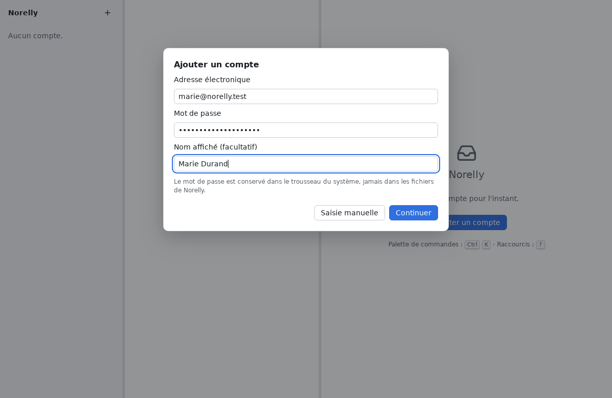
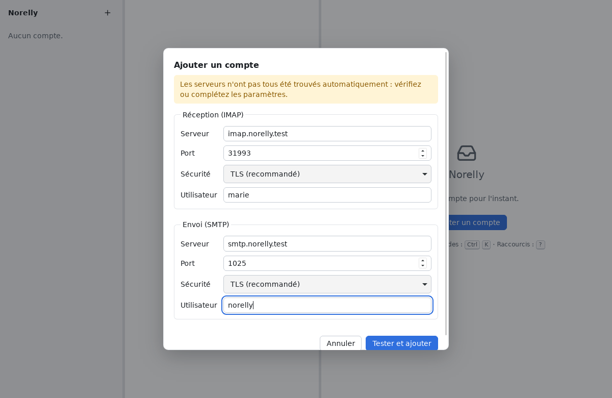
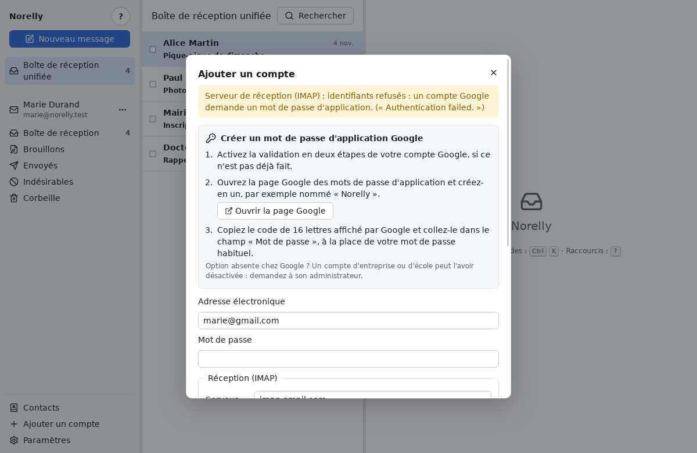

# Ajouter votre adresse électronique

[← Retour au sommaire](README.md)

Dans Norelly, chaque adresse électronique s'appelle un **compte**. Vous
pouvez en ajouter plusieurs (par exemple une adresse personnelle et une
adresse pour une association).

## Ce qu'il vous faut

- votre **adresse électronique**, par exemple `marie.durand@exemple.fr` ;
- son **mot de passe**. Pour Gmail et Outlook.com, ce n'est pas votre mot
  de passe habituel mais un **mot de passe d'application** : lisez d'abord
  [la partie qui les concerne](#gmail-et-outlookcom--le-mot-de-passe-dapplication).

## Étape par étape

1. Cliquez sur **Ajouter un compte** : sur l'accueil si c'est votre
   premier compte, sinon sur le bouton **+** en haut du panneau de gauche.
2. Tapez votre **adresse électronique** et votre **mot de passe**. Le
   **nom affiché** est facultatif : c'est le nom que vos correspondants
   verront à côté de votre adresse (par exemple « Marie Durand »).

   

3. Cliquez sur **Continuer**. Norelly cherche tout seul les réglages de
   votre fournisseur : patientez quelques secondes.
4. Le plus souvent, c'est tout : Norelly teste la connexion, puis votre
   adresse apparaît dans le panneau de gauche et vos messages arrivent.
   La première fois, le téléchargement de vos messages peut prendre
   quelques minutes si vous en avez beaucoup. Vous pouvez déjà lire les
   premiers arrivés.

Votre mot de passe est rangé dans le **trousseau** de votre système (le
coffre-fort à mots de passe de Windows ou de Linux). Seule exception : sous
Linux, si aucun trousseau ne répond, Norelly peut vous proposer de
l'enregistrer dans un fichier **non chiffré** ; il ne le fait que si vous
l'acceptez (voir [les messages d'erreur](errors.md#autres-messages)).

### Si Norelly vous montre les réglages des serveurs

Quand Norelly ne trouve pas tout seul les réglages, il vous affiche deux
cadres : **Réception (IMAP)** et **Envoi (SMTP)**. Votre fournisseur
donne ces informations sur sa page d'aide (cherchez « IMAP » et « SMTP »
avec le nom de votre fournisseur).

- **Serveur** : un nom comme `imap.exemple.fr` (réception) ou
  `smtp.exemple.fr` (envoi) ;
- **Port** : un nombre, le plus souvent `993` pour la réception et `465`
  ou `587` pour l'envoi ;
- **Sécurité** : gardez **TLS (recommandé)**, ou **STARTTLS** si votre
  fournisseur l'indique (souvent avec le port `587` ou `143`). Ne
  choisissez **Aucune (non chiffré)** que si vous savez exactement
  pourquoi ;
- **Utilisateur** : le plus souvent votre adresse complète.

Cliquez ensuite sur **Tester et ajouter**.

### Si Norelly vous parle de certificat

Un **certificat** est la carte d'identité d'un serveur. Si Norelly ne
peut pas la vérifier, il s'arrête et vous montre cet écran.

Avec les grands fournisseurs (Gmail, Outlook.com, Orange, Free…), cet
écran **ne doit jamais apparaître** : s'il apparaît, cliquez sur
**Annuler** et réessayez plus tard, depuis un autre réseau (votre box
plutôt qu'un Wi-Fi public). Voir aussi
[les messages d'erreur](errors.md#certificat-non-reconnu).

Ne cliquez sur **Faire confiance à ce serveur** que pour un serveur que
vous connaissez (un serveur personnel, celui de votre entreprise), et si
son administrateur vous a confirmé l'**empreinte** affichée.

## Gmail et Outlook.com : le mot de passe d'application

Gmail et Outlook.com refusent votre mot de passe habituel dans un
programme comme Norelly. Ils vous demandent de créer un **mot de passe
d'application** : un mot de passe spécial, fait de 16 lettres, réservé à
Norelly. Vous le créez une seule fois, sur le site de votre fournisseur,
puis vous le collez dans Norelly à la place de votre mot de passe.

Avantage : si vous changez un jour votre mot de passe habituel, ou si
vous voulez couper l'accès de Norelly, il suffit de supprimer ce mot de
passe d'application.

### Gmail

Si vous avez tapé votre mot de passe habituel, Norelly le remarque :
Google le refuse, et Norelly affiche à la place les étapes ci-dessous,
avec un bouton **Ouvrir la page Google** qui ouvre directement la bonne
page dans votre navigateur. Le champ **Mot de passe** est vidé : collez-y
le mot de passe d'application, puis cliquez à nouveau sur **Continuer**
(ou **Tester et ajouter**).

1. Activez d'abord la **validation en deux étapes** de votre compte
   Google, si ce n'est pas déjà fait : dans votre navigateur, ouvrez
   <https://myaccount.google.com/security>, puis **Validation en deux
   étapes**, et suivez les instructions (Google vous enverra un code par
   SMS, par exemple).
2. Ouvrez ensuite <https://myaccount.google.com/apppasswords>.
   Connectez-vous si Google le demande.
3. Dans **Nom de l'application**, tapez `Norelly`, puis cliquez sur
   **Créer**.
4. Google affiche un mot de passe de 16 lettres dans un cadre jaune.
   Sélectionnez-le, copiez-le (**Ctrl** + **C**), puis collez-le
   (**Ctrl** + **V**) dans le champ **Mot de passe** de Norelly. Les
   espaces n'ont pas d'importance.
5. Cliquez sur **OK** chez Google : ce mot de passe ne sera plus jamais
   affiché. Ce n'est pas grave : si vous le perdez, créez-en un autre.

Vous ne trouvez pas l'option chez Google ? Elle n'existe pas pour un
compte protégé uniquement par une clé de sécurité, ni pour un compte en
« Protection avancée ». Pour une adresse d'entreprise ou d'école gérée par
Google, son administrateur a pu la désactiver : demandez-lui.

### Outlook.com (et Hotmail, Live)

1. Activez la **vérification en deux étapes** : dans votre navigateur,
   ouvrez <https://account.microsoft.com/security>, puis **Options de
   sécurité avancées**, et activez **Vérification en deux étapes**.
2. Sur la même page, sous **Mots de passe d'application**, cliquez sur
   **Créer un nouveau mot de passe d'application**.
3. Copiez le mot de passe affiché et collez-le dans le champ **Mot de
   passe** de Norelly.

> **À savoir** : Microsoft limite de plus en plus l'accès des programmes
> de messagerie par mot de passe, au profit d'une connexion par sa propre
> page (que Norelly ne sait pas encore faire). Si Norelly affiche
> « identifiants refusés » malgré un mot de passe d'application correct,
> Microsoft refuse cette méthode pour votre compte : voir
> [les questions fréquentes](faq.md#outlookcom-refuse-mon-mot-de-passe-dapplication).

## Retirer un compte

Dans le panneau de gauche, cliquez sur le bouton **⋯** à côté de
l'adresse du compte, puis sur **Supprimer ce compte…**. Norelly vous
demande de confirmer.

Retirer un compte efface de votre ordinateur sa copie des messages et son
mot de passe. **Vos messages restent chez votre fournisseur** : vous les
retrouverez sur son site, ou en ajoutant de nouveau le compte.

Suite : [utiliser Norelly au quotidien](everyday.md).
