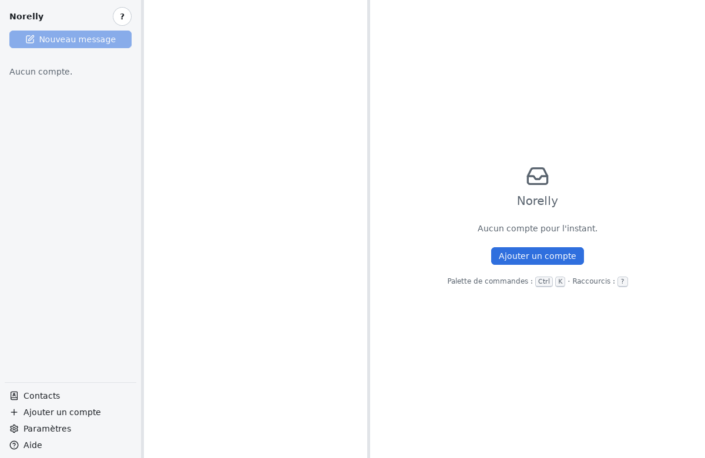

# Installer Norelly

[← Retour au sommaire](README.md)

Norelly fonctionne sous **Windows 10 et 11** et sous **Linux**. Choisissez
la partie qui correspond à votre ordinateur.

> **Où trouver Norelly ?** Uniquement aux adresses données ci-dessous. Ne
> téléchargez jamais Norelly depuis un autre site : un programme modifié
> pourrait voler vos mots de passe.

## Sous Windows

### Méthode simple : l'installateur

1. Ouvrez votre navigateur (Edge, Firefox, Chrome…) et allez à l'adresse
   <https://github.com/gbourquet/norelly/releases>.
2. Sous le titre de la version la plus récente (tout en haut), cliquez sur
   **Assets** si la liste est repliée, puis sur le fichier dont le nom finit
   par **`_x64-setup.exe`** (par exemple `Norelly_1.0.0_x64-setup.exe`).
3. Attendez la fin du téléchargement, puis ouvrez le fichier : cliquez
   dessus dans la liste des téléchargements du navigateur, ou retrouvez-le
   dans le dossier **Téléchargements**.
4. Windows peut afficher une fenêtre bleue **« Windows a protégé votre
   ordinateur »**. C'est normal : Norelly n'a pas encore de signature
   numérique reconnue par Microsoft (elle est demandée) : l'éditeur
   apparaît comme **« Éditeur inconnu »**. Cette fenêtre ne peut donc pas
   vous dire si le fichier est authentique : la garantie est de l'avoir
   téléchargé vous-même depuis l'adresse ci-dessus (vérifiez qu'elle
   commence bien par `https://github.com/gbourquet/norelly` dans la barre
   d'adresse), ou de le vérifier
   ([voir plus bas](#vérifier-un-fichier-téléchargé-facultatif)). Si c'est
   le cas, cliquez sur **Informations
   complémentaires**, puis sur **Exécuter quand même**. Dans le doute,
   préférez la méthode winget ci-dessous, qui vérifie le fichier pour
   vous.
5. L'installateur s'ouvre. Cliquez sur **Suivant**, puis sur
   **Installer**. Aucun mot de passe administrateur n'est demandé : Norelly
   s'installe pour vous seul.
6. Cliquez sur **Terminer**. Norelly se trouve désormais dans le menu
   **Démarrer** : tapez « Norelly » pour le retrouver.

### Méthode pour les habitués : winget

Si vous utilisez le terminal de Windows, une seule commande suffit :

```
winget install GuillaumeBourquet.Norelly
```

### Mises à jour sous Windows

Au premier lancement, Norelly vous demande s'il peut rechercher lui-même
ses nouvelles versions ([voir plus bas](#premier-lancement)). Si vous répondez **Oui**, un
bandeau vous prévient quand une nouvelle version est prête : cliquez sur
**Installer et redémarrer**. Chaque mise à jour est vérifiée (signée)
avant d'être installée.

## Sous Linux

1. Allez à l'adresse <https://github.com/gbourquet/norelly/releases>.
2. Téléchargez :
   - le fichier qui finit par **`.deb`** pour Ubuntu, Debian, Linux Mint ;
   - le fichier qui finit par **`.rpm`** pour Fedora, openSUSE.
3. Double-cliquez sur le fichier téléchargé : la Logithèque s'ouvre et
   propose **Installer**. Votre mot de passe de session est demandé.

Avec un paquet .deb ou .rpm, Norelly ne se met pas à jour tout seul :
retournez sur la page des versions de temps en temps.

## Vérifier un fichier téléchargé (facultatif)

Cette partie s'adresse aux personnes à l'aise avec un terminal : elle
n'est pas nécessaire pour utiliser Norelly. Elle permet de s'assurer qu'un
fichier téléchargé est bien celui que le projet a construit, et qu'il n'a
pas été modifié depuis.

Sur la page des versions, chaque version contient, en plus des
installateurs :

- **`SHA256SUMS`** : l'empreinte de chaque fichier de la version ;
- **`Norelly_<version>_provenance.sigstore.json`** : une attestation de
  provenance signée. Elle prouve que chaque fichier de la version, et
  `SHA256SUMS` lui-même, a été construit par le programme de publication
  du dépôt `gbourquet/norelly`, à partir de cette version précise.

Dans les commandes ci-dessous, remplacez `1.0.0` par le numéro de la
version téléchargée (il apparaît plusieurs fois), lu sur la page des
versions de `https://github.com/gbourquet/norelly` et non sur le fichier :
vérifiez qu'il s'agit bien de la dernière version, car une ancienne
version authentique passerait aussi la vérification. Remplacez aussi
`Norelly_1.0.0_x64-setup.exe` par le nom de votre fichier (`.deb`, `.rpm`,
ou `SHA256SUMS`).

### Avec cosign, sans compte

Installez [cosign](https://docs.sigstore.dev/cosign/system_config/installation/)
(version 2.4 ou plus récente), placez le fichier et l'attestation dans le même dossier, puis lancez, dans
ce dossier :

```
cosign verify-blob-attestation --new-bundle-format --type slsaprovenance1 --bundle Norelly_1.0.0_provenance.sigstore.json --certificate-oidc-issuer https://token.actions.githubusercontent.com --certificate-identity https://github.com/gbourquet/norelly/.github/workflows/release.yml@refs/tags/v1.0.0 Norelly_1.0.0_x64-setup.exe
```

La réponse **`Verified OK`** confirme que le fichier est authentique.
Tout autre message (signature, empreinte ou identité refusée) : ne
l'installez pas.

### Avec GitHub CLI, avec un compte GitHub

Si vous utilisez [GitHub CLI](https://cli.github.com) (`gh`, version 2.102
ou plus récente), connecté à votre compte, l'attestation est retrouvée sur
GitHub, sans la télécharger :

```
gh attestation verify Norelly_1.0.0_x64-setup.exe --repo gbourquet/norelly --cert-identity https://github.com/gbourquet/norelly/.github/workflows/release.yml@refs/tags/v1.0.0 --source-ref refs/tags/v1.0.0 --deny-self-hosted-runners
```

La réponse doit indiquer **`Verification succeeded!`** ; en cas de refus,
`gh` affiche une erreur : n'installez pas le fichier.

### Par les empreintes

Une fois `SHA256SUMS` vérifié par l'une des commandes ci-dessus, il suffit
de comparer les empreintes des autres fichiers téléchargés :

- sous Linux, dans le dossier des fichiers :
  `sha256sum --check --ignore-missing SHA256SUMS` (chaque fichier doit
  afficher **OK**) ;
- sous Windows, dans PowerShell : `Get-FileHash Norelly_1.0.0_x64-setup.exe`,
  puis comparez l'empreinte affichée à la ligne du fichier dans
  `SHA256SUMS` (majuscules et minuscules sans importance).

Comparer les empreintes **sans** avoir vérifié `SHA256SUMS` détecte
seulement un téléchargement abîmé, pas un faux fichier : un site qui
propose un faux fichier peut aussi proposer de fausses empreintes.

## Premier lancement

Ouvrez Norelly depuis le menu **Démarrer** (Windows) ou la liste de vos
applications (Linux).

Sous Windows, au tout premier lancement, Norelly vous pose une seule
question : **« Norelly peut rechercher automatiquement ses mises à jour.
Le souhaitez-vous ? »**. Le bouton **Oui** est proposé d'avance : appuyez
sur **Entrée** ou cliquez dessus. Aucune information personnelle n'est
envoyée pour cela, et vous pourrez changer d'avis dans les **Paramètres**.
Sous Linux, cette question n'est pas posée : les mises à jour passent par
la Logithèque.

Ensuite, Norelly est vide : il attend votre première adresse
électronique. Cliquez sur **Ajouter un compte** et suivez la page
suivante.



Suite : [ajouter votre adresse](first-account.md).
