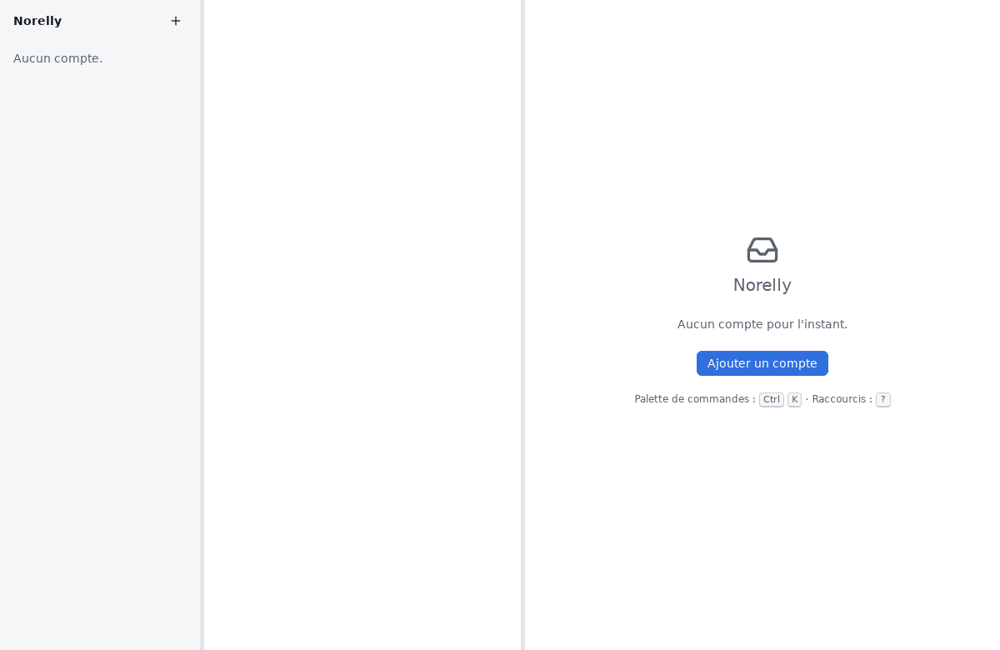

# Installer Norelly

[← Retour au sommaire](README.md)

Norelly fonctionne sous **Windows 10 et 11** et sous **Linux**. Choisissez
la partie qui correspond à votre ordinateur.

> **Où trouver Norelly ?** Uniquement aux adresses données ci-dessous. Ne
> téléchargez jamais Norelly depuis un autre site : un programme modifié
> pourrait voler vos mots de passe.

## Sous Windows

### Méthode simple : l'installateur

1. Ouvrez votre navigateur (Edge, Firefox, Chrome…) et allez à l'adresse
   <https://github.com/gbourquet/norelly/releases>.
2. Sous le titre de la version la plus récente (tout en haut), cliquez sur
   **Assets** si la liste est repliée, puis sur le fichier dont le nom finit
   par **`_x64-setup.exe`** (par exemple `Norelly_1.0.0_x64-setup.exe`).
3. Attendez la fin du téléchargement, puis ouvrez le fichier : cliquez
   dessus dans la liste des téléchargements du navigateur, ou retrouvez-le
   dans le dossier **Téléchargements**.
4. Windows peut afficher une fenêtre bleue **« Windows a protégé votre
   ordinateur »**. C'est normal : Norelly n'a pas encore de signature
   numérique reconnue par Microsoft (elle est demandée). Cliquez sur
   **Informations complémentaires**, vérifiez que l'éditeur ou le nom du
   fichier est bien celui de Norelly, puis sur **Exécuter quand même**.
5. L'installateur s'ouvre. Cliquez sur **Suivant**, puis sur
   **Installer**. Aucun mot de passe administrateur n'est demandé : Norelly
   s'installe pour vous seul.
6. Cliquez sur **Terminer**. Norelly se trouve désormais dans le menu
   **Démarrer** : tapez « Norelly » pour le retrouver.

### Méthode pour les habitués : winget

Si vous utilisez le terminal de Windows, une seule commande suffit :

```
winget install GuillaumeBourquet.Norelly
```

### Mises à jour sous Windows

Au premier lancement, Norelly vous demande s'il peut rechercher lui-même
ses nouvelles versions ([voir plus bas](#premier-lancement)). Si vous répondez **Oui**, un
bandeau vous prévient quand une nouvelle version est prête : cliquez sur
**Installer et redémarrer**. Chaque mise à jour est vérifiée (signée)
avant d'être installée.

## Sous Linux

### Méthode conseillée : Flathub

Flathub est le magasin d'applications de la plupart des distributions
Linux (Ubuntu, Fedora, Linux Mint, Debian…).

1. Ouvrez la **Logithèque** de votre système (« Logiciels », « GNOME
   Logiciels », « Discover » ou « Gestionnaire de logiciels » selon la
   distribution).
2. Cherchez **Norelly**, puis cliquez sur **Installer**.
3. Une fois l'installation finie, Norelly apparaît parmi vos
   applications.

En ligne de commande, si Flathub est déjà configuré :

```
flatpak install flathub io.github.gbourquet.Norelly
```

Les mises à jour arrivent alors par la Logithèque, comme pour vos autres
applications.

### Autre méthode : paquet .deb ou .rpm

1. Allez à l'adresse <https://github.com/gbourquet/norelly/releases>.
2. Téléchargez :
   - le fichier qui finit par **`.deb`** pour Ubuntu, Debian, Linux Mint ;
   - le fichier qui finit par **`.rpm`** pour Fedora, openSUSE.
3. Double-cliquez sur le fichier téléchargé : la Logithèque s'ouvre et
   propose **Installer**. Votre mot de passe de session est demandé.

Avec un paquet .deb ou .rpm, Norelly ne se met pas à jour tout seul :
retournez sur la page des versions de temps en temps.

## Premier lancement

Ouvrez Norelly depuis le menu **Démarrer** (Windows) ou la liste de vos
applications (Linux).

Sous Windows, au tout premier lancement, Norelly vous pose une seule
question : **« Norelly peut rechercher automatiquement ses mises à jour.
Le souhaitez-vous ? »**. Le bouton **Oui** est proposé d'avance : appuyez
sur **Entrée** ou cliquez dessus. Aucune information personnelle n'est
envoyée pour cela, et vous pourrez changer d'avis dans les **Paramètres**.
Sous Linux, cette question n'est pas posée : les mises à jour passent par
la Logithèque.

Ensuite, Norelly est vide : il attend votre première adresse
électronique. Cliquez sur **Ajouter un compte** et suivez la page
suivante.



Suite : [ajouter votre adresse](first-account.md).
