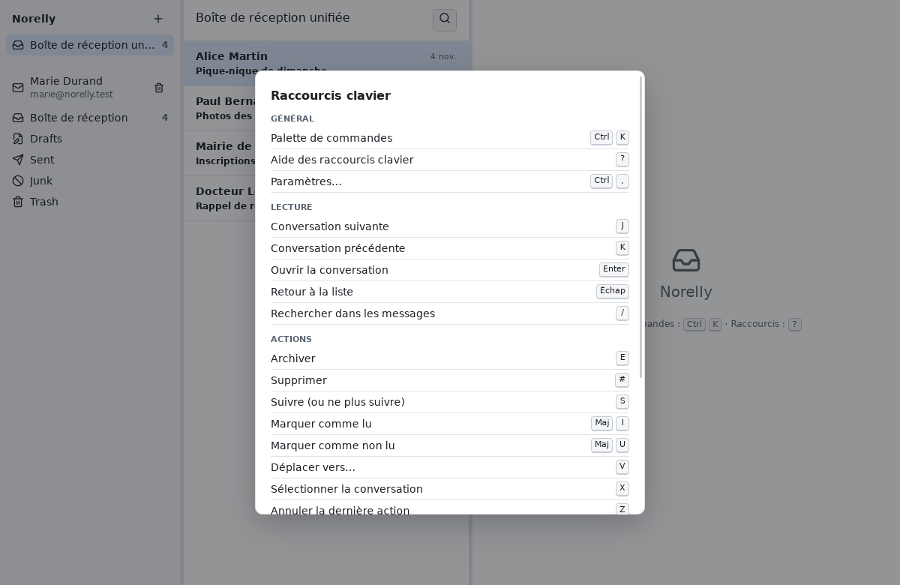

# Aide-mémoire des raccourcis clavier

[← Retour au sommaire](README.md)

Un **raccourci** est une touche (ou une combinaison de touches) qui fait une
action sans passer par la souris. Ils sont facultatifs : tout se fait aussi
à la souris ou par la **palette de commandes**.

**Comment lire ce tableau** : `Ctrl+K` veut dire « appuyez sur **Ctrl**,
gardez-la enfoncée, puis appuyez sur **K** ». **Maj** est la touche des
majuscules (flèche vers le haut, ⇧). Les lettres seules (`J`, `R`…) se tapent
en minuscule, sans **Maj**.

Les raccourcis à une seule touche ne fonctionnent pas pendant que vous
écrivez dans un champ (sinon taper un « r » dans un message lancerait une
réponse). Appuyez d'abord sur **Échap** pour sortir du champ.

Dans Norelly, la touche `?` ou le bouton **?** en haut à gauche affiche ce
tableau à tout moment. Chaque bouton montre aussi sa touche quand vous
laissez la souris dessus un instant.

## Général

| Action | Raccourci |
|---|---|
| Palette de commandes | `Ctrl+K` |
| Aide des raccourcis clavier | `?` |
| Paramètres… | `Ctrl+,` |

## Lecture

| Action | Raccourci |
|---|---|
| Conversation suivante | `J` |
| Conversation précédente | `K` |
| Ouvrir la conversation | `Entrée` |
| Retour à la liste | `Échap` |
| Rechercher dans les messages | `/` |
| Boîte de réception unifiée | palette |
| Préférer le texte brut (ou le HTML) | palette |

`Enter` est la touche **Entrée** (↵). Dans la recherche, `J` et `K`
passent d'un résultat à l'autre et `Échap` ferme la recherche.

## Actions

| Action | Raccourci |
|---|---|
| Archiver | `E` |
| Supprimer | `#` |
| Suivre (ou ne plus suivre) | `S` |
| Marquer comme lu | `Maj+I` |
| Marquer comme non lu | `Maj+U` |
| Déplacer vers… | `V` |
| Sélectionner la conversation | `X` |
| Tout désélectionner | palette |
| Annuler la dernière action | `Z` |

Les actions visent la conversation ouverte, celle choisie dans la liste, ou
toutes les conversations cochées avec `X`.

## Rédaction

| Action | Raccourci |
|---|---|
| Nouveau message | `C` |
| Répondre | `R` |
| Répondre à tous | `A` |
| Transférer | `F` |
| Brouillons… | palette |
| Boîte d'envoi | palette |

Dans la fenêtre de rédaction : `Ctrl+Entrée` envoie le message, `Échap`
ferme la fenêtre en gardant le brouillon. Dans le champ **À** : les flèches
choisissent une adresse proposée, `Entrée` ou `,` la valide.

## Contacts

| Action | Raccourci |
|---|---|
| Ouvrir les contacts | `Ctrl+Maj+B` |
| Nouveau contact | `N` |
| Modifier le contact | `Maj+E` |
| Écrire au contact | `W` |
| Favori (ajouter ou retirer) | `Maj+S` |
| Supprimer le contact | `Suppr` |
| Désélectionner les contacts | palette |
| Ajouter au carnet d'adresses | palette |
| Voir le contact | palette |

Dans la vue **Contacts**, ces actions visent le contact ouvert à droite, ou
tous les contacts cochés. `N` fonctionne partout : il ouvre les contacts et
la fiche d'un nouveau contact. **Ajouter au carnet d'adresses** et **Voir le
contact** visent la personne dont le menu est ouvert (clic sur un nom dans
un message, clic droit sur une conversation), sinon l'expéditeur du dernier
message de la conversation ouverte.

## Comptes

| Action | Raccourci |
|---|---|
| Ajouter un compte… | palette |
| Nouveau dossier… | palette |
| Renommer le dossier… | palette |
| Déplacer le dossier… | palette |
| Supprimer le dossier… | palette |
| Choisir le dossier d'archives… | palette |
| Synchroniser le compte sélectionné | palette |
| Supprimer le compte sélectionné… | palette |

« palette » : pas de raccourci, ouvrez la palette (`Ctrl+K`) et tapez
quelques lettres du nom de l'action.

## Panneaux

Les séparateurs entre les trois panneaux se déplacent aussi au clavier :
placez-vous dessus avec **Tab**, puis utilisez les flèches **←** et **→**
(**Début** et **Fin** pour les extrêmes).
